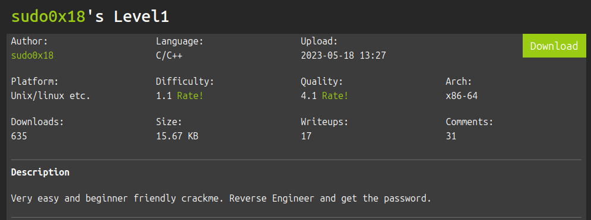
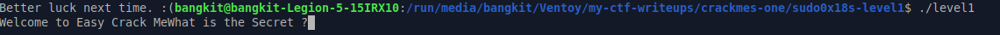

# Level1

## Overview



**Challenge link**: [touch me](https://crackmes.one/crackme/646627a933c5d439389131d9)

## Analysis

### Files

Pertama, saya cek terlebih dahulu filenya:
```bash
$ file level1
level1: ELF 64-bit LSB pie executable, x86-64, version 1 (SYSV), dynamically linked, interpreter /lib64/ld-linux-x86-64.so.2, BuildID[sha1]=89f40555f67806b4082e5785d91836bb6baaaa9d, for GNU/Linux 3.2.0, not stripped
```

Kedua, saya cek securitynya
```bash
$ checksec --file=./level1
RELRO           STACK CANARY      NX            PIE             RPATH      RUNPATH	Symbols		FORTIFY	Fortified	Fortifiable	FILE
Partial RELRO   No canary found   NX enabled    PIE enabled     No RPATH   No RUNPATH   38 Symbols	  No	0		1		./level1
```

setelah ini saya tes dahulu menjalankan programnya



Dari foto diatas program meminta `secret` yang kemungkinan maksudnya adalah password

Ketiga, saya coba analisis ELF header nya dengan cara

```bash
$ readelf -h ./level1
ELF Header:
  Magic:   7f 45 4c 46 02 01 01 00 00 00 00 00 00 00 00 00 
  Class:                             ELF64
  Data:                              2's complement, little endian
  Version:                           1 (current)
  OS/ABI:                            UNIX - System V
  ABI Version:                       0
  Type:                              DYN (Position-Independent Executable file)
  Machine:                           Advanced Micro Devices X86-64
  Version:                           0x1
  Entry point address:               0x1060
  Start of program headers:          64 (bytes into file)
  Start of section headers:          14064 (bytes into file)
  Flags:                             0x0
  Size of this header:               64 (bytes)
  Size of program headers:           56 (bytes)
  Number of program headers:         13
  Size of section headers:           64 (bytes)
  Number of section headers:         31
  Section header string table index: 30
```

Dari output diatas, program dieksekusi pada address `0x1060`

Keempat, saya gunakan perintah `objdump` untuk disassemble

```bash
$ objdump -d -M intel -C ./level1
./level1:     file format elf64-x86-64

Disassembly of section .init:

0000000000001000 <_init>:
    1000:	48 83 ec 08          	sub    rsp,0x8
    1004:	48 8b 05 c5 2f 00 00 	mov    rax,QWORD PTR [rip+0x2fc5]        # 3fd0 <__gmon_start__@Base>
    100b:	48 85 c0             	test   rax,rax
    100e:	74 02                	je     1012 <_init+0x12>
    1010:	ff d0                	call   rax
    1012:	48 83 c4 08          	add    rsp,0x8
    1016:	c3                   	ret

Disassembly of section .plt:

0000000000001020 <printf@plt-0x10>:
    1020:	ff 35 ca 2f 00 00    	push   QWORD PTR [rip+0x2fca]        # 3ff0 <_GLOBAL_OFFSET_TABLE_+0x8>
    1026:	ff 25 cc 2f 00 00    	jmp    QWORD PTR [rip+0x2fcc]        # 3ff8 <_GLOBAL_OFFSET_TABLE_+0x10>
    102c:	0f 1f 40 00          	nop    DWORD PTR [rax+0x0]

0000000000001030 <printf@plt>:
    1030:	ff 25 ca 2f 00 00    	jmp    QWORD PTR [rip+0x2fca]        # 4000 <printf@GLIBC_2.2.5>
    1036:	68 00 00 00 00       	push   0x0
    103b:	e9 e0 ff ff ff       	jmp    1020 <_init+0x20>

0000000000001040 <__isoc99_scanf@plt>:
    1040:	ff 25 c2 2f 00 00    	jmp    QWORD PTR [rip+0x2fc2]        # 4008 <__isoc99_scanf@GLIBC_2.7>
    1046:	68 01 00 00 00       	push   0x1
    104b:	e9 d0 ff ff ff       	jmp    1020 <_init+0x20>

Disassembly of section .plt.got:

0000000000001050 <__cxa_finalize@plt>:
    1050:	ff 25 8a 2f 00 00    	jmp    QWORD PTR [rip+0x2f8a]        # 3fe0 <__cxa_finalize@GLIBC_2.2.5>
    1056:	66 90                	xchg   ax,ax

Disassembly of section .text:

0000000000001060 <_start>:
    1060:	31 ed                	xor    ebp,ebp
    1062:	49 89 d1             	mov    r9,rdx
    1065:	5e                   	pop    rsi
    1066:	48 89 e2             	mov    rdx,rsp
    1069:	48 83 e4 f0          	and    rsp,0xfffffffffffffff0
    106d:	50                   	push   rax
    106e:	54                   	push   rsp
    106f:	45 31 c0             	xor    r8d,r8d
    1072:	31 c9                	xor    ecx,ecx
    1074:	48 8d 3d 5a 01 00 00 	lea    rdi,[rip+0x15a]        # 11d5 <main>
    107b:	ff 15 3f 2f 00 00    	call   QWORD PTR [rip+0x2f3f]        # 3fc0 <__libc_start_main@GLIBC_2.34>
    1081:	f4                   	hlt
    1082:	66 2e 0f 1f 84 00 00 	cs nop WORD PTR [rax+rax*1+0x0]
    1089:	00 00 00 
    108c:	0f 1f 40 00          	nop    DWORD PTR [rax+0x0]

0000000000001090 <deregister_tm_clones>:
    1090:	48 8d 3d 89 2f 00 00 	lea    rdi,[rip+0x2f89]        # 4020 <__TMC_END__>
    1097:	48 8d 05 82 2f 00 00 	lea    rax,[rip+0x2f82]        # 4020 <__TMC_END__>
    109e:	48 39 f8             	cmp    rax,rdi
    10a1:	74 15                	je     10b8 <deregister_tm_clones+0x28>
    10a3:	48 8b 05 1e 2f 00 00 	mov    rax,QWORD PTR [rip+0x2f1e]        # 3fc8 <_ITM_deregisterTMCloneTable@Base>
    10aa:	48 85 c0             	test   rax,rax
    10ad:	74 09                	je     10b8 <deregister_tm_clones+0x28>
    10af:	ff e0                	jmp    rax
    10b1:	0f 1f 80 00 00 00 00 	nop    DWORD PTR [rax+0x0]
    10b8:	c3                   	ret
    10b9:	0f 1f 80 00 00 00 00 	nop    DWORD PTR [rax+0x0]

00000000000010c0 <register_tm_clones>:
    10c0:	48 8d 3d 59 2f 00 00 	lea    rdi,[rip+0x2f59]        # 4020 <__TMC_END__>
    10c7:	48 8d 35 52 2f 00 00 	lea    rsi,[rip+0x2f52]        # 4020 <__TMC_END__>
    10ce:	48 29 fe             	sub    rsi,rdi
    10d1:	48 89 f0             	mov    rax,rsi
    10d4:	48 c1 ee 3f          	shr    rsi,0x3f
    10d8:	48 c1 f8 03          	sar    rax,0x3
    10dc:	48 01 c6             	add    rsi,rax
    10df:	48 d1 fe             	sar    rsi,1
    10e2:	74 14                	je     10f8 <register_tm_clones+0x38>
    10e4:	48 8b 05 ed 2e 00 00 	mov    rax,QWORD PTR [rip+0x2eed]        # 3fd8 <_ITM_registerTMCloneTable@Base>
    10eb:	48 85 c0             	test   rax,rax
    10ee:	74 08                	je     10f8 <register_tm_clones+0x38>
    10f0:	ff e0                	jmp    rax
    10f2:	66 0f 1f 44 00 00    	nop    WORD PTR [rax+rax*1+0x0]
    10f8:	c3                   	ret
    10f9:	0f 1f 80 00 00 00 00 	nop    DWORD PTR [rax+0x0]

0000000000001100 <__do_global_dtors_aux>:
    1100:	f3 0f 1e fa          	endbr64
    1104:	80 3d 15 2f 00 00 00 	cmp    BYTE PTR [rip+0x2f15],0x0        # 4020 <__TMC_END__>
    110b:	75 2b                	jne    1138 <__do_global_dtors_aux+0x38>
    110d:	55                   	push   rbp
    110e:	48 83 3d ca 2e 00 00 	cmp    QWORD PTR [rip+0x2eca],0x0        # 3fe0 <__cxa_finalize@GLIBC_2.2.5>
    1115:	00 
    1116:	48 89 e5             	mov    rbp,rsp
    1119:	74 0c                	je     1127 <__do_global_dtors_aux+0x27>
    111b:	48 8b 3d f6 2e 00 00 	mov    rdi,QWORD PTR [rip+0x2ef6]        # 4018 <__dso_handle>
    1122:	e8 29 ff ff ff       	call   1050 <__cxa_finalize@plt>
    1127:	e8 64 ff ff ff       	call   1090 <deregister_tm_clones>
    112c:	c6 05 ed 2e 00 00 01 	mov    BYTE PTR [rip+0x2eed],0x1        # 4020 <__TMC_END__>
    1133:	5d                   	pop    rbp
    1134:	c3                   	ret
    1135:	0f 1f 00             	nop    DWORD PTR [rax]
    1138:	c3                   	ret
    1139:	0f 1f 80 00 00 00 00 	nop    DWORD PTR [rax+0x0]

0000000000001140 <frame_dummy>:
    1140:	f3 0f 1e fa          	endbr64
    1144:	e9 77 ff ff ff       	jmp    10c0 <register_tm_clones>

0000000000001149 <checkPass>:
    1149:	55                   	push   rbp
    114a:	48 89 e5             	mov    rbp,rsp
    114d:	48 89 7d f8          	mov    QWORD PTR [rbp-0x8],rdi
    1151:	48 8b 45 f8          	mov    rax,QWORD PTR [rbp-0x8]
    1155:	0f b6 00             	movzx  eax,BYTE PTR [rax]
    1158:	3c 73                	cmp    al,0x73
    115a:	75 70                	jne    11cc <checkPass+0x83>
    115c:	48 8b 45 f8          	mov    rax,QWORD PTR [rbp-0x8]
    1160:	48 83 c0 01          	add    rax,0x1
    1164:	0f b6 00             	movzx  eax,BYTE PTR [rax]
    1167:	3c 75                	cmp    al,0x75
    1169:	75 68                	jne    11d3 <checkPass+0x8a>
    116b:	48 8b 45 f8          	mov    rax,QWORD PTR [rbp-0x8]
    116f:	48 83 c0 02          	add    rax,0x2
    1173:	0f b6 00             	movzx  eax,BYTE PTR [rax]
    1176:	3c 64                	cmp    al,0x64
    1178:	75 59                	jne    11d3 <checkPass+0x8a>
    117a:	48 8b 45 f8          	mov    rax,QWORD PTR [rbp-0x8]
    117e:	48 83 c0 03          	add    rax,0x3
    1182:	0f b6 00             	movzx  eax,BYTE PTR [rax]
    1185:	3c 6f                	cmp    al,0x6f
    1187:	75 4a                	jne    11d3 <checkPass+0x8a>
    1189:	48 8b 45 f8          	mov    rax,QWORD PTR [rbp-0x8]
    118d:	48 83 c0 04          	add    rax,0x4
    1191:	0f b6 00             	movzx  eax,BYTE PTR [rax]
    1194:	3c 30                	cmp    al,0x30
    1196:	75 3b                	jne    11d3 <checkPass+0x8a>
    1198:	48 8b 45 f8          	mov    rax,QWORD PTR [rbp-0x8]
    119c:	48 83 c0 05          	add    rax,0x5
    11a0:	0f b6 00             	movzx  eax,BYTE PTR [rax]
    11a3:	3c 78                	cmp    al,0x78
    11a5:	75 2c                	jne    11d3 <checkPass+0x8a>
    11a7:	48 8b 45 f8          	mov    rax,QWORD PTR [rbp-0x8]
    11ab:	48 83 c0 06          	add    rax,0x6
    11af:	0f b6 00             	movzx  eax,BYTE PTR [rax]
    11b2:	3c 31                	cmp    al,0x31
    11b4:	75 1d                	jne    11d3 <checkPass+0x8a>
    11b6:	48 8b 45 f8          	mov    rax,QWORD PTR [rbp-0x8]
    11ba:	48 83 c0 07          	add    rax,0x7
    11be:	0f b6 00             	movzx  eax,BYTE PTR [rax]
    11c1:	3c 38                	cmp    al,0x38
    11c3:	75 0e                	jne    11d3 <checkPass+0x8a>
    11c5:	b8 01 00 00 00       	mov    eax,0x1
    11ca:	eb 07                	jmp    11d3 <checkPass+0x8a>
    11cc:	b8 00 00 00 00       	mov    eax,0x0
    11d1:	eb 00                	jmp    11d3 <checkPass+0x8a>
    11d3:	5d                   	pop    rbp
    11d4:	c3                   	ret

00000000000011d5 <main>:
    11d5:	55                   	push   rbp
    11d6:	48 89 e5             	mov    rbp,rsp
    11d9:	48 83 ec 50          	sub    rsp,0x50
    11dd:	89 7d bc             	mov    DWORD PTR [rbp-0x44],edi
    11e0:	48 89 75 b0          	mov    QWORD PTR [rbp-0x50],rsi
    11e4:	48 8d 05 19 0e 00 00 	lea    rax,[rip+0xe19]        # 2004 <_IO_stdin_used+0x4>
    11eb:	48 89 c7             	mov    rdi,rax
    11ee:	b8 00 00 00 00       	mov    eax,0x0
    11f3:	e8 38 fe ff ff       	call   1030 <printf@plt>
    11f8:	48 8d 05 1e 0e 00 00 	lea    rax,[rip+0xe1e]        # 201d <_IO_stdin_used+0x1d>
    11ff:	48 89 c7             	mov    rdi,rax
    1202:	b8 00 00 00 00       	mov    eax,0x0
    1207:	e8 24 fe ff ff       	call   1030 <printf@plt>
    120c:	48 8d 45 c0          	lea    rax,[rbp-0x40]$ objdump -d -M intel -C ./level1

./level1:     file format elf64-x86-64


Disassembly of section .init:

0000000000001000 <_init>:
    1000:	48 83 ec 08          	sub    rsp,0x8
    1004:	48 8b 05 c5 2f 00 00 	mov    rax,QWORD PTR [rip+0x2fc5]        # 3fd0 <__gmon_start__@Base>
    100b:	48 85 c0             	test   rax,rax
    100e:	74 02                	je     1012 <_init+0x12>
    1010:	ff d0                	call   rax
    1012:	48 83 c4 08          	add    rsp,0x8
    1016:	c3                   	ret

Disassembly of section .plt:

0000000000001020 <printf@plt-0x10>:
    1020:	ff 35 ca 2f 00 00    	push   QWORD PTR [rip+0x2fca]        # 3ff0 <_GLOBAL_OFFSET_TABLE_+0x8>
    1026:	ff 25 cc 2f 00 00    	jmp    QWORD PTR [rip+0x2fcc]        # 3ff8 <_GLOBAL_OFFSET_TABLE_+0x10>
    102c:	0f 1f 40 00          	nop    DWORD PTR [rax+0x0]

0000000000001030 <printf@plt>:
    1030:	ff 25 ca 2f 00 00    	jmp    QWORD PTR [rip+0x2fca]        # 4000 <printf@GLIBC_2.2.5>
    1036:	68 00 00 00 00       	push   0x0
    103b:	e9 e0 ff ff ff       	jmp    1020 <_init+0x20>

0000000000001040 <__isoc99_scanf@plt>:
    1040:	ff 25 c2 2f 00 00    	jmp    QWORD PTR [rip+0x2fc2]        # 4008 <__isoc99_scanf@GLIBC_2.7>
    1046:	68 01 00 00 00       	push   0x1
    104b:	e9 d0 ff ff ff       	jmp    1020 <_init+0x20>

Disassembly of section .plt.got:

0000000000001050 <__cxa_finalize@plt>:
    1050:	ff 25 8a 2f 00 00    	jmp    QWORD PTR [rip+0x2f8a]        # 3fe0 <__cxa_finalize@GLIBC_2.2.5>
    1056:	66 90                	xchg   ax,ax

Disassembly of section .text:

0000000000001060 <_start>:
    1060:	31 ed                	xor    ebp,ebp
    1062:	49 89 d1             	mov    r9,rdx
    1065:	5e                   	pop    rsi
    1066:	48 89 e2             	mov    rdx,rsp
    1069:	48 83 e4 f0          	and    rsp,0xfffffffffffffff0
    106d:	50                   	push   rax
    106e:	54                   	push   rsp
    106f:	45 31 c0             	xor    r8d,r8d
    1072:	31 c9                	xor    ecx,ecx
    1074:	48 8d 3d 5a 01 00 00 	lea    rdi,[rip+0x15a]        # 11d5 <main>
    107b:	ff 15 3f 2f 00 00    	call   QWORD PTR [rip+0x2f3f]        # 3fc0 <__libc_start_main@GLIBC_2.34>
    1081:	f4                   	hlt
    1082:	66 2e 0f 1f 84 00 00 	cs nop WORD PTR [rax+rax*1+0x0]
    1089:	00 00 00 
    108c:	0f 1f 40 00          	nop    DWORD PTR [rax+0x0]

0000000000001090 <deregister_tm_clones>:
    1090:	48 8d 3d 89 2f 00 00 	lea    rdi,[rip+0x2f89]        # 4020 <__TMC_END__>
    1097:	48 8d 05 82 2f 00 00 	lea    rax,[rip+0x2f82]        # 4020 <__TMC_END__>
    109e:	48 39 f8             	cmp    rax,rdi
    10a1:	74 15                	je     10b8 <deregister_tm_clones+0x28>
    10a3:	48 8b 05 1e 2f 00 00 	mov    rax,QWORD PTR [rip+0x2f1e]        # 3fc8 <_ITM_deregisterTMCloneTable@Base>
    10aa:	48 85 c0             	test   rax,rax
    10ad:	74 09                	je     10b8 <deregister_tm_clones+0x28>
    10af:	ff e0                	jmp    rax
    10b1:	0f 1f 80 00 00 00 00 	nop    DWORD PTR [rax+0x0]
    10b8:	c3                   	ret
    10b9:	0f 1f 80 00 00 00 00 	nop    DWORD PTR [rax+0x0]

00000000000010c0 <register_tm_clones>:
    10c0:	48 8d 3d 59 2f 00 00 	lea    rdi,[rip+0x2f59]        # 4020 <__TMC_END__>
    10c7:	48 8d 35 52 2f 00 00 	lea    rsi,[rip+0x2f52]        # 4020 <__TMC_END__>
    10ce:	48 29 fe             	sub    rsi,rdi
    10d1:	48 89 f0             	mov    rax,rsi
    10d4:	48 c1 ee 3f          	shr    rsi,0x3f
    10d8:	48 c1 f8 03          	sar    rax,0x3
    10dc:	48 01 c6             	add    rsi,rax
    10df:	48 d1 fe             	sar    rsi,1
    10e2:	74 14                	je     10f8 <register_tm_clones+0x38>
    10e4:	48 8b 05 ed 2e 00 00 	mov    rax,QWORD PTR [rip+0x2eed]        # 3fd8 <_ITM_registerTMCloneTable@Base>
    10eb:	48 85 c0             	test   rax,rax
    10ee:	74 08                	je     10f8 <register_tm_clones+0x38>
    10f0:	ff e0                	jmp    rax
    10f2:	66 0f 1f 44 00 00    	nop    WORD PTR [rax+rax*1+0x0]
    10f8:	c3                   	ret
    10f9:	0f 1f 80 00 00 00 00 	nop    DWORD PTR [rax+0x0]

0000000000001100 <__do_global_dtors_aux>:
    1100:	f3 0f 1e fa          	endbr64
    1104:	80 3d 15 2f 00 00 00 	cmp    BYTE PTR [rip+0x2f15],0x0        # 4020 <__TMC_END__>
    110b:	75 2b                	jne    1138 <__do_global_dtors_aux+0x38>
    110d:	55                   	push   rbp
    110e:	48 83 3d ca 2e 00 00 	cmp    QWORD PTR [rip+0x2eca],0x0        # 3fe0 <__cxa_finalize@GLIBC_2.2.5>
    1115:	00 
    1116:	48 89 e5             	mov    rbp,rsp
    1119:	74 0c                	je     1127 <__do_global_dtors_aux+0x27>
    111b:	48 8b 3d f6 2e 00 00 	mov    rdi,QWORD PTR [rip+0x2ef6]        # 4018 <__dso_handle>
    1122:	e8 29 ff ff ff       	call   1050 <__cxa_finalize@plt>
    1127:	e8 64 ff ff ff       	call   1090 <deregister_tm_clones>
    112c:	c6 05 ed 2e 00 00 01 	mov    BYTE PTR [rip+0x2eed],0x1        # 4020 <__TMC_END__>
    1133:	5d                   	pop    rbp
    1134:	c3                   	ret
    1135:	0f 1f 00             	nop    DWORD PTR [rax]
    1138:	c3                   	ret
    1139:	0f 1f 80 00 00 00 00 	nop    DWORD PTR [rax+0x0]

0000000000001140 <frame_dummy>:
    1140:	f3 0f 1e fa          	endbr64
    1144:	e9 77 ff ff ff       	jmp    10c0 <register_tm_clones>

0000000000001149 <checkPass>:
    1149:	55                   	push   rbp
    114a:	48 89 e5             	mov    rbp,rsp
    114d:	48 89 7d f8          	mov    QWORD PTR [rbp-0x8],rdi
    1151:	48 8b 45 f8          	mov    rax,QWORD PTR [rbp-0x8]
    1155:	0f b6 00             	movzx  eax,BYTE PTR [rax]
    1158:	3c 73                	cmp    al,0x73
    115a:	75 70                	jne    11cc <checkPass+0x83>
    115c:	48 8b 45 f8          	mov    rax,QWORD PTR [rbp-0x8]
    1160:	48 83 c0 01          	add    rax,0x1
    1164:	0f b6 00             	movzx  eax,BYTE PTR [rax]
    1167:	3c 75                	cmp    al,0x75
    1169:	75 68                	jne    11d3 <checkPass+0x8a>
    116b:	48 8b 45 f8          	mov    rax,QWORD PTR [rbp-0x8]
    116f:	48 83 c0 02          	add    rax,0x2
    1173:	0f b6 00             	movzx  eax,BYTE PTR [rax]
    1176:	3c 64                	cmp    al,0x64
    1178:	75 59                	jne    11d3 <checkPass+0x8a>
    117a:	48 8b 45 f8          	mov    rax,QWORD PTR [rbp-0x8]
    117e:	48 83 c0 03          	add    rax,0x3
    1182:	0f b6 00             	movzx  eax,BYTE PTR [rax]
    1185:	3c 6f                	cmp    al,0x6f
    1187:	75 4a                	jne    11d3 <checkPass+0x8a>
    1189:	48 8b 45 f8          	mov    rax,QWORD PTR [rbp-0x8]
    118d:	48 83 c0 04          	add    rax,0x4
    1191:	0f b6 00             	movzx  eax,BYTE PTR [rax]
    1194:	3c 30                	cmp    al,0x30
    1196:	75 3b                	jne    11d3 <checkPass+0x8a>
    1198:	48 8b 45 f8          	mov    rax,QWORD PTR [rbp-0x8]
    119c:	48 83 c0 05          	add    rax,0x5
    11a0:	0f b6 00             	movzx  eax,BYTE PTR [rax]
    11a3:	3c 78                	cmp    al,0x78
    11a5:	75 2c                	jne    11d3 <checkPass+0x8a>
    11a7:	48 8b 45 f8          	mov    rax,QWORD PTR [rbp-0x8]
    11ab:	48 83 c0 06          	add    rax,0x6
    11af:	0f b6 00             	movzx  eax,BYTE PTR [rax]
    11b2:	3c 31                	cmp    al,0x31
    11b4:	75 1d                	jne    11d3 <checkPass+0x8a>
    11b6:	48 8b 45 f8          	mov    rax,QWORD PTR [rbp-0x8]
    11ba:	48 83 c0 07          	add    rax,0x7
    11be:	0f b6 00             	movzx  eax,BYTE PTR [rax]
    11c1:	3c 38                	cmp    al,0x38
    11c3:	75 0e                	jne    11d3 <checkPass+0x8a>
    11c5:	b8 01 00 00 00       	mov    eax,0x1
    11ca:	eb 07                	jmp    11d3 <checkPass+0x8a>
    11cc:	b8 00 00 00 00       	mov    eax,0x0
    11d1:	eb 00                	jmp    11d3 <checkPass+0x8a>
    11d3:	5d                   	pop    rbp
    11d4:	c3                   	ret

00000000000011d5 <main>:
    11d5:	55                   	push   rbp
    11d6:	48 89 e5             	mov    rbp,rsp
    11d9:	48 83 ec 50          	sub    rsp,0x50
    11dd:	89 7d bc             	mov    DWORD PTR [rbp-0x44],edi
    11e0:	48 89 75 b0          	mov    QWORD PTR [rbp-0x50],rsi
    11e4:	48 8d 05 19 0e 00 00 	lea    rax,[rip+0xe19]        # 2004 <_IO_stdin_used+0x4>
    11eb:	48 89 c7             	mov    rdi,rax
    11ee:	b8 00 00 00 00       	mov    eax,0x0
    11f3:	e8 38 fe ff ff       	call   1030 <printf@plt>
    11f8:	48 8d 05 1e 0e 00 00 	lea    rax,[rip+0xe1e]        # 201d <_IO_stdin_used+0x1d>
    11ff:	48 89 c7             	mov    rdi,rax
    1202:	b8 00 00 00 00       	mov    eax,0x0
    1207:	e8 24 fe ff ff       	call   1030 <printf@plt>
    120c:	48 8d 45 c0          	lea    rax,[rbp-0x40]
    1210:	48 89 c6             	mov    rsi,rax
    1213:	48 8d 05 18 0e 00 00 	lea    rax,[rip+0xe18]        # 2032 <_IO_stdin_used+0x32>
    121a:	48 89 c7             	mov    rdi,rax
    121d:	b8 00 00 00 00       	mov    eax,0x0
    1222:	e8 19 fe ff ff       	call   1040 <__isoc99_scanf@plt>
    1227:	48 8d 45 c0          	lea    rax,[rbp-0x40]
    122b:	48 89 c7             	mov    rdi,rax
    122e:	e8 16 ff ff ff       	call   1149 <checkPass>
    1233:	85 c0                	test   eax,eax
    1235:	74 16                	je     124d <main+0x78>
    1237:	48 8d 05 f9 0d 00 00 	lea    rax,[rip+0xdf9]        # 2037 <_IO_stdin_used+0x37>
    123e:	48 89 c7             	mov    rdi,rax
    1241:	b8 00 00 00 00       	mov    eax,0x0
    1246:	e8 e5 fd ff ff       	call   1030 <printf@plt>
    124b:	eb 14                	jmp    1261 <main+0x8c>
    124d:	48 8d 05 f6 0d 00 00 	lea    rax,[rip+0xdf6]        # 204a <_IO_stdin_used+0x4a>
    1254:	48 89 c7             	mov    rdi,rax
    1257:	b8 00 00 00 00       	mov    eax,0x0
    125c:	e8 cf fd ff ff       	call   1030 <printf@plt>
    1261:	b8 00 00 00 00       	mov    eax,0x0
    1266:	c9                   	leave
    1267:	c3                   	ret

Disassembly of section .fini:

0000000000001268 <_fini>:
    1268:	48 83 ec 08          	sub    rsp,0x8
    126c:	48 83 c4 08          	add    rsp,0x8
    1270:	c3                   	ret

    1210:	48 89 c6             	mov    rsi,rax
    1213:	48 8d 05 18 0e 00 00 	lea    rax,[rip+0xe18]        # 2032 <_IO_stdin_used+0x32>
    121a:	48 89 c7             	mov    rdi,rax
    121d:	b8 00 00 00 00       	mov    eax,0x0
    1222:	e8 19 fe ff ff       	call   1040 <__isoc99_scanf@plt>
    1227:	48 8d 45 c0          	lea    rax,[rbp-0x40]
    122b:	48 89 c7             	mov    rdi,rax
    122e:	e8 16 ff ff ff       	call   1149 <checkPass>
    1233:	85 c0                	test   eax,eax
    1235:	74 16                	je     124d <main+0x78>
    1237:	48 8d 05 f9 0d 00 00 	lea    rax,[rip+0xdf9]        # 2037 <_IO_stdin_used+0x37>
    123e:	48 89 c7             	mov    rdi,rax
    1241:	b8 00 00 00 00       	mov    eax,0x0
    1246:	e8 e5 fd ff ff       	call   1030 <printf@plt>
    124b:	eb 14                	jmp    1261 <main+0x8c>
    124d:	48 8d 05 f6 0d 00 00 	lea    rax,[rip+0xdf6]        # 204a <_IO_stdin_used+0x4a>
    1254:	48 89 c7             	mov    rdi,rax
    1257:	b8 00 00 00 00       	mov    eax,0x0
    125c:	e8 cf fd ff ff       	call   1030 <printf@plt>
    1261:	b8 00 00 00 00       	mov    eax,0x0
    1266:	c9                   	leave
    1267:	c3                   	ret

Disassembly of section .fini:

0000000000001268 <_fini>:
    1268:	48 83 ec 08          	sub    rsp,0x8
    126c:	48 83 c4 08          	add    rsp,0x8
    1270:	c3                   	ret
```

Berdasarkan hasil disassemble program terlebih dahulu berjalan dengan mengeksekusi fungsi `start`, setelah itu memanggil dan menjalankan fungsi `main`, didalam fungsi main, akan terdapat pemanggilan fungsi `checkPass` yang digunakan untuk mengecek password yang telah dimasukkan

## Exploitation

Saya akan ubah program menjadi pseudocode menggunakan ghidra, lalu saya cek fungsi `main` dan `checkPass`

```c++
// main
undefined8 main(void)

{
  int iVar1;
  undefined1 local_48 [64];
  
  printf("Welcome to Easy Crack Me");
  printf("What is the Secret ?");
  __isoc99_scanf(&DAT_00102032,local_48);
  iVar1 = checkPass(local_48);
  if (iVar1 == 0) {
    printf("Better luck next time. :(");
  }
  else {
    printf("You are correct :)");
  }
  return 0;
}
```

berdasarkan code berikut, fungsi main menyiapkan sebuah variabel local_48 yang menampung nilai sebesar 64 bytes, lalu menyiapkan program dan menerima input, input dari pengguna akan disimpan kedalam variabel iVarl dengan memanggil fungsi checkPass dengan parameter input yang sudah dimasukkan oleh pengguna

```c++
// checkPass
char checkPass(char *param_1)

{
  char cVar1;
  
  if (*param_1 == 's') {
    cVar1 = param_1[1];
    if ((((cVar1 == 'u') && (cVar1 = param_1[2], cVar1 == 'd')) &&
        (cVar1 = param_1[3], cVar1 == 'o')) &&
       (((cVar1 = param_1[4], cVar1 == '0' && (cVar1 = param_1[5], cVar1 == 'x')) &&
        ((cVar1 = param_1[6], cVar1 == '1' && (cVar1 = param_1[7], cVar1 == '8')))))) {
      cVar1 = '\x01';
    }
  }
  else {
    cVar1 = '\0';
  }
  return cVar1;
}
```

Didalam fungsi checkPass, argumen akan dicek sesuai dengan aturan pengkondisian diatas dengan cara memeriksa setiap char dalam argumen, simpelnya aturan pengkondisian diatas mengecek apakah argumen bernilai `sudo0x18`, sehingga password yang diminta oleh program adalah `sudo0x18`.

```bash
$ /level1
Welcome to Easy Crack MeWhat is the Secret ?sudo0x18
You are correct :)
```