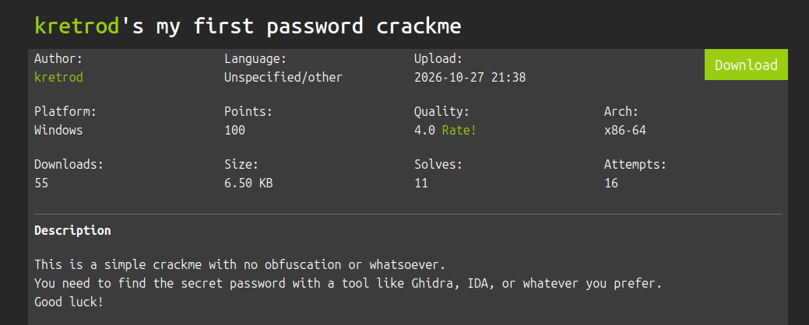
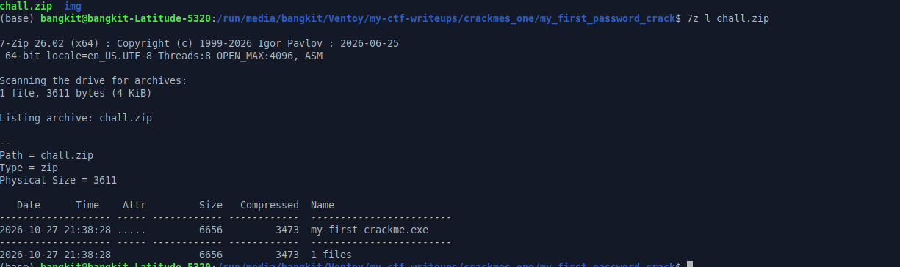

# My First Password Crackme

### Category 
Reverse Engineering.



### Files
[chall.zip](./chall.zip)

### Analysis
Sebelum saya ekstrak file nya, terlebih dahulu saya ubah nama folder chall biar memudahkan dalam proses pengerjaan,setelah itu saya cek isi folder dengan isi sebagai berikut



Folder chall berisi file executable .exe yang artinya ini adalah file aplikasi windows, setelah itu saya cek filenya sebagai berikut:

```
my-first-crackme.exe: PE32+ executable for MS Windows 6.00 (console), x86-64, 2 sections
```
Program tersebut merupakan executable 32 bit yang berjalan di windows console. Karena ini adalah chall Reverse tingkat dasar , harusnya tidak seribet itu untuk melakukan exploit, berdasarkan deskripsi soal kita hanya disuruh untuk mencari secret password nya saja.

### Exploitation
Saya akan menggunakan perintah 'strings' untuk melihat output program tanpa harus menjalankan programnya, dan setelah itu saya rasa saya telah menemukan secret password yang dimaksud dan menyelesaikan tantangannya.

