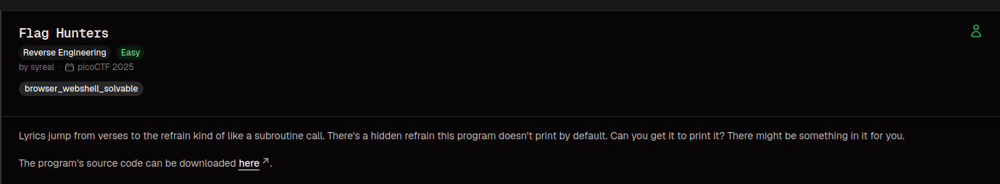
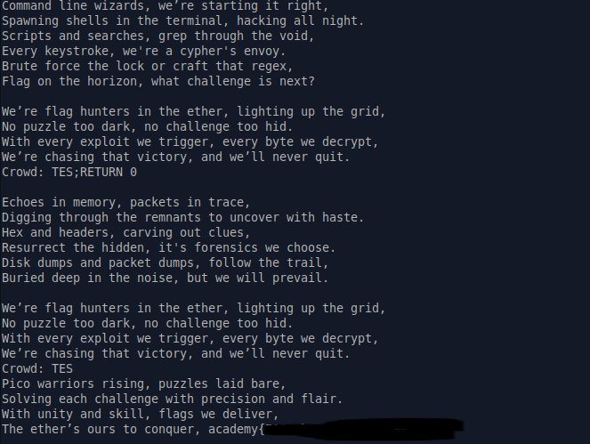

# Flag Hunter

### Category 
Reverse Engineering.

### Overview


### Source
[flag_hunter](https://learn.cylabacademy.org/library/472?page=1&category=3&workspace=true)

### Analysis
Ketika program dijalankan ia akan menampilkan lirik yang tampil secara berurutan, lalu akan muncul input dengan inisal Crowd. Namun input tersebut tidak divalidasi sehingga langsung dilempar kedalam program untuk dieksekusi, seperti berikut

```python
 # Find startLabel, refrain and refrain return
  for i in range(0, len(song_lines)):
    if song_lines[i] == startLabel:
      start = i + 1
    elif song_lines[i] == '[REFRAIN]':
      refrain = i + 1
    elif song_lines[i] == 'RETURN':
      refrain_return = i

while not finished and line_count < MAX_LINES:
    line_count += 1
    for line in song_lines[lip].split(';'):
      if line == '' and song_lines[lip] != '':
        continue
      if line == 'REFRAIN':
        song_lines[refrain_return] = 'RETURN ' + str(lip + 1)
        lip = refrain
      elif re.match(r"CROWD.*", line):
        crowd = input('Crowd: ')
        song_lines[lip] = 'Crowd: ' + crowd
        lip += 1
      elif re.match(r"RETURN [0-9]+", line):
        lip = int(line.split()[1])
      elif line == 'END':
        finished = True
      else:
        print(line, flush=True)
        time.sleep(0.5)
        lip += 1
```

Dari Source Code berikut raw input langsung diterima oleh program dan dieksekusi, lalu ketika ada tanda ';' diantara input yang kita masukkan, hal ini akan memengaruhi flow dari program yang sedang berjalan, lalu ketika program ini pertama kali dijalankan dia melompati lirik yang mengandung flag dan langsung lompat ke lirik yang memiliki label seperti [REFRAIN], sedangkan lirik yang mengandung flag tidak memiliki label sama sekali seperti berikut:

```python
secret_intro = \
'''Pico warriors rising, puzzles laid bare,
Solving each challenge with precision and flair.
With unity and skill, flags we deliver,
The ether’s ours to conquer, '''\
+ flag + '\n'
```

Dari analisa tersebut program rentan terhadap serangan yang berhubungan langsung dengan subroutine call, yaitu ketika suatu program memanggil fungsi dan ketika fungsi tersebut selesai dijalankan, memaksa RETURN ketujuan yang bukan tempat awal pemanggilan fungsi,sehingga kita bisa memanfaatkan hal ini untuk memaksa program mengeksekusi ke tempat yang kita inginkan, contohnya ke lirik pertama yang tidak pernah dicetak oleh program.  

### Exploitation
Susun payloadnya:

```bash
TES;RETURN 0 # perintah return digunakan untuk memberi perintah pada program untuk mengembalikan program
```
Ketika program meminta input 'Crowd: ', masukkan payload tersebut ke dalam input 

Lalu BOOM program mencetak lirik yang mengandung flag


### References
[https://youtu.be/xt2Q9n1Udb4?si=86VqJxeKIsyXPrKL](https://youtu.be/xt2Q9n1Udb4?si=86VqJxeKIsyXPrKL)
