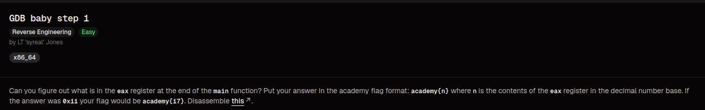
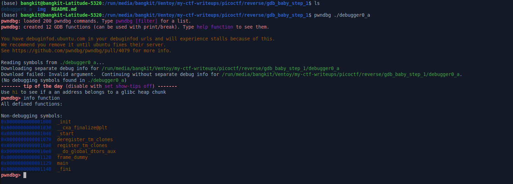
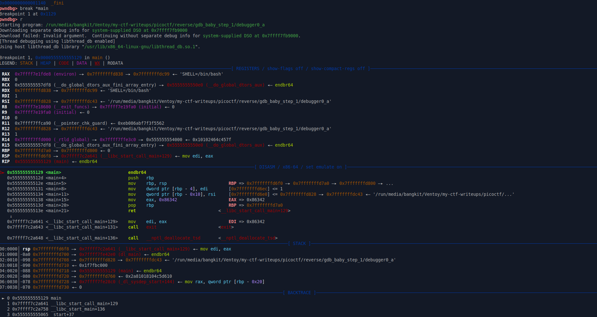
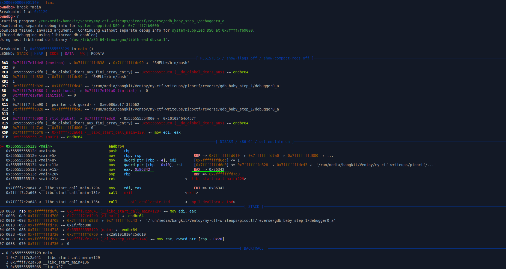

# GDB Baby Step 1

### Category 
Reverse Engineering.

### Overview


### Source
[gdb_baby_step_1](https://learn.cylabacademy.org/library/395?page=1&category=3&workspace=true)

### Analysis

**File**
- debugger0_a - ELF 64-bit LSB pie executable, x86-64, version 1 (SYSV), dynamically linked, interpreter /lib64/ld-linux-x86-64.so.2, BuildID[sha1]=c493499e7d12705006009934ee0a6225376448bf, for GNU/Linux 3.2.0, not stripped

**Checksec**
```bash
RELRO           STACK CANARY      NX            PIE             RPATH      RUNPATH	Symbols		FORTIFY	Fortified	Fortifiable	FILE
Full RELRO      No canary found   NX enabled    PIE enabled     No RPATH   No RUNPATH   35 Symbols	  No	0		0		./debugger0_a
```

- Full Relro - GOT Protection
- No canary found - Tidak ada proteksi terhadap buffer overflow
- NX enabled - Shellcode execution
- Pie enabled - Base address selalu berubah ketika program dijalankan

### Exploitation
Seperti deskripsi dari soal kita diberi tugas untuk mencari EAX dari fungsi main dan mendapatkan nilai base decimalnya. 

Pertama debug programnya menggunakan pwndbg, dan menampilkan seluruh function.


Break fungsi main, lalu jalankan


Terdapat nilai hex, disamping EAX dan itulah yang kita cari


Setelah menemukan nilai hexnya, langkah terakhir adalah mengkonversi nilai hexadecimal ke nilai decimal, saya menggunakan script buatan saya sendiri atau bisa menggunakan hex converter online seperti
[https://www.rapidtables.com/convert/number/hex-to-decimal.html](https://www.rapidtables.com/convert/number/hex-to-decimal.html)

lalu, ambil nilai decimalnya dan susun flagnya dengan format academy{nilai_decimal}

