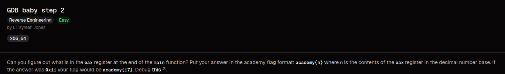
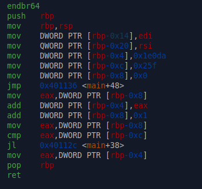
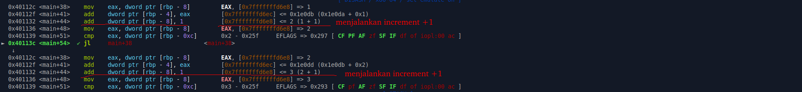
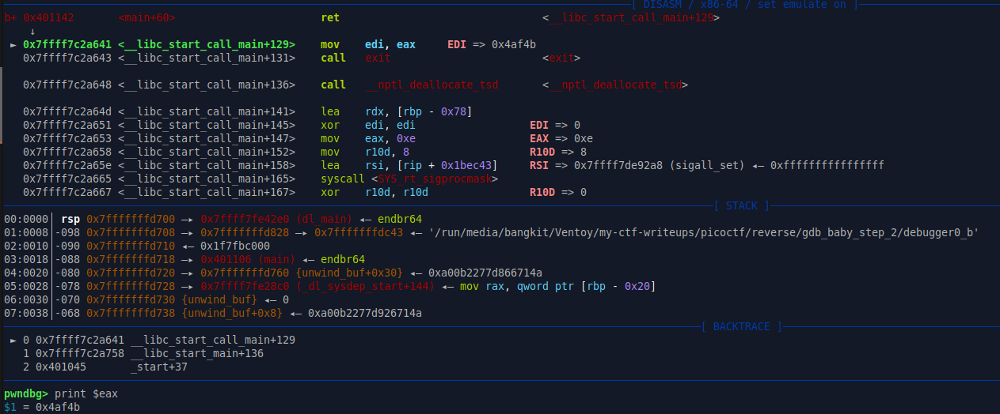

# GDB Baby Step 2

### Category 
Reverse Engineering.

### Overview


### Source
[gdb_baby_step_2](https://learn.cylabacademy.org/library/396?page=1&category=3&workspace=true)

### Analysis

**File**
- debugger0_b -  ELF 64-bit LSB executable, x86-64, version 1 (SYSV), dynamically linked, interpreter /lib64/ld-linux-x86-64.so.2, BuildID[sha1]=8959ccd2c070ef18e2741cc31536cd906ec970dd, for GNU/Linux 3.2.0, not stripped

**Checksec**
```bash
RELRO           STACK CANARY      NX            PIE             RPATH      RUNPATH	Symbols		FORTIFY	Fortified	Fortifiable	FILE
Partial RELRO   No canary found   NX enabled    No PIE          No RPATH   No RUNPATH   33 Symbols	  No	0		0		./debugger0_b
```

- Partial Relro - GOT Protection
- No canary found - Tidak ada proteksi terhadap buffer overflow
- NX enabled - Shellcode execution
- No PIE - Base address tetap ketika program dijalankan

Sebelum saya memulai untuk eksploitasi, saya akan melakukan disassamble fungsi main untuk mendapatkan binary assemblynya, seperti berikut



Lalu setelah itu saya reverse juga programnya menggunakan ghidra dan saya mendapatkan source code berikut

```c
int main(void)

{
  int local_10;
  int local_c;
  
  local_c = 0x1e0da;
  for (local_10 = 0; local_10 < 0x25f; local_10 = local_10 + 1) {
    local_c = local_c + local_10;
  }
  return local_c;
}
```

Dari source code tersebut fungsi main menjalankan program looping, dengan ketentuan sebagai berikut:

```
local_c = 0x1e0da => 123098
```

looping akan terus berjalan dan melakukan increment sampai var local_10 itu sama dengan 0x25f atau 607. Dimana jika kondisi looping bernilai TRUE maka var local_c akan ditambahkan dengan hasil operasi pada
local_c itu sendiri ditambah dengan hasil dari increment local_10, ketika looping sudah melewati atau sama dengan 607, looping akan berhenti dan return nilai final dari local_c.

### Exploitation
Untuk membuktikan apakah program main adalah program looping saya lakukan dengan break main dan menjalankannya menggunakan pwndbg.



Lalu kita bisa mengetahui nilai final local_c tanpa harus menjalankan looping hingga selesai, caranya set break lagi di address RET dan jalankan program sekali, setelah itu print nilai $eax



Setelah mendapatkan nilai hex nya, convert ke decimal dan susun flagnya dengan format academy{decimal}
