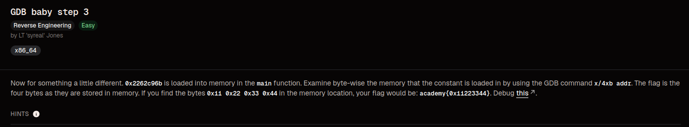
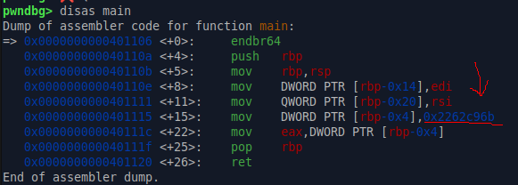
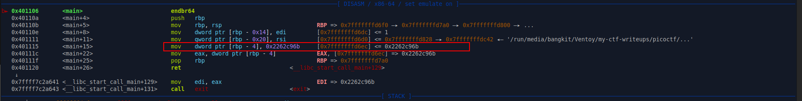

# GDB Baby Step 3

### Category 
Reverse Engineering.

### Overview


### Source
[gdb_baby_step_3](https://learn.cylabacademy.org/library/397?page=1&category=3&workspace=true&difficulty=1)

### Analysis

**File**
- debugger0_c - ELF 64-bit LSB executable, x86-64, version 1 (SYSV), dynamically linked, interpreter /lib64/ld-linux-x86-64.so.2, BuildID[sha1]=f9ee57033ffd192216cf01c935635535472b0d93, for GNU/Linux 3.2.0, not stripped

**Checksec**
```bash
RELRO           STACK CANARY      NX            PIE             RPATH      RUNPATH	Symbols		FORTIFY	Fortified	Fortifiable	FILE
Partial RELRO   No canary found   NX enabled    No PIE          No RPATH   No RUNPATH   33 Symbols	  No	0		0		./debugger0_c
```

- Partial Relro - GOT Protection
- No canary found - Tidak ada proteksi terhadap buffer overflow
- NX enabled - Shellcode execution
- No PIE - Base address tetap ketika program dijalankan

Sebelum saya memulai untuk eksploitasi, saya akan melakukan disassamble fungsi main untuk mendapatkan binary assemblynya, seperti berikut



Seperti deskripsi soal, kita disuruh untuk mencari isi memori dari address 0x2262c96b 

### Exploitation
Langkah pertama saya break fungsi main dan menjalankannya, lalu debugging sampai melewati proses yang saya beri kotak merah



Nah kenapa begitu? karena kita hanya bisa mengakses address 0x2262c96b ketika susah diinsialisasi ke dalam stack memori, sedangkan disini nilai 0x2262c96b sudah dipindahkan kedalam rbp-4, maka untuk 
melihat isi memory nya kita perlu x/4xb rbp-4, outputnya

```
0x7fffffffd6ec:	0x6b	0xc9	0x62	0x22
```

Kenapa bisa disusun secara terbalik seperti itu? karena komputer menyimpan nilai dengan menggunakan little endian,artinya komputer akan menempatkan endian yang lebih kecil di urutan awal
dan selalu memproses dari kanan ke kiri, maka flag nya adalah academy{0x6bc96222}.

### References
[https://en.wikipedia.org/wiki/Endianness](https://en.wikipedia.org/wiki/Endianness)
