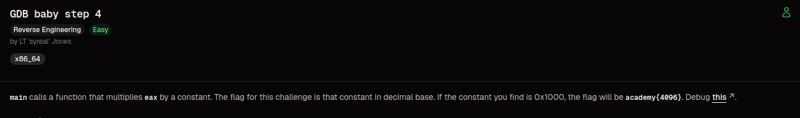
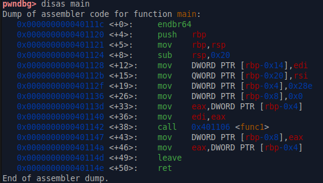
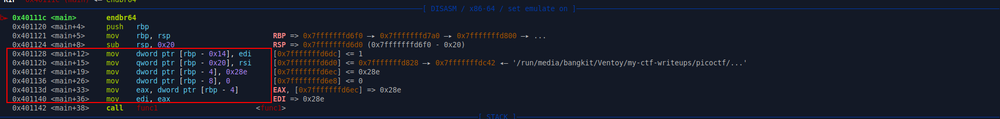
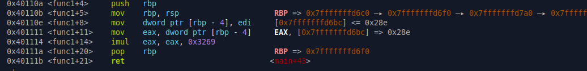

# GDB Baby Step 4

### Category 
Reverse Engineering.

### Overview


### Source
[gdb_baby_step_4](https://learn.cylabacademy.org/library/398?page=1&category=3&workspace=true&difficulty=1)

### Analysis

**File**
- debugger0_d - ELF 64-bit LSB executable, x86-64, version 1 (SYSV), dynamically linked, interpreter /lib64/ld-linux-x86-64.so.2, BuildID[sha1]=215da7639f755654a398bf847fbe62cf3cfe0aa3, for GNU/Linux 3.2.0, not stripped


**Checksec**
```bash
RELRO           STACK CANARY      NX            PIE             RPATH      RUNPATH	Symbols		FORTIFY	Fortified	Fortifiable	FILE
Partial RELRO   No canary found   NX enabled    No PIE          No RPATH   No RUNPATH   34 Symbols	  No	0		0		./debugger0_d
```

- Partial Relro - GOT Protection
- No canary found - Tidak ada proteksi terhadap buffer overflow
- NX enabled - Shellcode execution
- No PIE - Base address tetap ketika program dijalankan

Sebelum saya memulai untuk eksploitasi, saya akan melakukan disassamble fungsi main untuk mendapatkan binary assemblynya, seperti berikut



Seperti deskripsi soal, kita disuruh untuk mencari nilai constant dari $eax ketika fungsi main memanggil sebuah fungsi.

### Exploitation
Saya melakukan break ke fungsi main terlebih dahulu dan menajalankan programmnya, seperti berikut



Dari kotak merah tersebut, program melakukan insialisasi yang sama berulang kali dengan nilai 0x28e atau 654, hal ini saya buktikan dengan menjalankan programnya
dan mencetak nilai yang ada pada $eax dimana nilainya selalu tetap. Setelah itu saya lanjutkan dengan call ke func1, sebagai berikut



saya lanjutkan untuk melakukan debugging hingga sampai diprogram ini

```
0x401114 <func1+14>    imul   eax, eax, 0x3269
```

Karena program berikut sama halnya dengan berikut:

```c
eax = eax * 0x3269;
```

nilai 0x3269 sama halnya dengan nilai konstanta, jika dikonversi ke decimal maka hasilnya adalah 12905, karena sudah berhasil menemukan nilai constant maka susun dengan
flag sebagai berikut academy{12905}

