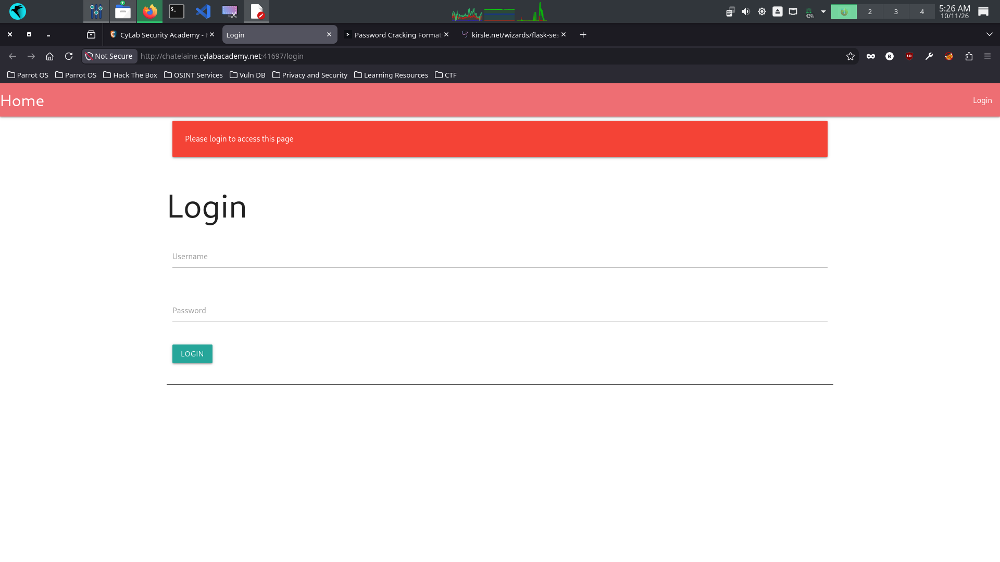
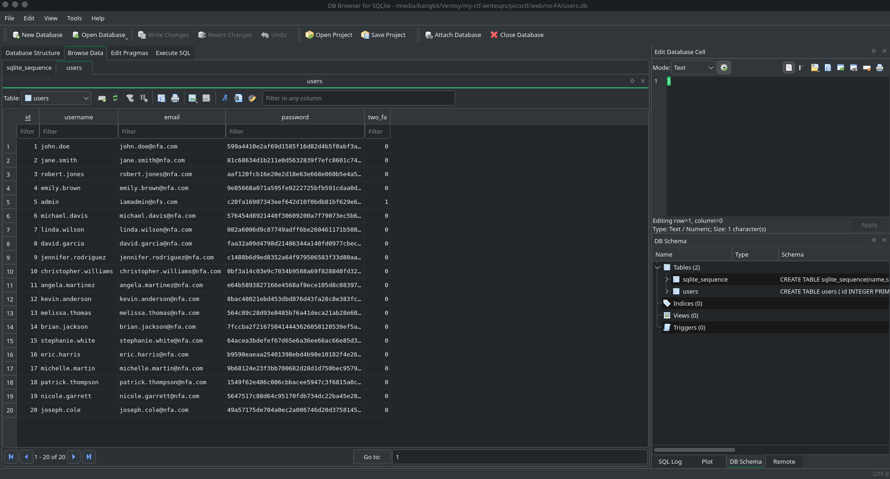
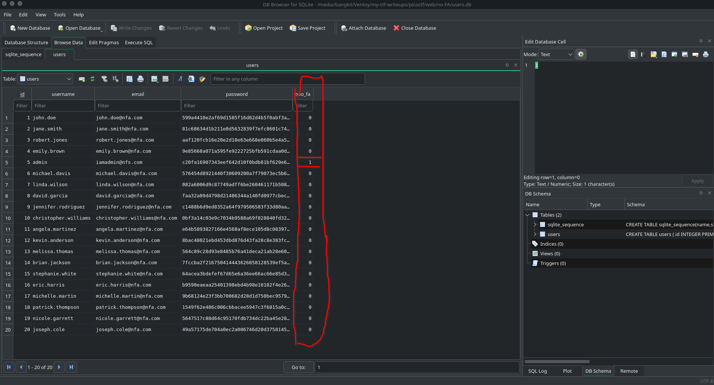
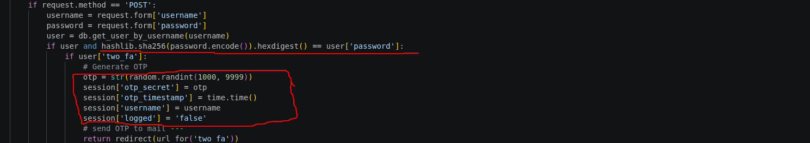
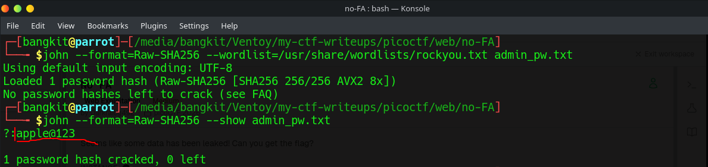
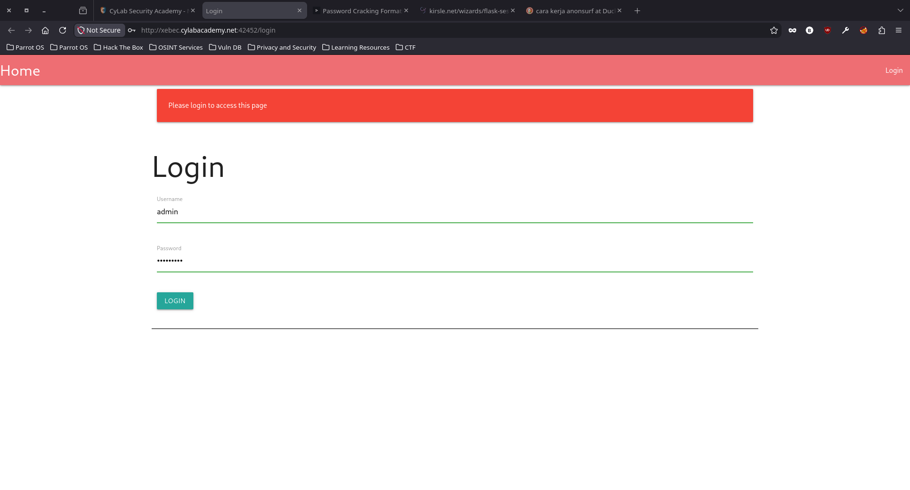
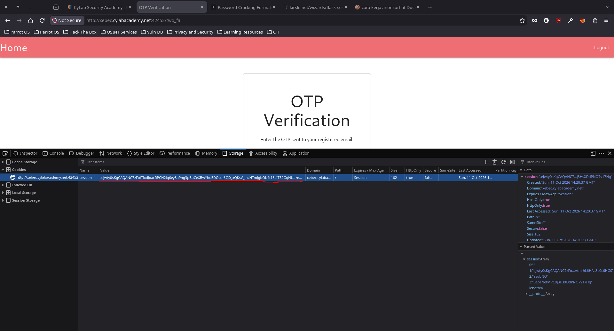
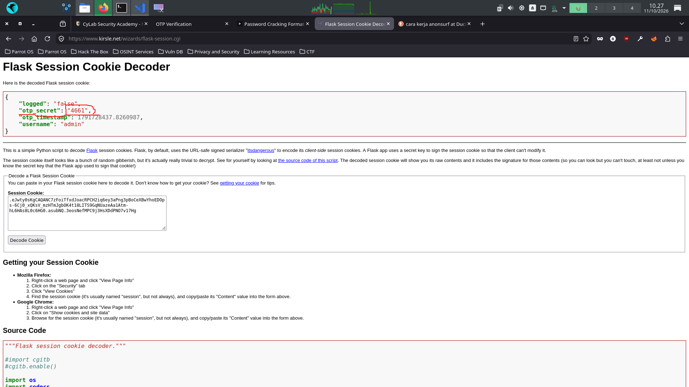
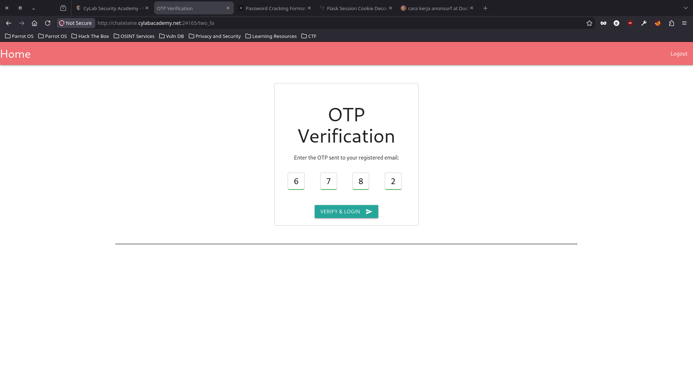
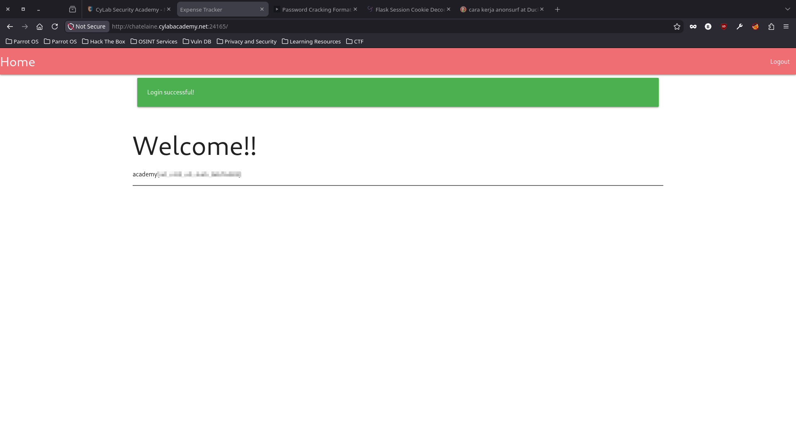

# No FA

### Category 
Web Exploitation.

### Description
> Seems like some data has been leaked! Can you get the flag?

### Author
Darkraicg492

### Source
[no-fa](https://learn.cylabacademy.org/library/765?page=1&category=1&workspace=true&difficulty=2).

Diberikan web seperti berikut

dan file database yang bocor sebagai berikut

## Exploitation
Setelah saya eksplorasi websitenya, titik kerentanan pada web ini adalah pengembangan sistem OTP yang buruk, hal itu bisa terjadi karena walaupun alert mengatakan kode OTP dikirim melalui email, tapi nyatanya tidak pernah masuk melainkan kode OTP Itu sendiri dikirim melalui session cookie ketika user berhasil melakukan login, oleh sebabnya hanya admin saja yang berhasil melakukan MFA seperti yang saya lingkari merah, dimana field two_fa bernilai 1 jika user telah melakukan verifikasi multi factor jika tidak akan bernilai 0

Karena database bocor, ini bisa dimanfaatkan untuk melakukan bypass login menggunakan akun admin yang sudah terverifikasi MFA nya. Caranya adalah dengan melakukan cracking pada password admin dengan algortima SHA-256, sesuai dengan petunjuk yang sudah saya temukan di SC nya, bahwa password dihash menggunakan algoritma tersebut.

1. Crack password admin
Saya copy password adminnya dari database, lalu saya simpan kedalam admin_pw.txt dan lakukan cracking dengan John the Ripper sebagai berikut

***NOTE**
Jika sebelumnya belum mengekstrak rockyou, ekstrak terlebih dahulu dengan cara berikut:
- cd /usr/share/wordlists atau copy aja pathnya
- sudo gunzip rockyou.tar.gz

2. Login dengan akun admin

Langkah selanjutnya ambil session cookie, karena kode OTP dikirim melalui cookie, kita bisa mengambil dengan cara:
- Inspect element
- Lalu ke tab storage
- pilih opsi cookies dan copy sessionnya

3. Decode cookie nya
Saya menggunakan decoder online sebagai berikut
[flask-seesion-cookie-decoder](https://www.kirsle.net/wizards/flask-session.cgi).

Setelah didecode

OTP secret sifatnya random, pastikan selalu menggunakan session cookie terbaru jika melakukan login ulang.

4. Masukkan OTP Secretnya

