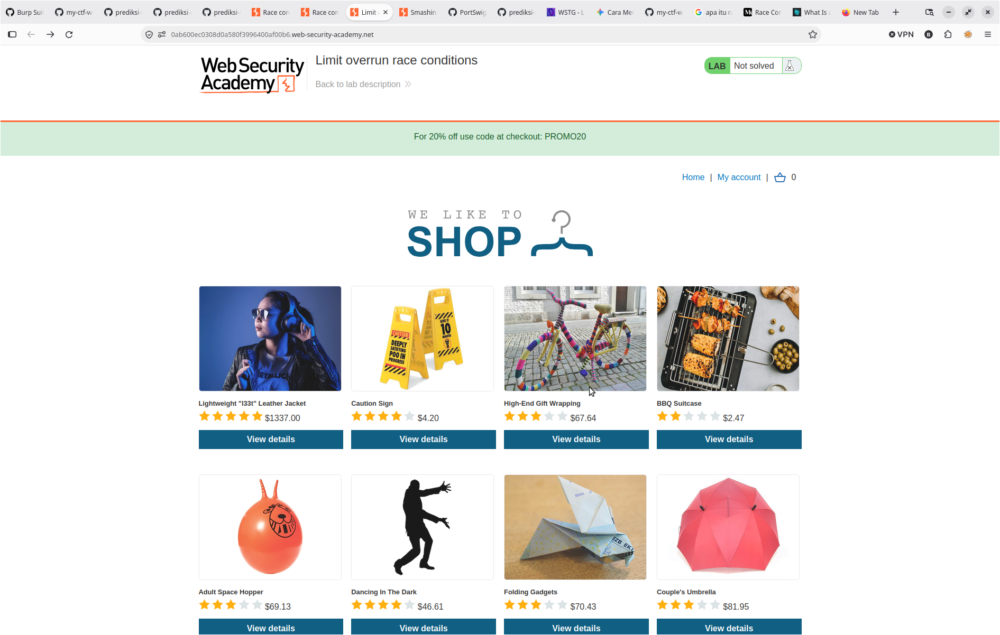
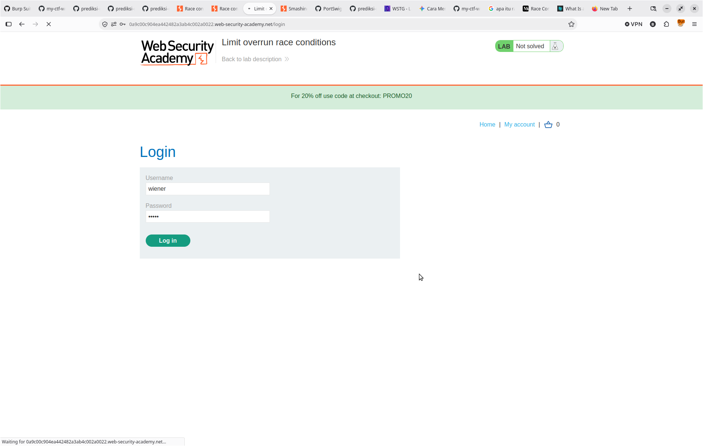
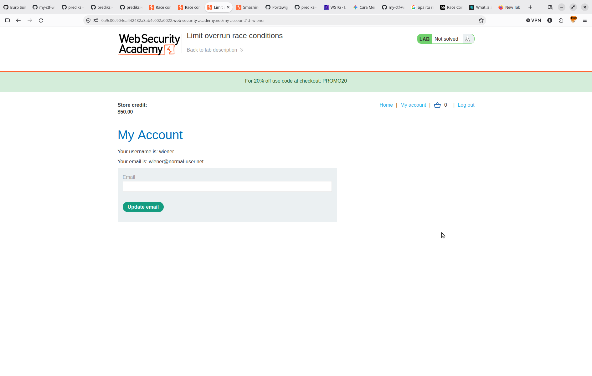
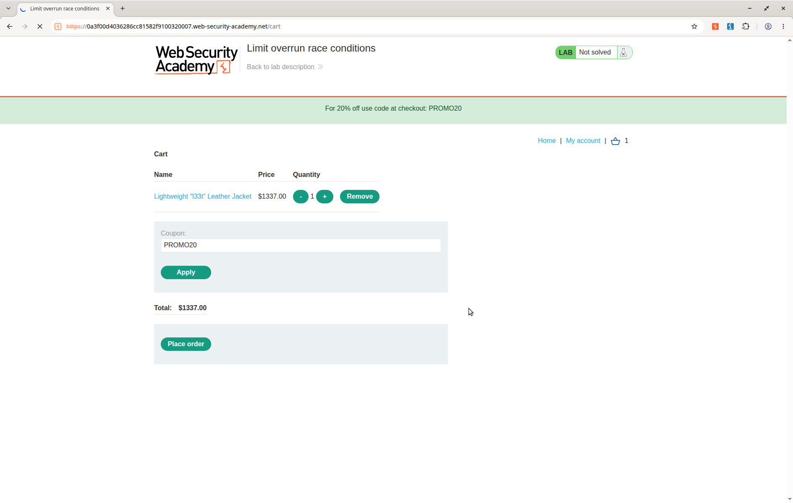
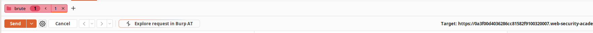
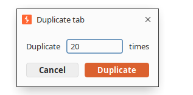
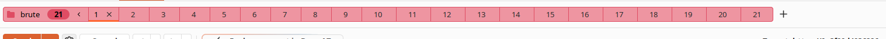
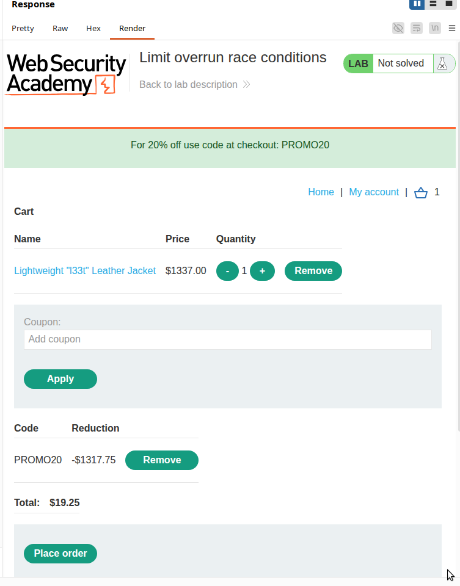
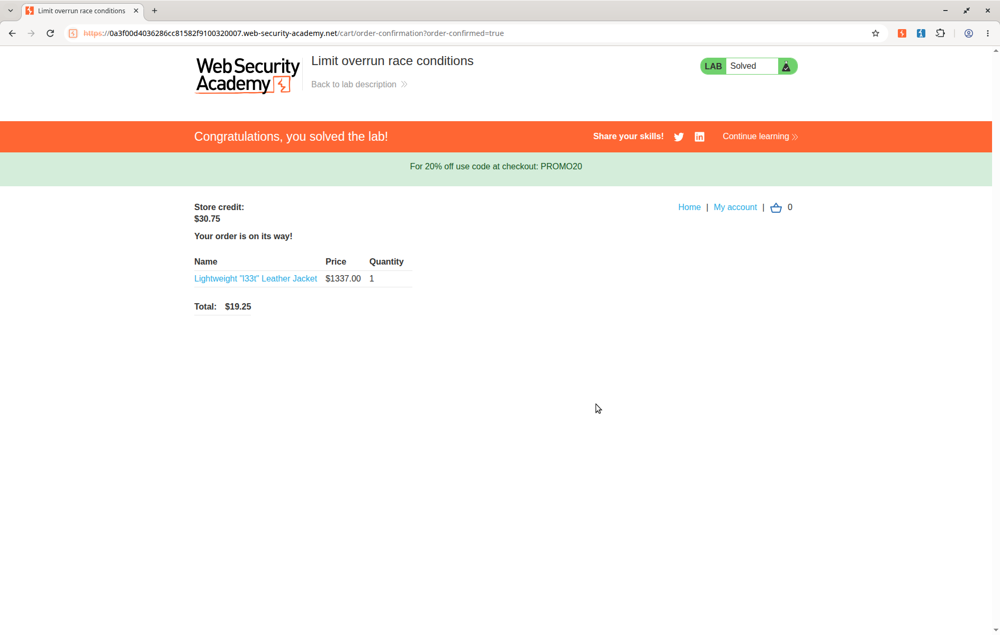

# Limit overrun race conditions

> **Lab Description:** This lab's purchasing flow contains a race condition that enables you to purchase items for an unintended price. To solve the lab, successfully purchase a Lightweight L33t Leather Jacket. You can log in to your account with the following credentials: wiener:peter. For a faster and more convenient way to trigger the race condition, we recommend that you solve this lab using the Trigger race conditions custom action. This is only available in Burp Suite Professional.

## Lab Overview

| Property             | Detail                                                                                                                  |
| :------------------- | :---------------------------------------------------------------------------------------------------------------------- |
| **Category**         | Race conditions                                                                                                         |
| **Difficulty Level** | Apprentice                                                                                                              |
| **Lab URL**          | [PortSwigger Lab Link](https://portswigger.net/web-security/jwt/lab-jwt-authentication-bypass-via-unverified-signature) |
| **Status**           | In progress                                                                                                             |
| **Date Completed**   |                                                                                                                         |

## Analysis

Diberikan web sebagai berikut:



Objektif dari lab ini adalah melakukan serangan `Race condition` untuk melakukan proses pembelian `Lightweight L33t Leather Jacket` dengan harga yang tidak terduga.

**Pertama**, saya akan melakukan login menggunakan akun `wiener:peter`.



Setelah login berhasil,akan dibawa kedalam dashboard



Awalnya kita diberi store credit sebesar `$50`, sedangkan harga `Lightweight L33t Leather Jacket` sebesar `$1337`, namun saat ini kita diberi kode kupon sebesar `20%` sekali pakai, jika kita gunakan diskon tersebut pada `Lightweight L33t Leather Jacket` kita hanya mendapat potongan harga `$264` dengan harga akhir sebesar `$1073`. Kesimpulannya kita perlu store credit sebesar `$1023`, disinilah perlunya melakukan race condition dalam kasus menggunakan potongan harga dengan kode kupon, sehingga akan memicu `TOCTTOU (time-of-check to time-of-use)` alih alih menggunakan kode kupon 1x tapi dapat ditumpuk akibat beban request masuk bersamaan sebelum server mengunci.

**Kedua**, saya akan menambahkan 1 produk `Lightweight L33t Leather Jacket` kedalam cart, request ini diproses api dengan `POST /cart`

**Ketiga** Menggunakan kode kupon, request ini diproses api dengan `POST /cart/coupon`



## Exploitation

**Pertama**, saya akan tangkap request `POST /cart/coupon`, lalu saya teruskan ke burp repeater, setelah itu saya bikin tab group baru



**Kedua**, Duplicate tab sebanyak 20





**Ketiga**, send request dengan mode `group in parallel`, server akan meresponse sebegai berikut

```text
HTTP/2 302 Found
Location: /cart
X-Frame-Options: SAMEORIGIN
Content-Length: 14

Coupon applied
```

Lalu cek apakah harga sudah dibawah store credit yang kita miliki dengan `follow redirection`. Jika harga masih mahal ulangi lagi dengan `remove` kode kupon dan ulangi lagi langkah ketiga

**Keempat**, Beli jacket setelah harga lebih murah dari store credit yang kita miliki





## New Knowledge

- Mempelajari bagaimana cara kerja `Race condition`
- Mempelajari bagaimana cara melakukan request group in parallel menggunakan burp repeater

## References

- [Smashing the state machine: the true potential of web race conditions](https://portswigger.net/research/smashing-the-state-machine)
- [Race conditions explained by Portswigger](https://portswigger.net/web-security/race-conditions)
