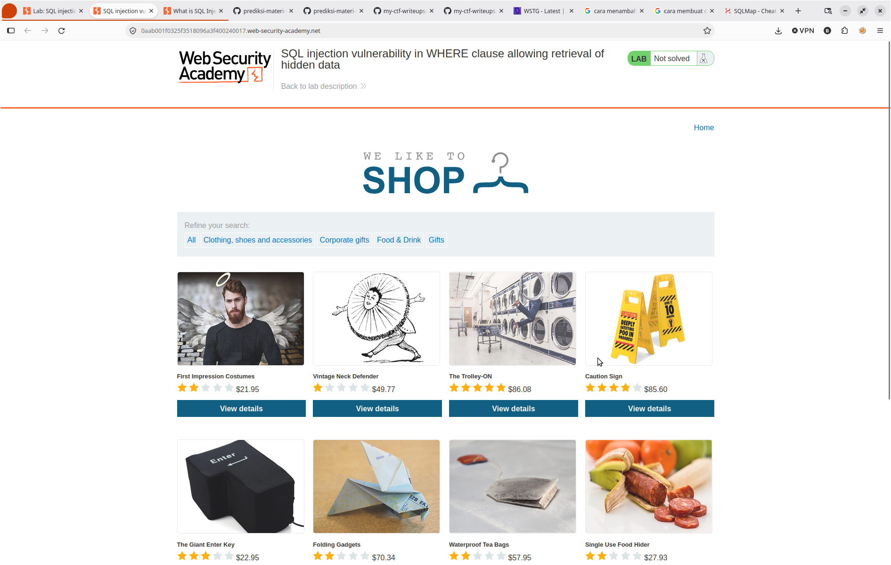
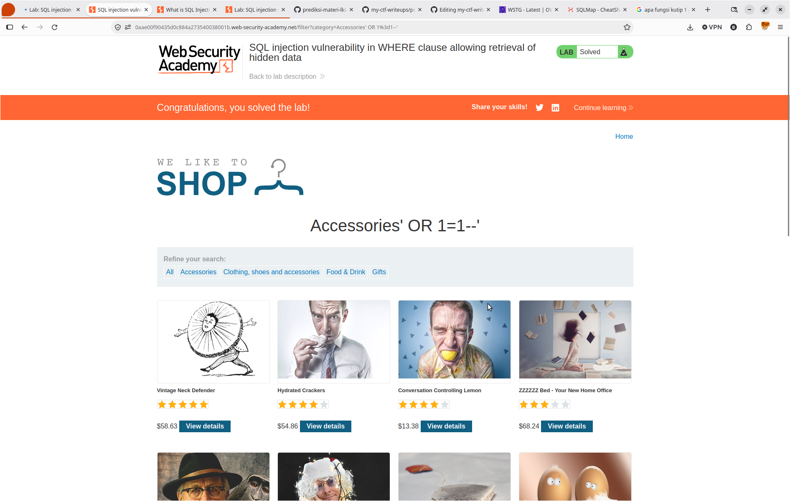

# SQL injection vulnerability in WHERE clause allowing retrieval of hidden data

> **Lab Description:**  This lab contains a SQL injection vulnerability in the product category filter. When the user selects a category, the application carries out a SQL query like the following: `SELECT * FROM products WHERE category = 'Gifts' AND released = 1` To solve the lab, perform a SQL injection attack that causes the application to display one or more unreleased products.

## Lab Overview

| Property             | Detail                                                                                                     |
| :------------------- | :--------------------------------------------------------------------------------------------------------- |
| **Category**         | SQL Injection                                                                                           |
| **Difficulty Level** | Apprentice                                                                                                 |
| **Lab URL**          | [PortSwigger Lab Link](https://portswigger.net/web-security/sql-injection/lab-retrieve-hidden-data) |
| **Status**           | Solved                                                                                                |
| **Date Completed**   |                 2026-11-18                                                                                      |

## Analysis

Diberikan web sebagai berikut:



Objektif dari lab ini adalah kita diminta untuk melakukan `SQL Injection` terhadap fitur filter kategori produk pada web e-commerce untuk menampilkan 1 atau lebih produk kategori yang belum rilis.

**Pertama**, saya Capture request ketika produk dimuat. Produk dimuat dengan cara memanggil endpoint `GET /filter?category=Accessories`

**Kedua**, saya lakukan tes injection dengan menggunakan burp repeater, lalu saya tes dengan menyisipkan payload `'` kedalam query parameter, setelah itu server mengembalikan response `500 Internal server error`, artinya server gagal menangani request tersebut, namun hal ini bisa menjadi celah `SQL Injection` karena server hanya gagal menangani bukan membatasi.

## Exploitation

Pertama, saya susun payload yang memicu kondisi true pada injection dan tidak memicu database error sebagai berikut `'OR 1=1--'`

```text
'' : delimiter
1=1 : menghasilkan true
-- : comment yang mengabaikan perintah kueri setelahnya
```

Kedua, saya kirim request beserta payload ke browser



### Final Exploit

```text
Accessories 'OR 1=1--'
```

## New Knowledge

- Mmepelajari cara kerja `SQL Injection`

## References

- [Explained SQL Injection by Portswigger](https://portswigger.net/web-security/sql-injection#what-is-sql-injection-sqli)
- [OWASP WSTG SQL Injection](https://wstg.owasp.org/latest/4-Web_Application_Security_Testing/07-Injection/05-SQL_Injection/)
