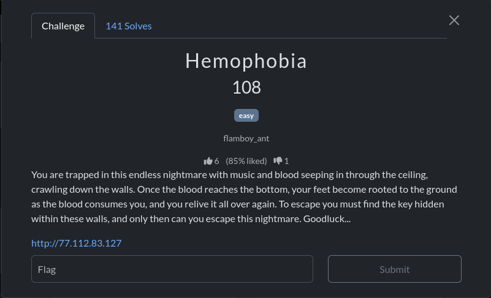
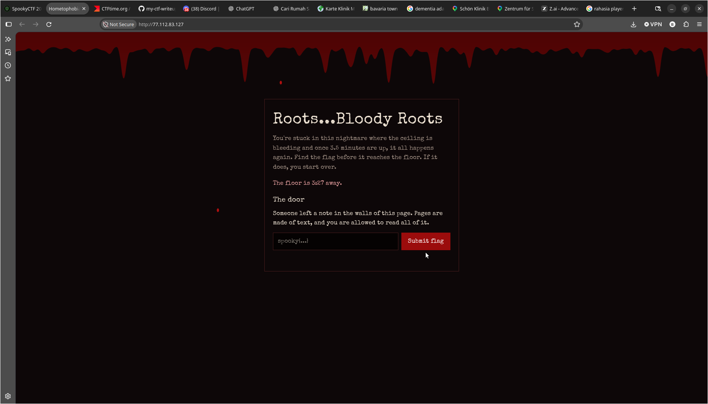
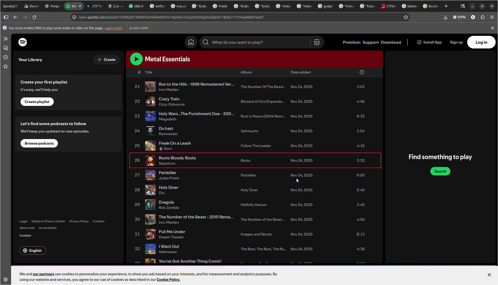
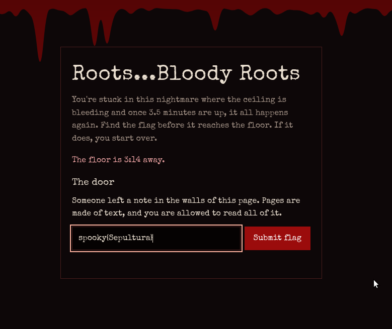
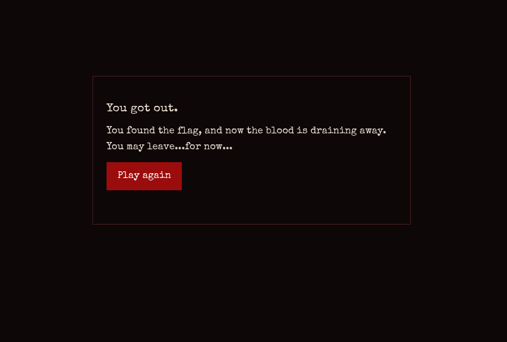

# Hemophobia

## Overview



## Analysis



Ketika pertama kali membuka websitenya terdapat deskripsi soal yang menurut saya adalah petunjuk yaitu:

```
Someone left a note in the walls of this page. Pages are made of text, and you are allowed to read all of it.
```

Lalu saya melakukan inspect element dan mendapatkan komentar HTML seperti berikut:

```
 There's a song that plays in this nightmare, but it's no longer here... I wrote it down somewhere though. I think it's in nightmare.txt...The flag looks like spooky{band}
```

Terdapat file nightmare.txt yang dapat kita baca secara publik dalam halaman website ini, lalu saya mencoba untuk mengakses /nightmare.txt dan saya mendapatkan sebuah catatan sederhana

```
The song from the nightmare.
I wrote the title down so I wouldn't forget it:

  Roots Bloody Roots

I think this is where I heard it:

  https://open.spotify.com/playlist/37i9dQZF1DWWOaP4H0w5b0?si=Ygn6SH-USsy5zhZiDgaGaQ

Who made it?
```

Berdasarkan isi dari nightmare.txt berikut terdapat nama yang harus kita cari yaitu **Roots Bloody Roots** pada tautan playlist spotify yang dibagikan

## Exploitation

Dari hasil analisis tersebut saya lalu mengunjungi tautan spotify yang dibagikan dan menemukan nama yang disebut dalam nighmare.txt



**Root Blody Roots** adalah sebuah nama lagu yang dibawakan oleh Sepultura, hal ini sesuai dengan pesan yang diberikan dalam komentar HTML dimana kita perlu mencari nama band yang dimaksud, setelah itu saya mencoba untuk menjawab pertanyaan diwebsite yang penuh darah diawal dan saya berhasil menyelesaikan tantangan penuh darah ini





**Flag** : spooky{Sepultura}
