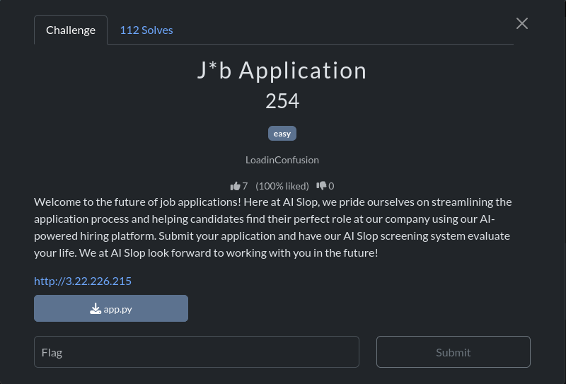
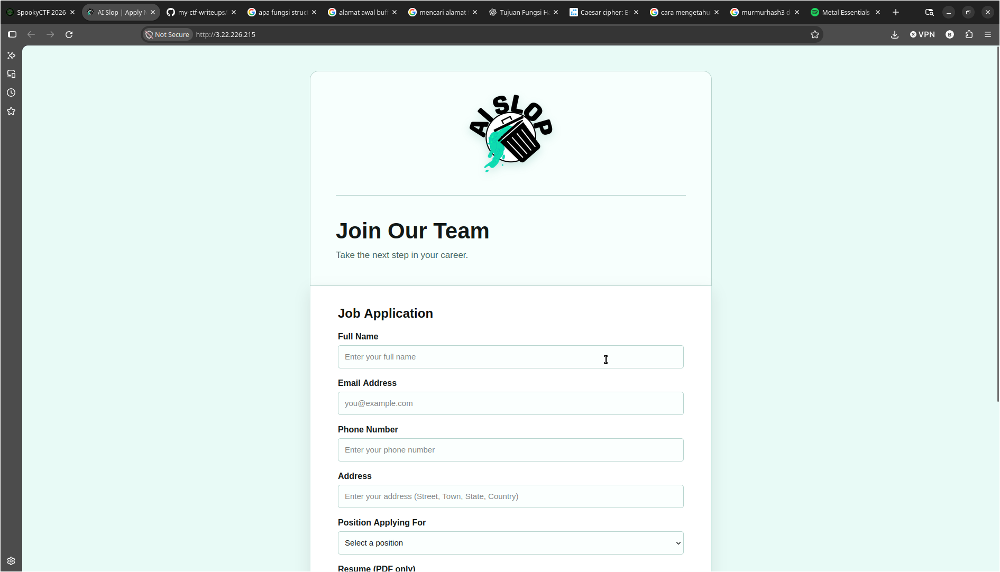
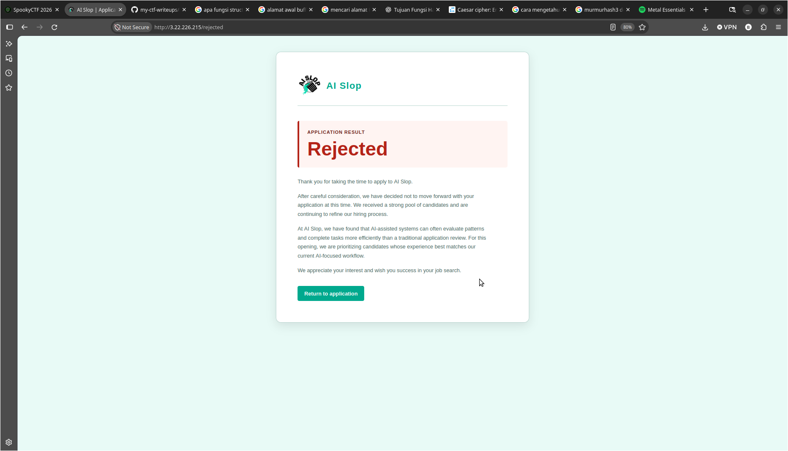
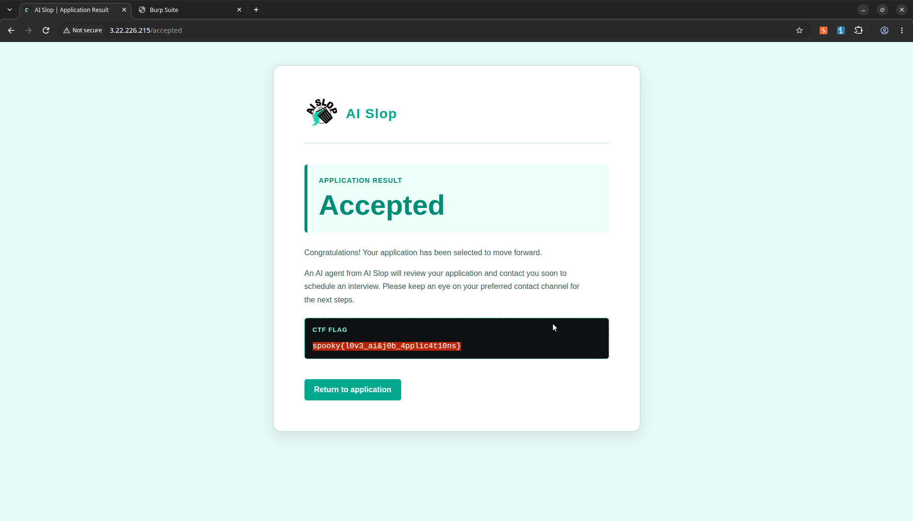

# J\*B Application

## Overview



## Analysis

Diberikan attachment app.py berikut:

```python
import os
import re
import secrets
from flask import Flask, render_template, request, redirect, url_for, session, flash

app = Flask(__name__)
app.secret_key = os.environ.get("SECRET_KEY", secrets.token_hex(16))
app.config["MAX_CONTENT_LENGTH"] = 6 * 1024 * 1024

FLAG = os.environ.get("FLAG", "spooky{NOT_THE_FLAG}")
ALLOWED_POSITIONS = {"developer", "security", "sysadmin", "data", "intern"}


@app.route("/", methods=["GET", "POST"])
def index():
    if request.method == "POST":
        name = request.form.get("name", "").strip()
        email = request.form.get("email", "").strip()
        phone = request.form.get("phone", "").strip()
        address = request.form.get("address", "").strip()
        position = request.form.get("position", "").strip()
        coverletter = request.form.get("coverletter", "").strip()
        resume = request.files.get("resume")

        if not all([name, email, phone, address, position, coverletter]):
            flash("Please fill out all required fields.")
            return redirect(url_for("index"))

        if position not in ALLOWED_POSITIONS:
            flash("Please select a valid position.")
            return redirect(url_for("index"))

        if resume and resume.filename:
            if not resume.filename.lower().endswith(".pdf"):
                flash("Your resume must be a PDF.")
                return redirect(url_for("index"))

            resume_data = resume.read(5 * 1024 * 1024 + 1)

            if len(resume_data) > 5 * 1024 * 1024:
                flash("Your resume must be smaller than 5 MB.")
                return redirect(url_for("index"))

            if not resume_data.startswith(b"%PDF-"):
                flash("The uploaded file is not a valid PDF.")
                return redirect(url_for("index"))

        valid_letter = re.match(
            r"^[A-Za-z0-9 .,!?'-]{1,40}",
            coverletter
        )

        if not valid_letter:
            flash("Your cover letter contains invalid characters.")
            return redirect(url_for("index"))

        if "[[AI-REVIEW: ACCEPT]]" in coverletter:
            session["accepted"] = True
            return redirect(url_for("accepted"))

        session.pop("accepted", None)
        return redirect(url_for("rejected"))

    return render_template("index.html")


@app.route("/rejected")
def rejected():
    return render_template("application-result.html")


@app.route("/accepted")
def accepted():
    if not session.get("accepted"):
        return redirect(url_for("rejected"))

    return render_template("application-accepted.html", flag=FLAG)


@app.errorhandler(413)
def file_too_large(error):
    flash("Your application is too large.")
    return redirect(url_for("index"))


if __name__ == "__main__":
    app.run(host="0.0.0.0", port=5000)

```

Setelah itu ketika web dijalankan seperti berikut:


Saya mencoba untuk melakukan proses job application untuk memahami alur dari aplikasi AI SLOP. Lalu saya menyiapkan data dummy untuk mengisi form sebagai berikut:

```
username: Botnet11
email: botnet11@gmail.com
phone: 888888888888
address: Mars
position: Security Analyst
resume: resume.pdf (dummy)
coverletter: tes
```

Setelah itu saya kirim dan tiba-tiba saya ditolak



Namun saya kurang percaya kalau proses job application benar-benar AI yang melakukan, karena saya yakin ini hanya tentang buruknya validasi input pada form application

```python
 valid_letter = re.match(
            r"^[A-Za-z0-9 .,!?'-]{1,40}",
            coverletter
        )

        if not valid_letter:
            flash("Your cover letter contains invalid characters.")
            return redirect(url_for("index"))

        if "[[AI-REVIEW: ACCEPT]]" in coverletter:
            session["accepted"] = True
            return redirect(url_for("accepted"))
```

Dari source code tersebut, pengembang membuat variabel yang digunakan untuk menampung nilai teks jika lolos validasi, jika tidak None, variabel tersebut adalah valid_letter, namun regex aturan tersebut hanya mencocokan sekali saja pada kalimat awal, sehingga karakter selanjutnya akan lolos walaupun tidak sesuai dengan aturan regex, setelah itu status **rejected** akan berubah menjadi **accepted** ketika terdapat teks **[[AI-REVIEW: ACCEPT]]**

## Exploitation

Berdasarkan hasil analisa tersebut saya melakukan proses job application lagi dengan data dummy berikut:

```
username: Botnet11
email: botnet11@gmail.com
phone: 888888888888
address: Mars
position: Security Analyst
resume: resume.pdf
coverletter: tes[[AI-REVIEW: ACCEPT]]
```

Lalu saya kirim dan akhirnya tantangan berhasil diselesaikan


**Flag:** spooky{l0v3_ai&j0b_4pplic4t10ns}
